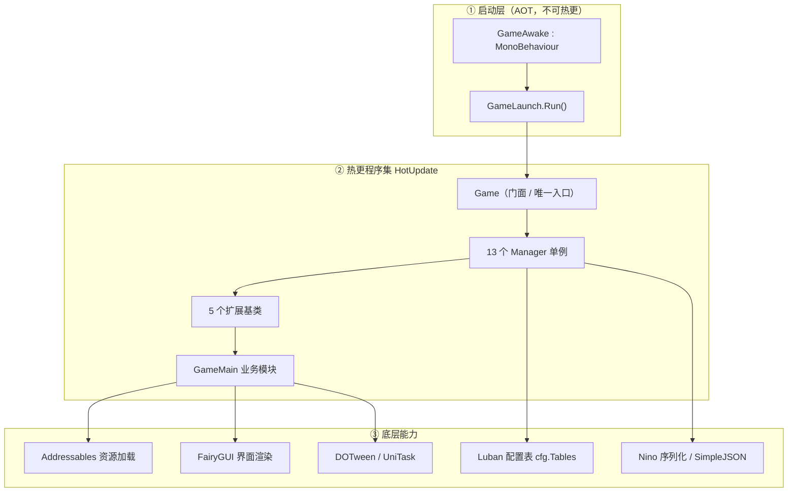
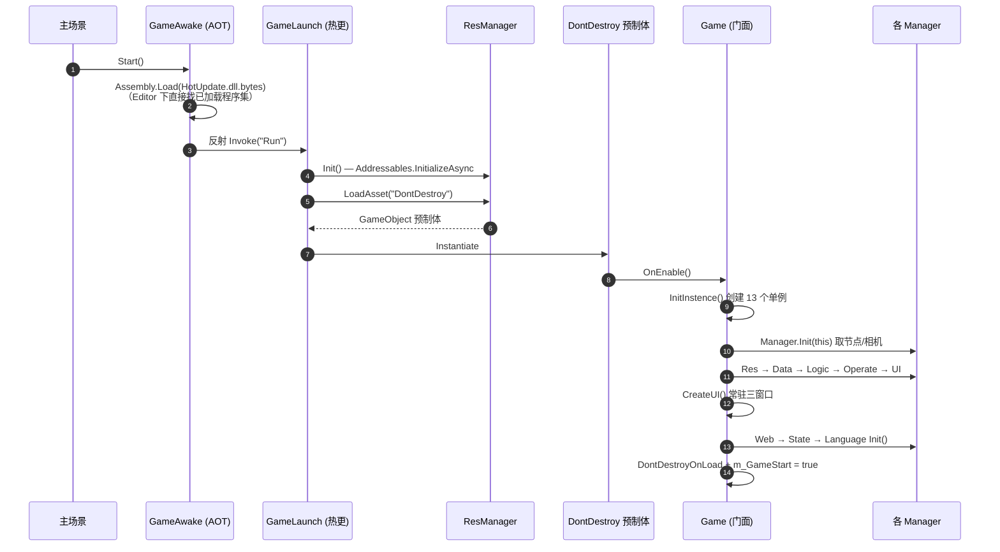
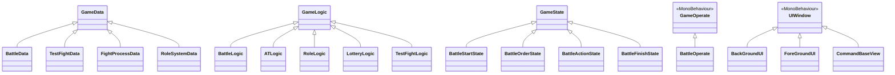
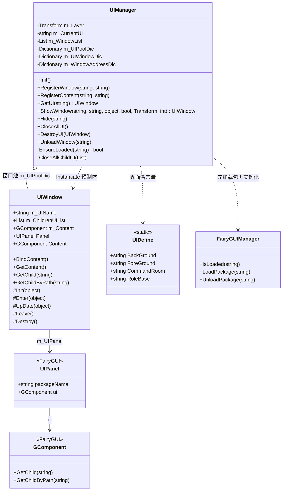
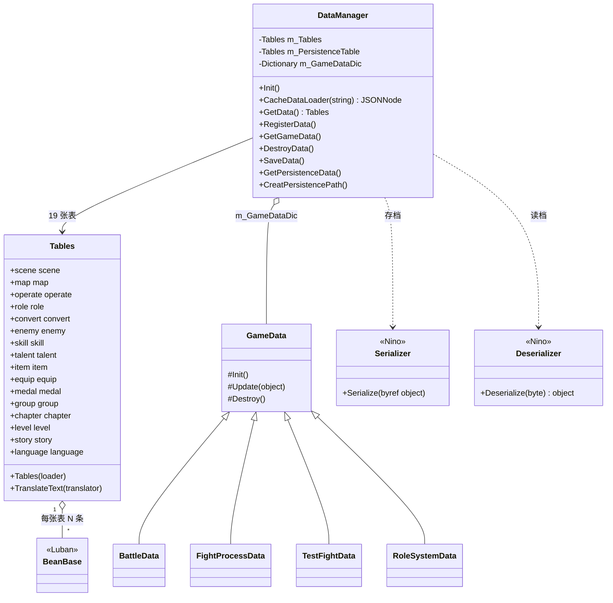
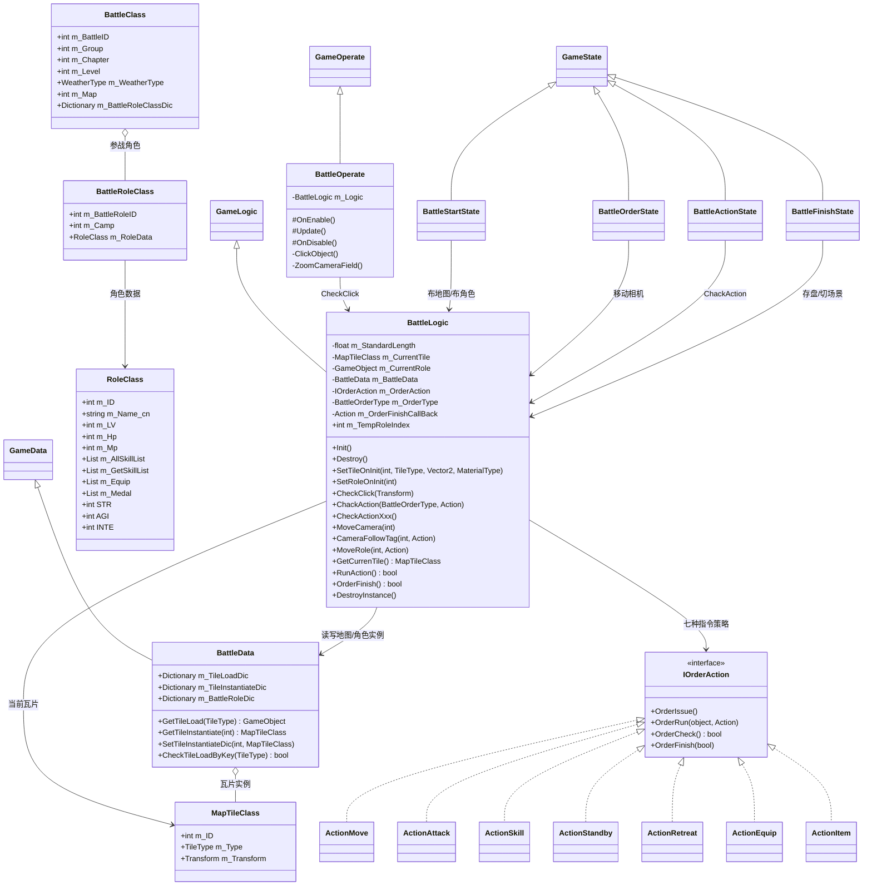
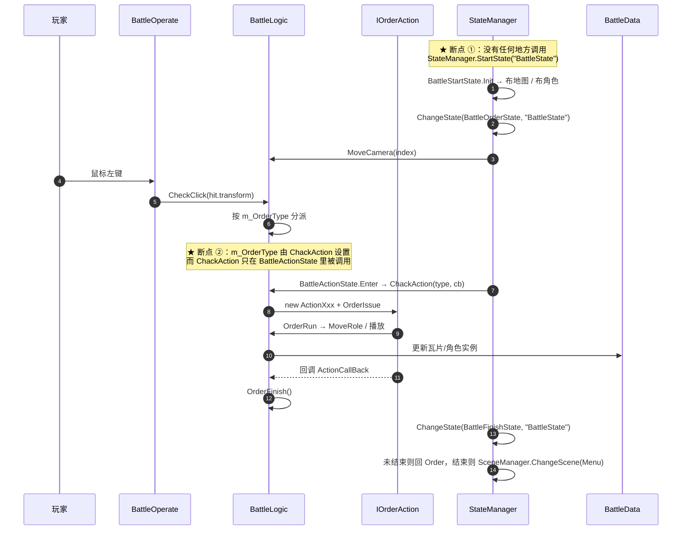

# UnityProject_xx 业务框架梳理与类图

> **范围**：`Assets/HotUpdate`（热更程序集）中的框架层与业务层源码。
> **环境**：Unity 2022.3.62f3c1 + HybridCLR（热更）+ Addressables（资源）+ FairyGUI（UI）+ Luban（配置表）+ Nino（序列化）+ DOTween / UniTask。
> **性质**：基于源码静态阅读整理，未运行工程验证；文中"现状"结论均标注了对应代码位置。
>
> **2026-11-09 规范化更新**：系统制作统一按 [`系统制作规范.md`](./系统制作规范.md) 执行。本次新增 `ModelBase` / `ModelManager` / `SystemDataBase`，`Game` 门面新增 `Model`；Role 系统已改为 `RoleSystem : ModelBase` + `RoleData : SystemDataBase` + `RoleViewData` + `RoleEvent`。下文"13 个管理器""RoleSystemData""扩展方式 5 个基类"等描述是改造前快照，以新规范为准。

---

## 0. 速览

| 维度 | 结论 |
|---|---|
| 架构风格 | **门面 + 单例管理器 + 注册表**（Registry）三件套，无 IOC 容器、无反射扫描 |
| 唯一入口 | `Game`（MonoBehaviour，挂在常驻预制体 `DontDestroy` 上，`partial` 拆成两个文件） |
| 门面暴露 | `Game.Data / Model / Event / Manager / Res / UI / Logic / State / Operate / Scene / Web / Log / Language / Sound / Helper` 共 15 个静态属性 |
| 扩展方式 | 继承基类（`GameData` / `GameLogic` / `GameState` / `GameOperate` / `UIWindow`；业务系统另用 `ModelBase` / `SystemDataBase`），由对应 Manager 用泛型注册 + 泛型获取 |
| 分层 | 启动层（AOT）→ 框架层（热更）→ 业务层（GameMain）→ 底层能力（Addressables / FGUI / Luban / Nino） |
| 当前状态 | 骨架完整、契约清晰，但**多个模块的注册代码被注释掉**，战斗闭环尚未接线（详见第 7 章） |

---

## 1. 工程分层与程序集

### 1.1 目录职责

| 路径 | 角色 | 说明 |
|---|---|---|
| `Assets/GameLaunch/GameAwake.cs` | 启动器（AOT） | 加载 `HotUpdate.dll.bytes`，反射调用 `GameLaunch.Run()` |
| `Assets/HotUpdate/Framework/Script/` | **框架层** | 与管理器、基类、UI/资源/数据基础设施，不含具体玩法 |
| `Assets/HotUpdate/GameMain/Script/` | **业务层** | `Game` 的玩法模块：Battle / Role / Lottery / TestFight / Ground / CommandRoom |
| `Assets/HotUpdate/GameMain/Script/DataTable/` | 配置表（生成） | Luban 生成的 `cfg.*` 类型，勿手改 |
| `Assets/Editor/` | 编辑器流水线 | Luban 导表、Addressables 打包、FGUI 包注册、Nino 代码生成 |
| `Assets/ThridParty/` | 第三方 | FairyGUI / DOTween / Nino / LubanLib / SimpleJSON / InfiniteScrollView |
| `Assets/Res/Prefab/DontDestroy.prefab` | 常驻根预制体 | `Game` 组件与各层节点的宿主 |

### 1.2 分层结构



### 1.3 程序集依赖

`Assets/HotUpdate/HotUpdate.asmdef` 引用：

```
LubanLib.asmdef            (GUID 3acca4…)
Nino.Shared.asmdef         (GUID 4e60f3…)
Nino.Serialization.asmdef  (GUID ba7803…)
FairyGUI.asmdef            (GUID 10f969…)
Unity.Addressables / Unity.ResourceManager / UniTask
```

> 关键点：**热更程序集不允许反向引用 AOT 侧的 `Assembly-CSharp`**，所以 `GameAwake` 只能用反射调用 `GameLaunch.Run()`，这也是启动链两段的根本原因。

---

## 2. 启动链路

### 2.1 时序



### 2.2 两段式启动

| 阶段 | 文件 | 职责 | 为什么这样切 |
|---|---|---|---|
| AOT 引导 | `GameAwake.cs` | 加载热更 DLL、反射入口、`DontDestroyOnLoad` | AOT 程序集不能引用热更程序集 |
| 热更运行 | `GameLaunch.cs` | 初始化 Addressables、加载并实例化 `DontDestroy` | 热更侧可以随便改启动逻辑 |

`GameLaunch.Run()` 有 `GameConst.m_GameStart` 幂等保护，重复调用直接返回。

### 2.3 `StartGame()` 的初始化顺序（`Game.cs:32`）

```
Manager.Init(this)   // 1. 先把预制体上的节点/相机塞进 GameManager
Res.Init()           // 2. Addressables 就绪
Data.Init()          // 3. Luban 表 + 运行时 GameData（Operate 初始化要读表，必须在它前面）
Logic.Init()         // 4. 逻辑注册
Operate.Init()       // 5. 遍历 operate 表，预加载所有操作组件
UI.Init()            // 6. 建 FairyGUI Stage，相机常驻
CreateUI()           // 7. 按层显示 BackGround / ForeGround / CommandRoom
Web.Init()           // 8. 空实现
State.Init()         // 9. 空实现
Language.Init()      // 10. 空实现
```

> **顺序依赖要注意**：`Operate.Init()` 内部会访问 `Game.Data.GetData.operate`，所以它必须排在 `Data.Init()` 之后；`UI.Init()` 依赖 `Game.Manager.m_MLayer`，必须排在 `Manager.Init()` 之后。

### 2.4 `DontDestroy` 预制体的节点契约

`GameManager.Init(Game)` 只是把这些引用抄进单例，节点本身由预制体维护：

| `Game` 字段 | 用途 | 预制体节点（观察值） |
|---|---|---|
| `m_TLayer` | 顶层 UI 层 | `T_Layer` |
| `m_MLayer` | 中层 UI 层（默认层） | `M_Layer` |
| `m_BLayer` | 底层 UI 层 | `B_Layer` |
| `m_GridUnits` | 地图瓦片实例父节点 | `GridUnits` |
| `m_RoleUnits` | 角色实例父节点 | `RoleUnits` |
| `m_Pool` | 隐藏窗口回收池 | `pool` |
| `m_GameCameraTra` | 相机跟随目标点 | `BattleFiled` |
| `m_GameCamera` | 3D 游戏相机 | `GameCamera` |
| `m_UICamera` | UI 相机 | `UICamera` |

> ⚠️ 这套"字段 ↔ 节点"是**隐式契约**：改预制体层级不会报错，只会在运行时拿到 null。建议后续加启动期断言。

---

## 3. 框架主干：门面 + 管理器 + 注册表

### 3.1 三条设计铁律

1. **一切从 `Game.XXX` 进入**：业务代码不 `new` 管理器，只读门面静态属性。
2. **管理器一律单例，构造私有化靠 `GetInstence()/GetInstance()` 自建**（非线程安全，够用即可）。
3. **业务对象由管理器持有**：基类实例注册进 Manager 的 `Dictionary<Type, T>`，用泛型 `GetXXX<T>()` 取回，业务侧不保存引用。

### 3.2 管理器清单

| 门面字段 | 类型 | 单例入口 | 职责 | 现状 |
|---|---|---|---|---|
| `Game.Manager` | `GameManager` | `GetInstence()` | 节点/相机引用容器 | ✅ 可用 |
| `Game.Res` | `ResManager` | `GetInstence()` | Addressables 封装（Key → 资源） | ✅ 可用 |
| `Game.Data` | `DataManager` | `GetInstence()` | Luban 表 + `GameData` 注册表 + 存档 | ⚠️ 仅注册 1 个数据 |
| `Game.UI` | `UIManager` | `GetInstance()` | 窗口按需加载 / 池化 / 层管理 / 生命周期 | ✅ 可用 |
| `Game.Logic` | `LogicManager` | `GetInstance()` | `GameLogic` 注册表 | ❌ 注册被注释 |
| `Game.State` | `StateManager` | `GetInstance()` | 多有限状态机 | ⚠️ 无入口调用 |
| `Game.Operate` | `OperateManager` | `GetInstance()` | 操作组件（输入）即时加载/销毁 | ✅ 可用 |
| `Game.Scene` | `SceneManager` | `GetInstance()` | 关 UI + 切场景 + 回调 | ✅ 可用 |
| `Game.Event` | `EventManager` | `GetInstance()` | 字符串主题的订阅/广播 | ✅ 可用 |
| `Game.Language` | `LanguageManager` | `GetInstance()` | 按 `GameConst.m_Language` 取词 | ✅ 可用 |
| `Game.Log` | `LogManager` | `GetInstence()` | 带开关的日志 | ✅ 可用 |
| `Game.Web` | `WebManager` | `GetInstence()` | 网络（空实现） | 🚧 未开发 |
| `Game.Helper` | `GameHelper` | `GetInstence()` | DOTween 动画助手（Pan/Reveal/Deformation） | ✅ 可用 |

> **坑位提示**：单例方法名在 `GetInstence`（拼写错误）与 `GetInstance` 之间混用——`Data / Res / Manager / Web / Log / Helper` 用 `GetInstence`，其余用 `GetInstance`。写新代码时照抄对应行的写法即可，别想当然。

### 3.3 核心类图（★ 主类图）

```mermaid
classDiagram
    class Game {
        +DataManager Data
        +EventManager Event
        +GameManager Manager
        +ResManager Res
        +UIManager UI
        +LogicManager Logic
        +StateManager State
        +OperateManager Operate
        +SceneManager Scene
        +WebManager Web
        +LogManager Log
        +LanguageManager Language
        +GameHelper Helper
        +InitInstence()
        +StartGame()
        +CreateUI()
    }

    class GameManager {
        +Transform m_Dontdestroy
        +Transform m_TLayer
        +Transform m_MLayer
        +Transform m_BLayer
        +Transform m_GridUnits
        +Transform m_RoleUnits
        +Transform m_Pool
        +Camera m_GameCamera
        +Camera m_UICamera
        +Init(Game)
    }

    class ResManager {
        -Dictionary m_ResHandleDic
        -Dictionary m_AssetHandleDic
        +Init()
        +Load(string) ResHandle
        +GetObject(ResHandle, string)
        +LoadAsset(string)
        +Unload(string)
        +UnLoadAll()
    }

    class ResHandle {
        +string Key
        +string name
    }

    class DataManager {
        -Tables m_Tables
        -Dictionary m_GameDataDic
        +Init()
        +GetData() Tables
        +RegisterData()
        +GetGameData()
        +DestroyData()
        +SaveData()
        +GetPersistenceData()
    }

    class LogicManager {
        -Dictionary m_LogicDic
        +Init()
        +GetLogic()
        +DestroyLogic()
    }

    class StateManager {
        -Dictionary m_GameStateDic
        -Dictionary m_GameStatePool
        +StartState(string, object)
        +ChangeState(string, object)
        +DestroyState(string)
    }

    class OperateManager {
        -Dictionary m_OperateDic
        -GameObject m_CurrentOperate
        +Init()
        +GetAllOperate()
        +LoadOperate(string) GameOperate
        +DestroyOperate()
    }

    class UIManager {
        -Dictionary m_UIPoolDic
        -Dictionary m_UIWindowDic
        -string m_CurrentUI
        +Init()
        +RegisterWindow(string, string)
        +RegisterContent(string, string)
        +ShowWindow() UIWindow
        +Hide(string)
        +CloseAllUI()
        +DestroyUI(UIWindow)
        +UnloadWindow(string)
    }

    class FairyGUIManager {
        -Dictionary m_PackageAssets
        +IsLoaded(string)
        +LoadPackage(string)
        +UnloadPackage(string)
    }

    class EventManager {
        -Dictionary m_ObserverDic
        +Subscribe(string, Action)
        +UnSubscribe(string, Action)
        +SendMessage(string, object)
    }

    class Observer {
        +Action m_Action
    }

    class SceneManager {
        +ChangeScene(SceneType, Action)
    }

    class LanguageManager {
        +GetLanguage(int) string
        +ChangeLanguage(LanguageType)
    }

    class LogManager {
        +LogInfo(object, bool)
        +LogWarning(object, bool)
        +LogError(object, bool)
    }

    class WebManager {
        +Init()
    }

    class GameHelper {
        +Pan(Transform, Vector3, float)
        +Reveal(Transform, float, float)
        +Deformation(Transform, Vector2, float)
    }

    class GameConst {
        +bool m_IsDev
        +bool m_GameStart
        +string m_DataJsonPath
        +string m_PersistenceDataPath
        +float m_MapTileSize
        +LanguageType m_Language
    }

    class GameData {
        #Init()
        #Update(object)
        #Destroy()
    }

    class GameLogic {
        #Init()
        #Destroy()
    }

    class GameState {
        #Init(object)
        #Enter(object)
        #Change()
        #Destroy()
    }

    class GameOperate {
        #OnEnable()
        #Update()
        #OnDisable()
    }

    class UIWindow {
        +string m_UIName
        +List m_ChildrenUIList
        +GComponent m_Content
        +UIPanel Panel
        +GComponent Content
        +BindContent()
        +GetContent()
        +GetChild(string)
        +GetChildByPath(string)
        #Init(object)
        #Enter(object)
        #Leave()
        #Destroy()
    }

    Game --> GameManager : Manager
    Game --> ResManager : Res
    Game --> DataManager : Data
    Game --> LogicManager : Logic
    Game --> StateManager : State
    Game --> OperateManager : Operate
    Game --> UIManager : UI
    Game --> EventManager : Event
    Game --> SceneManager : Scene
    Game --> LanguageManager : Language
    Game --> LogManager : Log
    Game --> WebManager : Web
    Game --> GameHelper : Helper

    ResManager ..> ResHandle : 返回
    UIManager ..> FairyGUIManager : 预加载 FGUI 包
    UIManager ..> ResManager : 加载窗口预制体
    EventManager o-- Observer : 1..*
    DataManager o-- GameData : 注册表
    LogicManager o-- GameLogic : 注册表
    StateManager o-- GameState : 状态池
    OperateManager o-- GameOperate : 当前实例
    UIManager o-- UIWindow : 窗口池
```



**依赖方向说明**：

- `Game` 是**唯一的枝干**，13 个管理器都是它的叶子；管理器之间**不互相持有**，只在运行时通过 `Game.XXX` 横向调用（如 `UIManager` 调 `Game.Res` / `Game.Manager`）。
- 这种星形结构简单好懂，代价是**任何模块都能访问任何模块**，编译器不会帮你发现层间越界。
- 五个基类只被各自的 Manager 持有，形成一条条"迷你注册表"。

### 3.4 五个扩展点与生命周期

| 基类 | 创建 | 进入 | 周期更新 | 离开 | 销毁 | 驱动方 |
|---|---|---|---|---|---|---|
| `GameData` | `Init()` | — | `Update(object)` | — | `Destroy()` | `DataManager` |
| `GameLogic` | `Init()` | — | — | — | `Destroy()` | `LogicManager` |
| `GameState` | `Init(object)` | `Enter(object)` | `Change()`（切走时） | — | `Destroy()` | `StateManager` |
| `GameOperate` | Unity `Awake` | `OnEnable()` | Unity `Update()` | `OnDisable()` | Unity `OnDestroy` | Unity + `OperateManager` |
| `UIWindow` | `BindContent()` → `Init(o)` | `Enter(o)` | `UpDate(o)`（**未被调用**） | `Leave()` | `Destroy()` | `UIManager` |

> `GameData` / `GameLogic` / `GameState` 的成员都是 `protected internal virtual`（不是 `abstract`），所以**不重写也能编译**，重写时需要 `override` 并调用 `base.XXX()`——项目里所有子类都遵循了这个约定。

### 3.5 业务子类继承总图



另一组与 UI 动画相关：`UIAnim`（抽象，持有 `m_Speed/m_Delay/m_IsStartShow` 与 `UniTask Anim()`）派生 `Anim_Pan` / `Anim_Reveal` / `Anim_Change` / `Anim_Deformation`，全部通过 `Game.Helper` 调 DOTween。

### 3.6 新增模块的标准动作

**新增一个界面**

1. 预制体放 `Assets/Res/Prefab/`，加入 Addressables（Address 默认 = 预制体名）；
2. FairyGUI 包导出后执行菜单 `Framework/FairyGUI/注册 UI 包到 Addressables`（约定 `<包名>_fui` + `<包名>_atlas0`）；
3. `UIDefine` 里加常量；
4. 新建类继承 `UIWindow`，重写 `Init` / `Enter` / `Leave`；
5. 需要强类型内容时 `UIManager.RegisterContent<T>(包名, 组件名)`，再用 `GetContent<T>()` 取。

**新增一个数据模块**

```csharp
public class XxxData : GameData {
    protected internal override void Init()  { base.Init(); /* 建表、读配置 */ }
    protected internal override void Update(object o) { base.Update(o); }
    protected internal override void Destroy() { base.Destroy(); }
}
// 在 DataManager.LoadGameData() 里：RegisterData<XxxData>();
// 使用：Game.Data.GetGameData<XxxData>(参数)
```

**新增一个逻辑模块**

```csharp
public class XxxLogic : GameLogic { /* 重写 Init / Destroy */ }
// 在 LogicManager.LoadLogic() 里：RegisterLogic<XxxLogic>();   ← 注意 RegisterLogic 目前是 private
// 使用：Game.Logic.GetLogic<XxxLogic>()
```

---

## 4. 子系统拆解

### 4.1 资源系统（`ResManager`，Addressables）

**核心模型**：把旧的 AB 包概念换成了 **Addressables Key（Address 或 Label）**，保留旧 API 形状以减少调用方改动。

```
Load(key)                → ResHandle（按 Label 预加载整组资源，同步 WaitForCompletion）
GetObject<T>(handle, name) → 优先在预加载结果里按名字找；找不到再按 Address 单独加载
LoadAsset<T>(address)    → 单个资源加载，按 "address|类型" 缓存句柄
Unload / UnLoadAll       → Addressables.Release + 清缓存
```

**兼容设计**：

- `Load(string, string _suffix)` 标了 `[Obsolete]`，后缀参数被忽略；
- `FindLocations` 未命中时会**转小写重试**一次（兼容旧 AB 小写包名）；
- `GetObject` 有 4 级兜底：预加载结果 → 资源名当 Address → `Key/资源名` → Key 自身。

**风险**：全部 `WaitForCompletion()` 同步阻塞主线程，资源多时会明显卡顿；建议后续改 `async UniTask` 并保留同步版本给编辑器。

### 4.2 UI 系统（UGUI 预制体窗口 + FairyGUI 内容）

这是本项目**最有特色的一层**：窗口是 UGUI 预制体（负责 Canvas / 分层 / 排序），窗口内的 **FairyGUI `UIPanel`** 负责内容渲染，并且**不使用 FairyGUI 自带的 `Window` / `GRoot` 窗口体系**。



**`ShowWindow` 的完整动作序列**（`UIManager.cs:157`）：

1. `EnsureLoaded(ui)`：首次则按 Address 取预制体 → 遍历预制体里所有 `UIPanel` → 逐个 `FairyGUIManager.LoadPackage(包名)`（**必须先加载包，再实例化**，否则 `OnEnable` 里创建内容会空白）；
2. 关掉"父窗口"和"当前窗口"名下挂着的所有子界面；
3. `_isHideCurrentUI` 为真时隐藏上一个窗口；
4. 池里没有则 `Instantiate` + 补挂 `UIWindow`（纯 UIPanel 预制体没有脚本时）+ 设置 `sortingOrder`；
5. 挂到父窗口 Transform / 指定层 / 默认中层 `m_MLayer`；
6. **仅新建时**调 `BindContent()` → `Init(o)`，之后每次 `Enter(o)`。

**关键约束**：

- 窗口是**池化**的：`Hide` 只是 `SetParent(m_Pool)` + `SetActive(false)` + `Leave()`，下次 `ShowWindow` 直接复用，不会重走 `Init`；
- `UIWindow` 的生命周期回调是 `protected internal virtual`，`UIManager` 与派生类同程序集，所以外部无法误调；
- **UI 层不能挂在会被 Canvas 缩放的节点下**：`UIPanel` 创建内容时会把窗口自身的 localScale 设成 `unitsPerPixel`（1920×1080 下约 0.00926），如果窗口还挂在 `ScreenSpaceCamera` Canvas 里（Canvas 自身也是 0.00926 缩放），FGUI 内容会被缩两次、最终只有约 0.16px，整层 UI 都看不见。`DontDestroy` 预制体里的 `B_Layer / M_Layer / T_Layer / pool` 因此直接挂在根节点下（世界原点、缩放 1）。
- **叠放顺序要显式指定**：`UIManager.ShowWindow` 会给新建窗口的 `UIPanel.SetSortingOrder` 赋值（底层 0 起、中层 100 起、顶层 200 起，子界面 = 父界面 +1）。FairyGUI 新建面板会被插到 Stage 显示列表最前面（等于画在最底层），不指定就会出现"后显示的界面被背景盖住"。
- 纯装饰的全屏界面（`BackGroundView` / `ForeGroundView`）在预制体里把 `UIPanel.touchDisabled` 打开，否则它们 1920×1080 的 `GLoader` 会吃掉所有点击。
- **字体要在运行时能按名字解析**：FGUI 包里的文本只保存字体**名字**（`AGENCYR` / `AGENCYB` / `FZYTK`，来自 `UIProject/assets/Base/package.xml` 的三个 font 资源），运行时走 `FontManager.GetFont(name)`：先 `Resources.Load("Fonts/<name>")`，再按系统字体名找，最后回退 Arial。字体 TTF 必须放在 `Assets/Resources/Fonts/` 下（或 `FontManager.RegisterFont` 手动注册），否则会静默变成系统默认字体（`Font.CreateDynamicFontFromOSFont` 对任意名字都返回非 null，不会报错）。
- **默认字体要跟 FGUI 工程一致**：`UIManager.OnInit` 里 `UIConfig.defaultFont = "FZYTK"`，对应 `UIProject/settings/Common.json` 的 `"font": "ui://5wifhyqavccf6"`（FZYTK）。FGUI 导出时不会把"默认字体"写进包，不设置就回退 Arial。
- 注意 `AGENCYR` / `AGENCYB` 是纯英文字体（Agency FB，无中文字形），这些字段里写中文会由 Unity 动态字体回退到系统字体；中文文本字段请在 FGUI 里改成 FZYTK。
- `RegisterWindow` / `RegisterContent` / `UpDate` 目前**没有任何调用点**（详见第 7 章）。

### 4.3 数据系统（Luban 配置表 + Nino 存档 + 运行时 GameData）

三条并行的数据通路：

| 通路 | 载体 | 读取方式 | 用途 |
|---|---|---|---|
| **静态配置** | `cfg.Tables`（Luban 生成） | 启动时 `JSON.Parse(File.ReadAllText(StreamingAssets/Data/xxx.json))` | 策划数值表 |
| **运行时状态** | `GameData` 子类 | `DataManager` 注册表 + 泛型获取 | 一局/一次战斗的内存态 |
| **持久化存档** | Nino 二进制 | `Serializer.Serialize<T>` / `Deserializer.Deserialize<T>` | 账号进度 |



**表清单**：`scene` / `map` / `operate` / `role` / `convert` / `enemy` / `fashion` / `group` / `chapter` / `level` / `story` / `skill` / `talent` / `item` / `equip` / `equip_set` / `medal` / `medal_set` / `language`。

**`GameData` 的三段式语义**：

- `RegisterData<T>()` → `new T()` + `Init()`，放进 `Dictionary`（**一次性初始化**）；
- `GetGameData<T>(o)` → 先 `Update(o)` 再返回（**每次取都带副作用**，慎用）；
- `DestroyData<T>()` → `Destroy()`（注意：**不从字典移除**，只清内部状态）。

### 4.4 事件中心（`EventManager`）

极简的字符串主题订阅：

```
Subscribe(msg, Action<object>)   → Dictionary<string, List<Observer>>
UnSubscribe(msg, Action<object>) → 按委托相等性移除
SendMessage(msg, object)         → 遍历调用
```

- `Observer` 只是 `Action<object>` 的包装类（便于拿到引用去做移除）；
- **同步**广播，无队列、无优先级、无异常隔离；**字符串字面量**是唯一契约，建议至少收敛到常量类。

项目里的实际用法：`BattleOrderState.Init` 订阅 `"OrderRing"`，`Destroy` 里反订阅（**但没有任何地方 `SendMessage("OrderRing")`**）。

### 4.5 状态机（`StateManager`）

支持**多台有限状态机并存**，用字符串标识符隔离（约定用起始状态名，如 `"BattleState"`）。

```
m_GameStateDic  : Dictionary<string, List<string>>   // FSM 名 → 经过的状态（只增不减，形似"历史栈"）
m_GameStatePool : Dictionary<string, GameState>      // 类型全名 → 状态实例（全局共享）
```

- `StartState<T>(name, o)`：新建状态 → 入池 → `Init(o)`；
- `ChangeState<T>(name, o)`：取列表末位当前状态 → `Change()` → 目标状态若已入池则 `Enter(o)`，否则 `Init` + `Enter` + 入池；
- `DestroyState(name)`：逐状态 `Destroy()` 并从池中移除。

⚠️ **状态实例是"全局单例池"**，不同 FSM 若用同一个 `T`，拿到的是**同一个对象**——写状态类时不要以为自己是独立的。

### 4.6 逻辑与操作

| | `LogicManager` | `OperateManager` |
|---|---|---|
| 管理对象 | `GameLogic`（纯 C# 类） | `GameOperate`（MonoBehaviour 预制体） |
| 创建时机 | `Init()` 时**全部预创建** | 启动时**全部预加载**，`LoadOperate` 时**实例化一个** |
| 存储 | `Dictionary<Type, GameLogic>` | `Dictionary<string, GameObject>` + 当前实例 |
| 生命周期 | 常驻 | 同一时刻**只有一个**，切换即销毁重建 |
| 典型用途 | 战斗/角色/抽卡等"无渲染的规则运算" | 鼠标键盘输入、相机缩放等"表现层驱动" |

`BattleOperate` 就是典型：`Update()` 里 `Physics.Raycast` 拾取物体，把命中 `Transform` 丢给 `BattleLogic.CheckClick()`。

### 4.7 场景 / 多语言 / 日志 / 网络

- **`SceneManager.ChangeScene(SceneType, callback)`**：先 `Game.UI.CloseAllUI()`，再 `SceneManager.LoadScene(枚举名)`，最后同步回调（**同步加载，无进度条**）。
- **`LanguageManager`**：`GetLanguage(id)` 按 `GameConst.m_Language` 从 `language` 表取简中/繁中/英文字段，无缓存。
- **`LogManager`**：`LogInfo/LogWarning/LogError(object, bool _show)`，只是带开关的 `Debug.Log` 包装。
- **`WebManager` / `WebBase` / `EventBase`**：空壳，尚未接入任何网络/事件实现。

---

## 5. 战斗模块类图（当前最完整的业务闭环）

### 5.1 类图



### 5.2 设计要点

- **指令 = 策略模式**：`IOrderAction` 四段式 `OrderIssue`（准备）→ `OrderRun`（执行）→ `OrderCheck`（结算）→ `OrderFinish`（收尾），`BattleLogic.ChackAction` 按 `BattleOrderType` 枚举 `new` 出对应实现。
- **状态机 = 回合流程**：`Start`（布场）→ `Order`（等玩家下指令）→ `Action`（演出）→ `Finish`（判定/存档/切场景）。
- **数据与表现分离**：`BattleData`（`GameData`）持有瓦片/角色实例与模板，`BattleLogic` 负责调度，`BattleOperate` 只负责输入。

### 5.3 设计意图中的一次回合（★ 断点已标注）



---

## 6. 一个完整业务模块的解剖（Role 系统，作为最小样板）

`RoleSystemData` 在**改造前**是唯一真正注册进 `DataManager` 的业务数据类，也是"数据驱动 UI"的样板；2026-11-09 已按 [`系统制作规范.md`](./系统制作规范.md) 拆成 `RoleData`（权威数据 + 持久化）和 `RoleViewData`（包注册 + 界面状态），`RoleSystem` 改为 `ModelBase` 模型。下面保留改造前的片段仅作历史对照：

```csharp
public class RoleSystemData : GameData {
    private string m_UIState = "RoleInfoView";

    public void ChangeUIState(string _type, object _obj = null) {
        if (_type != m_UIState) {
            m_UIState = _type;
            Game.UI.ShowWindow(_type, UIDefine.RoleBase, _obj, false);  // 父界面固定 RoleBaseView
        }
    }
    public string GetCurrentType() => m_UIState;
    public void SetCurrentType(string _type) => m_UIState = _type;
}
```

要点（改造前）：**数据类直接持有"当前子界面名"这一 UI 状态**，用父窗口挂靠（`_parent = RoleBaseView`）实现左右分栏式界面切换，子界面由 `UIManager` 自动回收管理。新系统不要照抄这个结构，界面状态放 `ViewData`，权威数据放 `SystemDataBase`，按新规范拆分。

---

## 7. 现状盘点：已接线 / 未接线 / 风险

### 7.1 未接线的部分（静态阅读可直接确认）

| # | 位置 | 现象 | 影响 |
|---|---|---|---|
| 1 | `LogicManager.LoadLogic()` | `RegisterLogic<BattleLogic>()` / `RegisterLogic<ATLogic>()` **被注释**，`RegisterLogic` 还是 `private` | `Game.Logic.GetLogic<T>()` 永远返回 `null`，战斗全链路 NRE |
| 2 | `DataManager.LoadGameData()` | 只 `RegisterData<RoleSystemData>()`，`BattleData` / `FightProcessData` 被注释 | `GetGameData<BattleData>()` 会走到 `m_GameDataDic[type]` 抛 `KeyNotFoundException` |
| 3 | `StateManager` | `StartState` **无任何调用点**；`ChangeState` 在 FSM 未注册时直接 `return` | `BattleStartState` 不可达，战斗流程从未启动 |
| 4 | `UIManager.RegisterWindow / RegisterContent` | 无调用点 | 窗口地址默认 = 界面名（尚可）；FairyGUI 内容类未注册，`GetContent<T>()` 拿不到子类 |
| 5 | `UIWindow.UpDate` | `UIManager` 从不调用 | 该回调是死代码 |
| 6 | 事件 `"OrderRing"` | 有 `Subscribe` / `UnSubscribe`，无 `SendMessage` | 指令环 UI 未接入 |
| 7 | `BattleOrderRing` 等旧 UGUI 界面 | 调用处全部被注释（`//Game.UI.ShowSystemUI(...)`） | UI 正在从 UGUI 迁往 FairyGUI，迁移未完成 |

### 7.2 明确的缺陷与风险

| 级别 | 位置 | 问题 | 建议 |
|---|---|---|---|
| **P0** | `GameConst.m_PersistenceDataPath` | 存档路径用的是 **`streamingAssetsPath`（打包后只读）**，而 `CreatPersistencePath()` 建的是 `persistentDataPath` | 统一改为 `persistentDataPath`，否则真机存档必失败 |
| **P0** | `GameAwake.cs` | 缺 `using System.IO`，`File.ReadAllBytes` 在 `#if !UNITY_EDITOR` 分支会编译失败 | 补 using（Editor 下被宏屏蔽，所以平时发现不了） |
| **P1** | `ResManager` | 全部 `WaitForCompletion()` 同步阻塞 | 改 `async UniTask`，或至少做加载进度与分批 |
| **P1** | `DataManager.GetGameData<T>` | 每次取都执行 `Update(o)`，副作用隐蔽 | 拆成 `Get` 与 `Update` 两个 API |
| **P1** | `StateManager.ChangeState` | 状态列表 `m_GameStateDic[name]` 只 `Add` 不弹出，历史无限增长；状态实例全局共享 | 改为真正的"当前态指针"，`StartState` 补上遗漏的 `Init(o)` 调用 |
| **P1** | `DataManager.DestroyData<T>` | 只调 `Destroy()`，不从字典移除 | 移除后置空，避免下次拿到脏实例 |
| **P2** | `GameManager` 节点契约 | 纯隐式约定，改预制体不报错 | 启动期加 null 断言 + 缺失日志 |
| **P2** | `UIManager.m_Layer` | `ShowWindow` 里会被重新赋值 | 默认层只读一次，避免状态漂移 |
| **P2** | 命名 | `GetInstence`（拼写错误）与 `GetInstance` 混用；`Opertae` 目录名拼错；`ChackAction` 拼错 | 一次性重命名，或者至少加注释说明 |
| **P2** | 空壳类 | `LogicBase` / `EventBase` / `WebBase` / `ResBase`+`ResUI` / `ConsoleToScreen` 均无引用 | 删除或补齐，避免误导后来者 |
| **P2** | `IOrderAction` | 声明在**全局命名空间**，实现类在 `GameMain.Script.Logic` | 收进命名空间，加 `internal` 显式修饰 |

### 7.3 做得好的地方

- **门面收敛**：业务侧只需认 `Game.XXX`，不关心单例实现细节；
- **扩展点整齐**：五个基类 + 泛型注册表，新增模块几乎没有模板代码负担；
- **UI 池化**：窗口按需加载 + 隐藏回收，避免频繁 Instantiate/Destroy；
- **资源语义统一**：全部走 Addressables，`Load/GetObject` 兼容层让旧代码平滑迁移；
- **配置表外置**：Luban 生成 19 张表，数值全部走 `StreamingAssets/Data/*.json`，策划可独立更新。

---

## 8. 附录 A：框架类清单

| 文件 | 类 / 接口 | 职责 |
|---|---|---|
| `Framework/Script/Game/Game.cs` | `Game`（partial, MonoBehaviour） | 门面 + 启动入口 |
| `Framework/Script/Game/Game.builin.cs` | `Game`（partial） | 15 个静态管理器属性（懒加载单例） |
| `Framework/Script/Game/GameLaunch.cs` | `GameLaunch` | 热更侧启动：Init Res + 实例化 DontDestroy |
| `Framework/Script/Game/GameHelper.cs` | `GameHelper` | DOTween 动画助手 |
| `Framework/Script/Game/ConsoleToScreen.cs` | `ConsoleToScreen` | 日志上屏（未接入） |
| `Framework/Script/Manager/GameManager.cs` | `GameManager` | 节点/相机引用容器 |
| `Framework/Script/Manager/ResManager.cs` | `ResManager`、`ResHandle` | Addressables 封装 |
| `Framework/Script/Manager/DataManager.cs` | `DataManager` | 配置表 + `GameData` 注册表 + 存档 |
| `Framework/Script/Manager/ModelManager.cs` | `ModelManager` | 业务模型注册表（`ModelBase` 的注册 / 启动 / 获取 / 销毁） |
| `Framework/Script/Manager/UIManager.cs` | `UIManager` | 窗口池 / 分层 / 生命周期 |
| `Framework/Script/Manager/FairyGUIManager.cs` | `FairyGUIManager` | FGUI 包加载/卸载 |
| `Framework/Script/Manager/LogicManager.cs` | `LogicManager` | `GameLogic` 注册表 |
| `Framework/Script/Manager/StateManager.cs` | `StateManager` | 多 FSM |
| `Framework/Script/Manager/OperateManager.cs` | `OperateManager` | 操作组件加载 |
| `Framework/Script/Manager/EventManager.cs` | `EventManager`、`Observer` | 订阅/广播 |
| `Framework/Script/Manager/SceneManager.cs` | `SceneManager` | 场景切换 |
| `Framework/Script/Manager/LanguageManager.cs` | `LanguageManager` | 多语言取词 |
| `Framework/Script/Manager/LogManager.cs` | `LogManager` | 日志开关 |
| `Framework/Script/Manager/WebManager.cs` | `WebManager` | 网络（空） |
| `Framework/Script/Data/GameData.cs` | `GameData` | 运行时数据结构基类 |
| `Framework/Script/Data/SystemDataBase.cs` | `SystemDataBase` | 业务系统 Data 基类（权威数据 + JSON 持久化） |
| `Framework/Script/Model/ModelBase.cs` | `ModelBase` | 业务系统 Model 基类（OnInit / OnStart / OnDestroy） |
| `Framework/Script/Logic/GameLogic.cs` | `GameLogic` | 逻辑基类 |
| `Framework/Script/Logic/LogicBase.cs` | `LogicBase` | 抽象逻辑基类（未使用） |
| `Framework/Script/State/GameState.cs` | `GameState` | 状态基类 |
| `Framework/Script/Opertae/GameOperate.cs` | `GameOperate` | 操作组件基类 |
| `Framework/Script/UI/UIWindow.cs` | `UIWindow` | 窗口基类 |
| `Framework/Script/UI/UIDefine.cs` | `UIDefine` | 界面名常量（= 预制体 Address） |
| `Framework/Script/UI/UIAnim.cs` | `UIAnim` | 动画基类（UniTask） |
| `Framework/Script/UI/Anim_*.cs` | `Anim_Pan/Reveal/Change/Deformation` | 四种内置动画 |
| `Framework/Script/Res/ResBase.cs` | `ResBase` | 资源模块基类（未使用） |
| `Framework/Script/Constant/GameConst.cs` | `GameConst` | 全局常量/开关 |
| `Framework/Script/Web/WebBase.cs` | `WebBase` | 网络基类（空） |
| `Framework/Script/Event/EventBase.cs` | `EventBase` | 事件基类（空） |

---

## 9. 附录 B：把骨架跑起来的最小 checklist

按依赖顺序补齐，即可让战斗闭环正常运行：

1. `DataManager.LoadGameData()` → `RegisterData<BattleData>(); RegisterData<FightProcessData>();`
2. 在 `BattleLogic.Init()` 前确保 `BattleStartState` 有入口：`Game.State.StartState<BattleStartState>("BattleState");`（例如放到场景加载回调里）
3. `StateManager.StartState` 的"已存在分支"补 `kState.Init(o)`
4. `LogicManager` 提供 `public void RegisterLogic<T>()`，并在 `LoadLogic()` 里注册 `BattleLogic`
5. 修正 `GameConst.m_PersistenceDataPath` 与 `GameAwake` 的 `using System.IO`
6. 补 `Game.Event.SendMessage("OrderRing", ...)` 或删除该订阅

---

*本文档由源码静态分析生成；行号与类名以当前工作区快照为准。*
