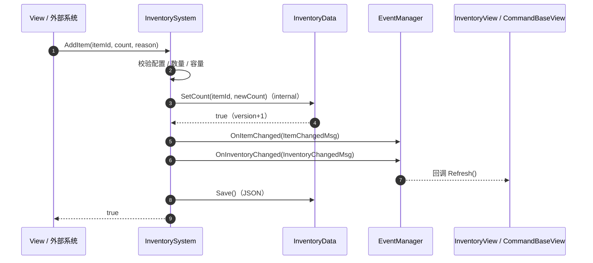

# 仓库（InventoryView）实现说明

> 2026-11-11 · 对应 `InventoryView` 界面与旧 Warehouse 系统的迁移
> 规范依据：[系统制作规范.md](系统制作规范.md)；军械库侧见 [军械库实现说明.md](军械库实现说明.md)

## 1. 界面结构

FairyGUI 包 `Inventory`（`Assets/Res/UI/Inventory_fui.bytes`），组件 `InventoryView`（1920×1080）：

| 节点 | 类型 | 用途 |
|---|---|---|
| `com_bg` | Base/CommonBgCom | 标题「仓库 / INVENTORY」+ 返回 |
| `txt_title` | 文本 | 当前页签标题（道具 / 装备） |
| `list_item` | 列表（flow_hz） | 物品网格，默认项 Base/CommonItemCom |
| `list_tab` | 列表（row） | 底部页签，默认项 Inventory/InventoryTabBtn（Radio） |

C#：

- `Game/Inventory/View/InventoryView.cs`（`UIWindow`）
- `Game/Inventory/View/InventoryViewData.cs`（`GameData`：包注册 + 当前页签）
- `Game/Inventory/Component/InventoryTabBtn.cs`（`GButton`：页签标题 + 选中态）

预制体 `Assets/Res/Prefab/InventoryView.prefab`（`UIPanel.packageName = Inventory`，`componentName = InventoryView`），
Addressables 地址 `InventoryView`，与 `Inventory_fui` 一起放在 `World` 组里（和军械库同样的做法，避免再建一套 Group Schema）。

入口：指挥室 `com_inventory`（「仓库」卡片）→ `Game.UI.ShowWindow(UIDefine.Inventory)`；
返回按钮回到 `UIDefine.CommandRoom`。

## 2. 页签与数据来源

界面固定两个页签（`InventoryDefine.GetTabCount() = 2`，顺序即 list_tab 下标）：

| 页签 | 数据来源 | 说明 |
|---|---|---|
| **道具**（`InventoryTab.Item`） | `item` 表 + `InventoryData` | 只显示**已持有**（数量 > 0）的道具，包含货币类（`type_show = 2`）——货币暂时不单独分页 |
| **装备**（`InventoryTab.Equip`） | `equip` 表 + `ArmoryData` | 军械库已合成的装备；装备持有数据仍归 `ArmorySystem`，仓库只读 |

网格排序：**品质降序 → 同品质 ID 升序**（`InventorySystem.SortEntries`，想改成 ID 升序只改这一处）。
数量 > 1 时格子右下角显示 `xN`（`CommonItemCom.SetCount`，代码创建的角标，FGUI 里没有对应节点）。
某个页签没有内容时，列表区域中间显示占位文案（`txt_empty`，同样是代码创建）。

## 3. 数据与规则

| 文件 | 说明 |
|---|---|
| `Game/Inventory/Data/InventoryData.cs` | 权威数据：`道具ID → 数量`（只存 > 0）+ 格子/负重上限 + 版本号；存档 `GameMain/Data/inventory.json` |
| `Game/Inventory/Model/InventorySystem.cs` | 唯一业务入口：增减/兑换/容量/快照 |
| `Game/Inventory/Data/InventoryItemStack.cs` | 查询结果 / 批量入参载体 |
| `Game/Inventory/Data/InventorySnapshot.cs` | 界面只读快照（条目 + 容量 + 总重） |
| `Game/Inventory/Define/InventoryDefine.cs` | 页签名、日志前缀、变化来源枚举 |

规则：

- 写入只走 `InventorySystem`（`AddItem / RemoveItem / SetItemCount / ClearItem / AddItems / RemoveItems / TryExchange / ClearAll / SetCapacity`）；
  `InventoryData` 的写方法全是 `internal`，别的系统想改道具必须调模型；
- 每次成功变更：`Data.SetCount` → 广播 `OnItemChanged` → 广播 `OnInventoryChanged` → `Data.Save()`；
  批量接口（`AddItems / RemoveItems`）只在最后存一次；
- 容量：`GetMaxSlots / GetMaxWeight` 默认 0（不限制），`SetCapacity` 设置；负重目前按**每件 1** 计算
  （`item.xlsx` 改版后没有 weight 列，等接回重量表只改 `InventoryData.GetTotalWeight`）；
- 配置校验在 Model：`item` 表里没有的 ID 拒绝写入；读档时保留未知 ID，只在组装快照时跳过并打 warning。

## 4. 数据流

关键点：

- View 不碰 `InventoryData`，只拿 `InventorySystem.BuildSnapshot(tab)` 的结果；
- 事件在数据写入成功之后广播，订阅方读到的一定是新数据；
- 隐藏的界面（`Leave`）会退订，重新 `Enter` 时主动 `Refresh()` 一次。

## 5. 存档与旧数据迁移

- 新存档：`Application.persistentDataPath/GameMain/Data/inventory.json`，UTF-8 JSON：
  `{ version, maxSlots, maxWeight, items:[{ id, count }] }`，items 按 ID 升序；
- `InventoryData.GetLegacySaveFileName()` 返回 `"warehouse.json"`：
  新文件不存在而旧文件存在时，`SystemDataBase.Load()` 会先读旧档，再立刻另存为 `inventory.json`；
  新文件存在但损坏时**不会**回退旧档（避免把旧数据又读回来）；
- 旧 `Game/Warehouse` 目录已删除，`WarehouseSystem / WarehouseData / WarehouseEventDefine` 不再存在。

## 6. 迁移涉及到的调用点

| 位置 | 改动 |
|---|---|
| `CommandBaseView` | 仓库卡片改为打开 `UIDefine.Inventory`；占用格子数读 `InventorySystem`，订阅 `InventoryEvent.OnInventoryChanged` |
| `ArmoryView / ArmorySystem` | 材料数量/扣除改走 `InventorySystem`；扣除原因 `InventoryChangeReason.Craft` |
| `BattleSettingSystem / BattleSettingDebug` | 物资校验与快照改走 `InventorySystem` |
| `ArmoryDebug` | 发放测试材料改走 `InventorySystem` |
| `DataManager` | `WarehouseData` → `InventoryViewData` + `InventoryData` |
| `ModelManager` | 注册 `InventorySystem`（在 `ArmorySystem` 之前） |

`CommonItemCom` 新增 `SetCount(int)`：只有仓库这类需要看持有数量的界面调用，其它界面 `SetCom` 后角标保持隐藏。

## 7. 调试入口

菜单 `Framework/仓库/…`（`Game/Inventory/Debug/InventoryDebug.cs`，仅编辑器）：

- 打开界面（运行中）
- 发放测试道具（材料 1005~1023 + 蓝图 2000~2005，每种 5 个）
- 发放测试装备（5001 / 5003 / 5007，各 1 件，走 `ArmorySystem.GrantEquip`）
- 打印仓库快照（`InventorySystem.Dump()` + 两个页签的 Snapshot 明细）
- 清空仓库（容量保持不变）
- 删除仓库存档

## 8. 已知待补

- 没有物品详情弹窗（`InventoryView` 只有网格），点击格子暂时没有行为；
- 道具页把货币类（`type_show = 2`）也列出来了，后续要单独做货币页时在 `InventorySystem.BuildItemEntries` 里过滤；
- 使用 / 出售 / 丢弃等操作没有界面入口，`itemUse.xlsx` 目前也是空表；
- `item` / `equip` 的 `icon` 列还是空的，格子里只有品质底图（与军械库一致）；
- 装备只展示、不能穿戴，穿戴要等装备系统接 `ArmoryData`。
