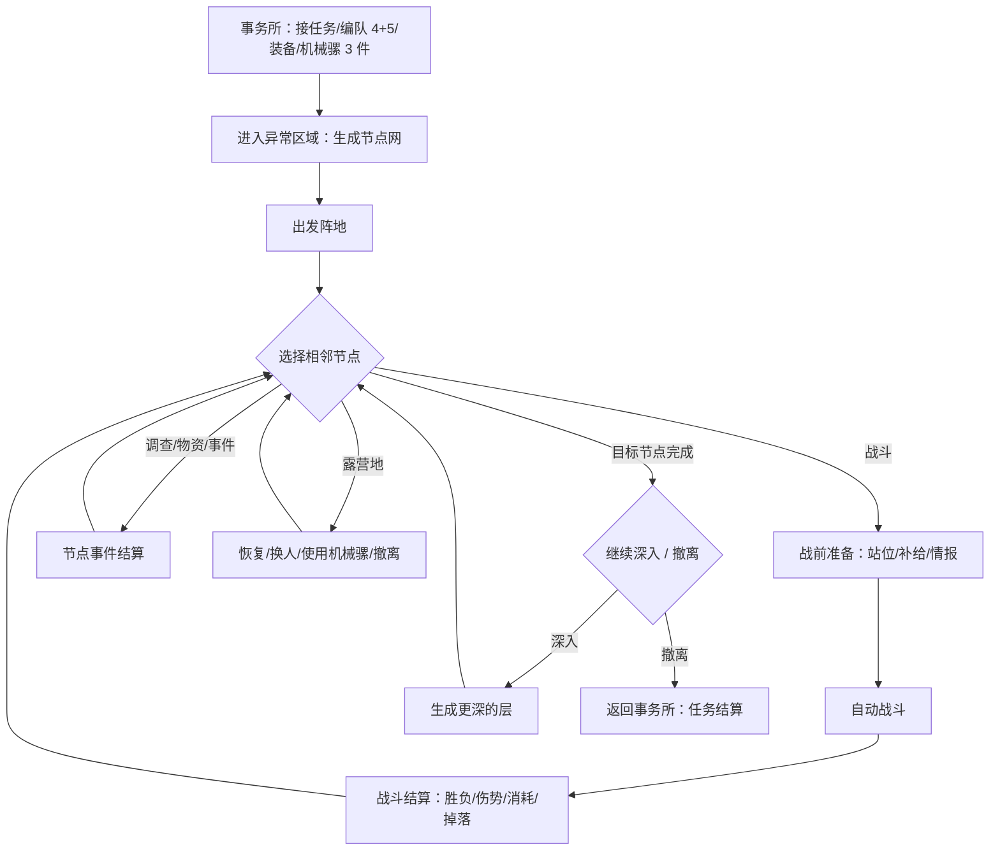
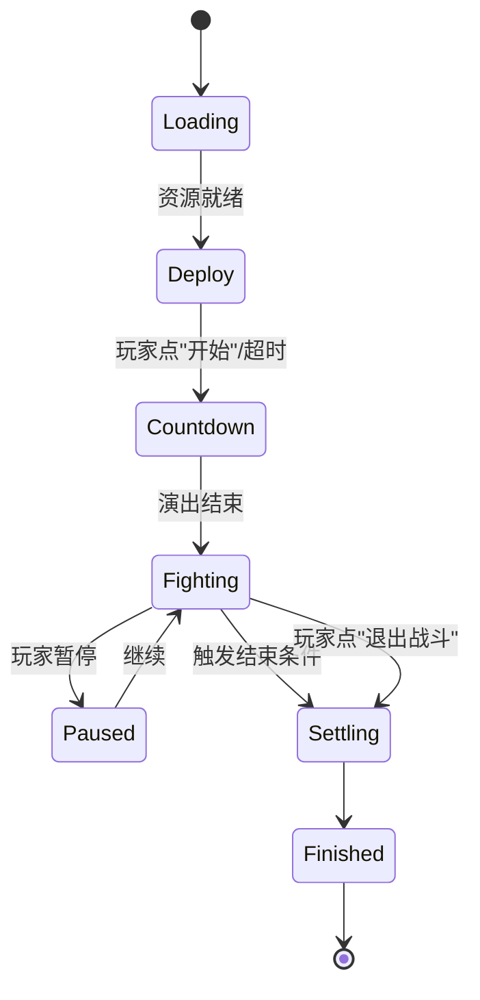
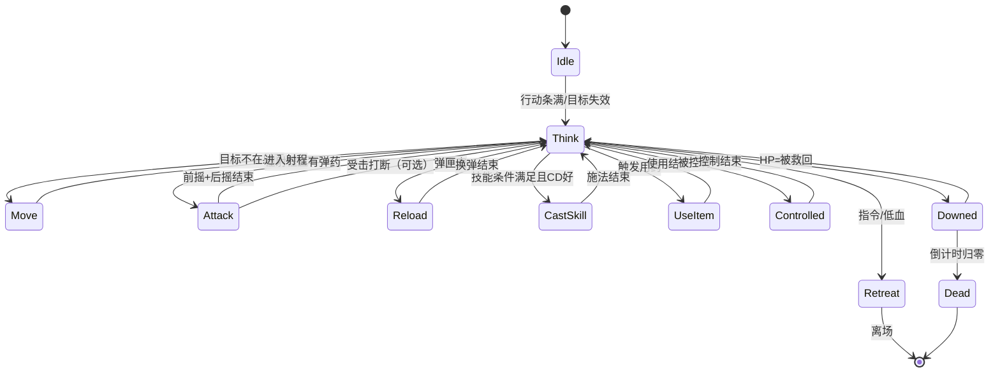
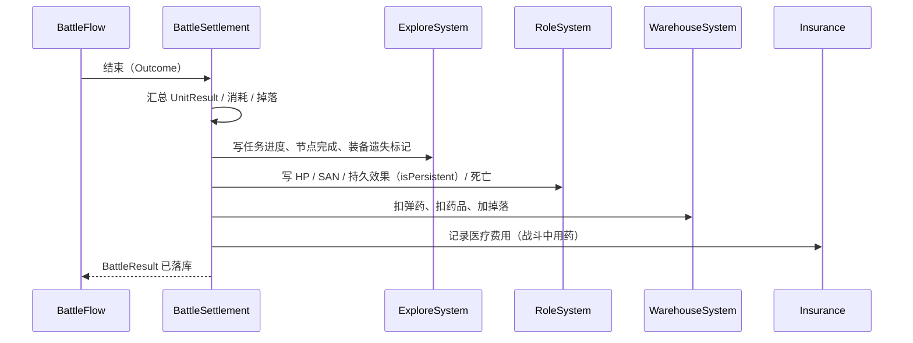

# 战斗系统实现计划（一维战场 · 自动战斗 · 网状探索）

> 状态：**规划稿，未开始实现**
> 版本：**v2.3**（v2.2 的 MVC 对齐 + 本轮全部决策落地：ATB / 指令响应 / 任意位置 / 跨战斗重伤 / 7 节点）
> 依据：`策划文档/1-项目介绍`、`4-角色培养系统`、`5-装备系统`、`8-战斗系统`；`Docs/系统制作规范.md`；现有 `Game/Battle` 代码与 `DataTable` 配置表。
> 配套文档：`Docs/技能系统实现计划.md`（技能部分单独成篇）。

---

## 0. 变更总览

### 0.1 旧设计 → 新设计

| 维度 | 旧（仓库里现在的代码） | 新（本计划） |
|---|---|---|
| 战场 | 六边形瓦片地图（`Map.xlsx` + `MapTileClass`） | **一维直线**，坐标 = 米，`[0, L]` 区间；**双方单位可出现在任意位置** |
| 行动 | 回合制，玩家逐个角色下指令（`BattleOrderType` + 7 个 `ActionXxx`） | **实时 + ATB 行动条**，角色由状态机自行决策、执行 |
| 玩家输入 | 点角色 → 点指令 → 点目标 | **指令**（集火/保持距离/全体撤离…）+ 暂停 / 退出；指令可能不被响应 |
| 节奏 | 一次行动 = 一个指令 | **ATB 行动条**：填充速度 = 1/武器攻击间隔（受敏捷修正），满了行动一次 |
| 技能节奏 | 玩家点技能，立刻执行 | **技能 CD 独立计时**，CD 到点即施放，不占用行动条 |
| 位置 | 瓦片格子，移动走格子 | 连续位置，移动 = 沿直线靠近/拉开；可被包夹 |
| 战斗的地位 | 独立场景，`level.xlsx` 里的关卡 | **探索流程中的一个节点**，进出都要和探索状态对接 |
| 目标选择 | 玩家点 | AI 按规则选，指令可覆盖 |

### 0.2 代码与配置的存废清单

**直接删除**（无外部引用，删了不影响别的系统）：

| 文件 | 原因 |
|---|---|
| `Game/Battle/Logic/IOrderAction.cs` + `ActionAttack/Item/Move/Retreat/Skill/Standby/Equip.cs` | 手动四段式指令模型整体作废 |
| `Game/Battle/Data/BattleData.cs` | 瓦片字典 + 瓦片预制体，新战场不需要 |
| `Class/GameClass.cs` 里的 `MapTileClass` | 同上 |
| `BattleLogic.cs` 的 `SetTileOnInit / SetRoleOnUpDate / CheckClick / MoveRole / ChackAction*` | 全是瓦片/点击/手动指令 |

**一并删除**（`GameLogic` / `GameState` 体系在战斗里整体退场，见规范 §3.3「旧系统的 Logic 目录不再新增」）：

| 文件 | 原因 |
|---|---|
| `Game/Battle/Logic/BattleLogic.cs`、`ATLogic.cs` | 业务模型改为 `BattleSystem : ModelBase`；计时并入 `BattleClock` |
| `Game/Battle/State/BattleStartState/OrderState/ActionState/FinishState` | 阶段由 `BattleFlow`（普通类 + `BattlePhase` 枚举）驱动，不再用 `StateManager` |
| `Game/FightProcess/`、`Game/TestFight/` | 职责拆进 `Explore/`（探索流程）与 `Battle/Debug/BattleDebug.cs`（调试） |
| `Class/GameClass.cs` 里的 `BattleClass` / `BattleRoleClass` | 被 `BattleField/BattleUnit` 取代 |
| `Game/Battle/Data/BattleData.cs` | 瓦片字典，新战场不需要 |

**保留并改造**：

| 文件 | 处置 |
|---|---|
| `Game/Battle/Operate/BattleOperate.cs` | 位置保留（`OperateManager` 按 `operate.xlsx` 加载），改为"输入 + 每帧驱动 `BattleSystem.Tick()`" |

> 以上删除项都没有外部引用（只有战斗模块自引用 + `LogicManager`/`DataManager` 里的注释行），可以一次性清掉，不会牵连其他系统。

**配置表**：

| 表 | 处置 |
|---|---|
| `Map.xlsx` | **废弃**（瓦片地图没了）。`__tables__.xlsx` 里删行，`Tables.cs` 重新生成 |
| `TileType` / `MaterialType` 枚举 | 保留不删（避免牵动生成代码），标注 `@deprecated` |
| `BattleOrderType` 枚举 | 语义从"角色指令"变为"单位行动类型"（`Attack/Move/Reload/CastSkill/UseItem/Retreat/Standby`），或新建 `UnitActionType` 后删掉旧枚举 |
| `level.xlsx` | `enemy` 内联结构改为引用 `encounterID`（见 §9.3） |
| `enemy.xlsx` | 大幅扩列（AI、技能、阵营、体型），见 §9.3 |

---

## 1. 战斗在探索流程中的位置

> 本节只写"战斗需要的部分"。探索系统的完整设计（事件内容、奖励池、剧情）另起文档。

### 1.1 一次调查任务的完整链路



### 1.2 探索地图（只列战斗相关规则）

| 规则 | 内容 | 来源 |
|---|---|---|
| 地图形态 | 分层**有向无环图**（DAG），层内 2~4 个节点，边只连相邻层 | 文档 1「节点网络组成的地图」 |
| 节点类型 | 战斗 / 调查 / 物资回收 / 特殊事件 / 遭遇 / 露营地 | 文档 1 |
| 保底 | 起始 1 个"出发阵地"；终点 1 个"目标节点"；每 3 层至少 1 个露营地 | 需定（§11） |
| 移动 | 只能走边到相邻**未探索**节点；已探索节点可回退但不再触发 | 文档 8 |
| SAN | **每次移动 -5**（受异常适应性修正）；归零→癫狂 | 文档 4 |
| 露营地 | 可撤离、可换人（支援组）、可使用机械骡 3 件物品 | 文档 1/8 |
| 深入 | 目标完成后可继续生成新层，风险与奖励递增 | 文档 8 |
| 重进 | 未完成任务再进入时，可部署到上次点亮的露营地；非露营节点**重新随机类型** | 文档 1 |
| 全灭 | 队伍全灭 → 装备遗失在区域，下次探索可回收 | 文档 8 |

> **关键点**：节点是**每局程序生成**的，不是手工摆的。所以表里配的是「生成规则 + 节点模板」，不是「地图上第 3 个节点是什么」。这一点直接决定 §9 的表结构。

### 1.3 进入/离开战斗的契约

**进入战斗**（从探索层发起）：

```csharp
// 探索层 → 战斗层
BattleRequest {
    int   m_EncounterId;      // encounter 表
    int   m_BattlefieldId;    // battlefield 表
    List<int> m_AllyRoleIds;  // 参战角色（行动组 4 人里还能打的）
    int   m_NodeSeed;         // 本场战斗的随机种子
    WeatherType m_Weather;    // 环境（来自区域/节点）
    List<int> m_CommandIds;   // 本场可用指令集
}
```

**离开战斗**（战斗层 → 探索层）：

```csharp
BattleResult {
    BattleOutcome m_Outcome;        // Win / Lose / Retreat / Abort
    float  m_Duration;              // 用时（秒）
    List<UnitResult> m_Units;       // 每个参战角色的战后状态
    List<ItemDelta> m_Consumed;     // 弹药/药品/补给消耗（含医疗费用，接保险）
    List<ItemDelta> m_Loot;         // 掉落
    bool   m_EquipLost;             // 是否全灭导致装备遗失
}
UnitResult {
    int  m_RoleId;
    int  m_Hp;                      // 战后血量（保留）
    int  m_San;                     // 战后 SAN
    bool m_Downed;                  // 重伤（倒计时是否已经走完）
    bool m_Dead;                    // 永久死亡
    List<RoleEffect> m_PersistEffects; // 伤残等持久效果（写 RoleRecord.m_Effects）
    float m_DownedTimer;            // 重伤倒计时剩余（若战斗结束时仍在倒计时）
}
```

**铁律**：战斗层只产出 `BattleResult`，**不直接写 `RoleRecord`**。回写由探索层/结算层统一做（详见 §7），避免"战斗中存档"这类事故。

---

## 2. 战斗流程

### 2.1 两层状态机

| 层 | 类 | 职责 | 生命周期 |
|---|---|---|---|
| 战斗流程 | `BattleFlow` | 加载、准备、开打、暂停、结算、退出 | 一场战斗一个 |
| 单位行为 | `UnitBrain` | 每个单位自己：想什么、做什么、被打断怎么办 | 一个单位一个 |

两层关系：`BattleFlow` 每帧 `Tick(dt)` 推进时钟并广播阶段事件；`UnitBrain` 由时钟驱动，**不能**反过来控制流程。

### 2.2 战斗生命周期



| 阶段 | 做什么 | 玩家能做什么 |
|---|---|---|
| `Loading` | 加载战场、单位、技能/效果表引用校验 | 无（显示进度） |
| `Deploy` | 分配物资（机械骡 → 角色）、摆放初始位置、查看敌人情报 | 拖拽站位、分配物资、确认 |
| `Countdown` | 3 秒倒计时 + 开场演出 | 无 |
| `Fighting` | 自动战斗主循环 | 发指令、暂停、退出 |
| `Paused` | **完全冻结**：战斗时钟、技能 CD、buff 计时、ATB 行动条、指令 CD 全部停 | **只能看信息**，不能发指令 |
| `Settling` | 结算演出：胜负、掉落、伤势 | 无 |
| `Finished` | 产出 `BattleResult`，交还探索层 | 点"返回" |

> **暂停**冻结所有计时（含技能 CD 与指令 CD），但 UI 动画（DOTween）照常。暂停期间不接受指令输入。

### 2.3 战前准备（Deploy）

| 能力 | 实现 | 备注 |
|---|---|---|
| 初始位置 | 每名队员拖到 `[0, L]` 内的任意位置（不再限定在某一侧） | 见 §3.2；用现有 `BattleSetting` 包 |
| 物资分配 | 把机械骡携带的补给品**分配到各角色身上**；战斗中只能用角色自带的 | 机械骡本身不进战斗 |
| 补给/治疗 | 战前可用分配的物资先治疗一次（走技能系统 `EffectService`） | 消耗的是角色身上的那份 |
| 查看敌人 | 按**感知**门槛：100~110 看血量，110~120 看词条 | 文档 4 |
| 换人 | **不允许**（只有露营地能换） | 文档 1 |

### 2.4 自动战斗主循环

```csharp
// 每帧
float dt = m_Clock.Scale > 0 ? Time.deltaTime * m_Clock.Scale : 0f;
m_Clock.Tick(dt);
TickSkillTimers(dt);      // 技能 CD：到点即施放（独立于行动条，优先级最高）
TickActionGauge(dt);      // ATB 行动条：满了行动一次（普攻/道具/换弹/移动）
TickUnits(dt);            // 移动插值、前摇、换弹
TickEffects(dt);          // 效果实例：剩余时长、周期 tick、条件型状态的触发
TickCommands(dt);         // 指令剩余时长、指令 CD（暂停时 dt=0，自然不走）
CheckBattleEnd();
```

**顺序要求**（同时对应文档 8 的伤害结算顺序与「主动技能 > 被动技能 > 普通攻击」）：

1. **技能 CD 到点 → 立即施放**（不等行动条）
2. **ATB 行动条满 → 决策 → 执行**（普攻/道具/换弹/移动；此时若技能 CD 也刚转好，技能优先，见上一行）
3. 即时伤害结算
4. 由伤害衍生的效果结算（叠层、满层触发、出血跳伤）
5. 死亡 / 重伤判定
6. 结束条件判定

### 2.5 玩家输入

| 输入 | 行为 | 约束 |
|---|---|---|
| 发指令 | 打开指令条 → 选指令 → （需要目标时）点敌人/点位置 | **仅 `Fighting` 可用**；指令有 CD；可能不被响应（§5.3） |
| 暂停 | `Clock.Pause()`，弹出战斗信息（敌我状态、效果） | 冻结一切计时；暂停中不能发指令 |
| 退出战斗 | 弹确认 → 走"主动撤退"分支 | 有惩罚（见 §7） |
| 倍速（可选） | `Clock.Scale = 1/2/3` | 建议做，自动战斗很需要 |

### 2.6 结束判定

| 结果 | 条件 | 后续 |
|---|---|---|
| `Win` | 敌方全部死亡/撤离 | 正常结算 + 任务进度 |
| `Lose` | 我方全部死亡/重伤 | 全灭流程（装备遗失） |
| `Retreat` | 我方存活单位**全部越过地图边界离场** | **越过边界的瞬间立刻结算**，判失败但保命 |
| `Abort` | 玩家主动退出 | 同撤退，额外惩罚 |

判定顺序：先判"我方是否还有可行动单位"，再判"敌方是否还有"；撤退判定插在两者之间（全部离场即结算，不等对方死完）。

---

## 3. 一维战场

### 3.1 坐标系与距离

- 战场是一段区间 `[0, L]`，单位位置 `pos ∈ [0, L]`，类型 `float`（米）。
- **双方单位都可以出现在任意位置**：不再有"我方从 0 侧、敌方从 L 侧"的硬约束。初始位置由 `encounter` 的单位配置给定（0~1 的百分比），战前玩家可拖拽我方单位。
- `Distance(a, b) = |a.pos - b.pos|`。
- 射程判定：`minRange <= Distance <= maxRange`（`minRange` 只有榴弹这类才有）。
- 表现层：`worldX = pos - L/2`，`worldZ` 按单位 index 加一点纵深偏移，避免完全重叠。
- **被包夹是合法局面**：敌人可以出现在我方两翼之间，单位的目标方向不再由"阵营朝向"决定，而由"目标在哪边"决定（`sign(target.pos - self.pos)`）。

### 3.2 站位与阵型

- 战前把 4 人拖到 `[0, L]` 内任意位置（不限定区间）。默认按 `battlefield.allyDefaultMin/Max` 平均铺开。
- "前排/后排"是**阵营内按 `pos` 排序的名次**（0 = 最靠后/最靠前由阵营的默认朝向决定，默认我方数字小=靠后）。被动里"当角色处于后排"就查这个名次（文档 4 的例子）。
- 名次**每帧重算**：角色移动后队形会变，"后排"是动态的。
- 敌人初始位置用**百分比**填（不同战场长度不一样），支持同一侧扎堆或分散包夹。

### 3.3 移动

| 行为 | 规则 |
|---|---|
| 接近目标 | 目标在射程外 → 朝 `sign(target.pos - self.pos)` 方向移动，直到进入 `maxRange` |
| 拉开距离 | 目标在 `minRange` 内（或被指令"保持距离"）→ 反向移动 |
| 撤退 | 朝**最近的地图边界**（0 或 L）移动，越界即离场 |
| 速度 | `移速 = 基础移速 × (1 + 敏捷修正) × 负重惩罚`；负重超上限有严重惩罚（文档 5） |
| 碰撞 | **不做碰撞**，允许重叠（一维上做碰撞会让 AI 卡死） |
| 边界 | 战斗中不能主动越过；撤退时允许越界离开 |
| 被围 | 不特殊处理：能不能出去取决于移速与拦路的单位，不设"突围成功率" |

### 3.4 武器与射程（直接对应装备文档）

文档 5 已经给出了完整的武器数据，这张表就是"一维战场"的设计依据：

| 武器 | 类型 | 射程(米) | 攻击间隔(s) | 换弹(s) | 弹匣 | 攻击加成 | 伤害倍率 | 附加 |
|---|---|---|---|---|---|---|---|---|
| 匕首 | 刀具 | 1 | 0.95 | — | — | +10 | 80% | 1 层切割伤 |
| 日本刀 | 刀具 | 2 | 1.8 | — | — | +15 | 105% | 2 层切割伤 |
| 手枪 | 枪械 | 5 | 0.85 | 1.5 | 7 | +20 | 100% | — |
| 突击步枪 | 枪械 | 15 | 1.2 | 2.5 | 20 | +35 | 100% | 每次 2 发 |
| 火焰喷射器 | 枪械 | 5 | 2.0 | 3.0 | 3 次 | +20 | 80% | 5 段，每段 1 层烧伤 |
| 榴弹发射器 | 枪械 | 3~10 | 2.0 | 5.0 | 6 | +25 | 105% | 半径 2，1 层烧伤 |

由此推出三条硬规则：

1. **攻击节奏由武器决定**，不是全局回合。近战 1 秒一刀，步枪 1.2 秒一发，喷火器 2 秒一轮 —— 这是自动战斗的"心跳"。
2. **枪械不吃角色攻击力**（文档原文"不使用角色攻击力"），伤害 = 武器攻击力 × 倍率；**刀具吃角色攻击力**。→ 伤害公式必须支持"攻击来源"参数（§6.1）。
3. **射程差异制造站位价值**：匕首 1 米、步枪 15 米，所以"谁站前面"是有意义的，配合"保持距离"指令形成风筝战术。

### 3.5 空间规则简化（必须写死的约定）

| 问题 | 约定 |
|---|---|
| 能否穿过敌我单位 | 能（一维不做阻挡） |
| 远程单位被贴脸怎么办 | 不自动后撤，除非有"保持距离"指令或行为逻辑偏好 |
| 爆炸范围 | 一维上就是 `[pos-radius, pos+radius]` 内所有敌对单位 |
| 背击/侧击 | **不做**（一维没有方位） |
| 地形/高低差 | **不做**（旧瓦片的 low/high/tower 全部作废） |

---

## 4. 单位与决策

### 4.1 单位数据

```csharp
class BattleUnit {
    int      m_UnitId;          // 战斗内唯一
    int      m_SourceId;        // 角色ID / 敌人ID
    UnitKind m_Kind;            // Role / Enemy / Summon / Neutral
    Faction  m_Faction;         // Ally / Enemy / Neutral
    int      m_TeamIndex;       // 我方 0..3 / 敌方 0..N（决定前后排名次）

    // 数值
    int m_Hp, m_MaxHp, m_San;
    Dictionary<int,int> m_Attrs;    // 攻击/敏捷/感知等（快照 + 修正）
    int m_AmmoInMag, m_MagazineSize;

    // 位置
    float m_Pos;
    float m_MoveSpeed;

    // 状态
    UnitBrainState m_State;
    List<EffectInstance> m_Effects;
    Dictionary<int,float> m_SkillCd;      // 技能ID → 剩余CD（独立计时）
    Dictionary<int,int>   m_CarriedItems;  // 战斗携带：补给品/弹药（战前分配）
    BattleUnit m_Target;            // 当前目标
    UnitIntent m_Intent;            // 当前意图
    float m_ActionGauge;            // ATB 0~1
    float m_ActionInterval;         // 填满所需秒数 = 武器攻击间隔 / 攻速修正
    float m_DownedRemain;           // 重伤剩余秒数（跨战斗保留）
}
```

### 4.2 UnitBrain 状态机



| 状态 | 说明 | 可被打断 |
|---|---|---|
| `Idle` | 无目标，等下一次决策 | — |
| `Think` | 瞬时，跑一次决策评分 | — |
| `Move` | 持续移动，每帧更新位置 | 可（受控/死亡/目标变更） |
| `Attack` | 前摇 → 命中判定 → 后摇，占满一个攻击间隔 | 否（除非控制） |
| `Reload` | 换弹，耗时来自武器 | 否 |
| `CastSkill` | 技能前摇 + 结算 | 否（v1 不做打断） |
| `UseItem` | 使用道具耗时 | 否 |
| `Retreat` | 朝边界移动，越界离场 | 可（指令取消） |
| `Controlled` | 眩晕/瘫痪等，不能行动 | — |
| `Downed` | 重伤，倒计时，可被药物救回 | — |
| `Dead` | 永久离场 | — |
| `Berserk` | 癫狂（SAN=0），攻击任意目标（含队友） | — |

### 4.3 行动节奏：ATB 行动条

时间模型是**实时 + ATB**：

```
每帧：m_ActionGauge += dt / m_ActionInterval      // 0 → 1 累积
m_ActionInterval = 武器攻击间隔 / (1 + 敏捷攻速修正)
m_ActionGauge >= 1 → Think → 执行一个行动 → 归零
```

- **填充速度由武器攻击间隔决定**：匕首 0.95 秒填满、步枪 1.2 秒、喷火器 2 秒 —— 这就是"心跳"。敏捷/攻速加成改的是分母。
- **技能用独立的 CD 计时器，不走行动条**（见技能文档 §1.4）：CD 一到立即施放；同一帧如果行动条也满了，**技能先执行**，行动条的这次行动让给技能（不额外消耗）。
- **移动不占行动条**：持续行为，每帧更新；移动到射程内立即停下攻击。
- **换弹**：弹匣空后下次 `Think` 必定 Reload，换弹结束行动条归零。
- **控制/重伤**：行动条清零并停止累积；恢复后从 0 重新开始。

### 4.4 决策评分（自动战斗的核心）

每次 `Think` 生成候选行动并打分，取最高分执行：

| 候选 | 基础分 | 加分项 | 减分项 |
|---|---|---|---|
| `Reload` | 0 | 弹匣空 → **必选** | — |
| `UseItem` | 40 | 自身/队友 HP<阈值、被动偏好 | 无药 −∞ |
| `Attack` | 50 | 目标在射程、目标被集火、命中率 | 无弹药 −∞、目标不可选中 −∞ |
| `Move` | 30 | 目标在射程外 → **必选** | — |
| `Retreat` | 0 | 指令 +200、HP<撤退阈值 +60、行为逻辑偏好 +20 | 有队友在救 +? |

> `CastSkill` **不在这个表里**：技能由独立 CD 计时器触发，不参与行动条的候选评分。这样"技能优先级高于普攻"是结构上保证的，不靠分数压制。

分数的输入来源（按优先级从高到低覆盖）：

```
玩家指令  >  被动天赋（决策型）  >  行为逻辑（behaviorLogic）  >  局势默认值
```

再加一点**随机扰动 ±5%**，让同配置的角色不至于完全同步（观感上更"活"）。

### 4.5 中断与抢占

| 事件 | 处理 |
|---|---|
| 当前目标死亡/离场 | 立即 `Idle` → 重新选目标 |
| 被眩晕/控制 | 强制 `Controlled`，清空行动条；**技能 CD 暂停累积**（控制期间不涨） |
| 受击（是否打断攻击） | v1 **不打断**（否则自动战斗会非常卡），只播受击表现 |
| 指令变更 | 不打断当前行动，下次 `Think` 生效 |
| HP 归零 | 强制 `Downed`，清空行动条与意图 |
| 弹药耗尽 | 下次 `Think` 强制 `Reload` |
| **技能 CD 到点** | **立即打断行动条行动**（若正在移动则停下），进入 `CastSkill`；施法结束行动条归零 |

---

## 5. 指令系统

### 5.1 指令清单（第一版）

| 指令 | 作用对象 | 参数 | 效果 | 备注 |
|---|---|---|---|---|
| 集火 | 全体 / 单人 | 敌方单位 | 把该单位设为全队当前目标，权重最高 | 最常用 |
| 保持距离 | 全体 / 单人 | 目标 + [min,max] | 与目标维持距离区间，超出就走 | 风筝战术 |
| 全体撤离 | 全体 | 无 | 全部进入 `Retreat`（向最近边界移动） | 撤离类不因天赋被拒，但受硬性状态限制（重伤/控制不响应） |
| 优先治疗 | 全体 / 单人 | 无 / 队友 | 提高 `UseItem`（治疗类）权重 | |
| 自由行动 | 全体 / 单人 | 无 | 清除所有指令，回到行为逻辑 | |
| 停止开火 | 全体 | 无 | 禁止 `Attack`/`CastSkill`（省弹药/等技能） | 可选 |

### 5.2 数据结构

```csharp
class CommandInstance {
    int    m_CommandId;      // command 表
    int    m_IssuerRoleId;   // 下达者（队长/玩家）
    int    m_Scope;          // 全体 / 单人
    int    m_TargetUnitId;   // 单人指令的目标单位
    int    m_ParamUnitId;    // 集火的敌人 / 保持距离的对象
    float  m_ParamMin, m_ParamMax;  // 距离区间
    float  m_Duration;       // 剩余时长（0 = 直到取消）
    int    m_Priority;       // 高优先级覆盖低优先级
}
```

### 5.3 响应判定：指令可能"不被响应"

> 文档 1：「'指令'是模糊的，角色可能会执行出错。」你已确认：这里的"出错"是**角色可能不响应指令**，原因包括——自身状态导致无法响应、自身状态判断优先级高于指令而忽略、天赋带来概率性拒绝响应。

所以指令不是一个"按下即生效"的开关，而是一次**请求**，由接收者自己判定：

| 判定顺序 | 条件 | 结果 |
|---|---|---|
| ① 硬性不可响应 | 重伤 / 死亡 / 眩晕 / 瘫痪 / 癫狂 | **必然不响应**，UI 冒"无法行动" |
| ② 自身状态优先 | 正在撤退、正在换弹、血量低于撤退阈值、被控制 | **忽略指令**（自身状态判断优先） |
| ③ 天赋拒绝 | 天赋配了 `commandRefuseRate`（万分比） | 概率拒绝，UI 冒"未响应" |
| ④ 基础响应 | 其余情况 | 按 `command.baseSuccess` 判定（默认 100%） |

```csharp
// 判定结果
enum CommandResponse { Accepted, Rejected_Disabled, Rejected_SelfPriority, Rejected_Talent, Rejected_Roll }
```

| 参数 | 位置 | 说明 |
|---|---|---|
| `baseSuccess` | `command.xlsx` | 基础响应率（万分比），默认 10000 |
| `refuseRate` | `talent.xlsx` | 天赋的拒绝概率（万分比） |
| `selfPriority` | `command.xlsx` | 是否受"自身状态优先"影响（1 是 / 0 否，撤离类为 1） |
| `refuseBubble` | `command.xlsx` | 未响应时冒的气泡文案 key |

> 与上一版的区别：**不再是单一成功率**，而是"硬性条件 → 自身状态 → 天赋 → 基础率"四段式。这样 SAN 低、带反骨天赋、正在撤退的角色会有不同的不响应表现，而不是一个统一的丢骰子。

### 5.4 优先级链

```
① 硬性状态（重伤/死亡/眩晕/瘫痪/癫狂）  —— 覆盖一切
② 自身状态判断（撤退中/换弹中/低血/被控）—— 高于玩家指令
③ 玩家指令（集火/保持距离/撤离）
④ 被动天赋（决策型）
⑤ 行为逻辑（behaviorLogic）
⑥ 局势（必须换弹/必须移动）
```

冲突示例："保持距离" + "集火" 同时存在 → 距离约束优先（先走位），到位后按集火目标攻击；如果走位导致无法攻击，允许在射程边缘停下。

---

## 6. 伤害与状态

### 6.1 伤害公式

```
命中判定：hit = rand() < (1 − 目标闪避率)
基础伤害 = 攻击来源 × 倍率
攻击来源 = 刀具: (角色攻击 + 武器攻击)
           枪械: (武器攻击)              ← 文档 5："不使用角色攻击力"
最终伤害 = 基础伤害 × (1 − 目标减伤) × (1 + 增伤修正) × (1 + 易伤修正)
```

- 减伤：装备 `DEF` + 效果（烧伤"每层受到伤害 +10%"就是易伤修正）。
- 增伤/易伤：来自效果实例的 `attrMod`（对"伤害"这个伪属性的百分比修正）。
- 暴击：**第一版不做**（文档 4 的五条属性里没有暴击；要做就放在 `combatConst` 里留开关）。

### 6.2 命中与闪避

文档 4 写的是「每有 1 点敏捷增加 2% 闪避概率，闪避概率最高不超过 75%」。但已拍板 **`role.xlsx` 保留掷骰**（敏捷 10~50），如果照搬 2%/点，敏捷 38 以上就全顶到 75% 上限，掷骰差异直接作废。

所以系数改为**表驱动**（`combatConst`），并按下调后的默认值跑：

```
闪避率 = min(dodgeCap, 目标敏捷 × dodgePerAgi)
默认：dodgePerAgi = 1%/点（万分比 100），dodgeCap = 75%
→ 敏捷 10~50 对应 10%~50%，仍有差异，且不会早早顶上限
```

- buff 里的"命中 -3%"直接作用在命中率上：`命中率 = 1 − 闪避率 + 命中修正`。
- `role.xlsx` 的敏捷上限是 100（掷点 10~50），装备/职称叠加上去也不会超过 100 → 闪避最高 100%×1% = 100%，仍由 `dodgeCap` 兜住。

### 6.3 伤害效果与衍生效果（完全按文档 8）

| 效果 | 触发 | 数值 | 备注 |
|---|---|---|---|
| 切割伤 | 被刀具命中 | 每次 20% 总攻击伤害；累计 3 层→出血 | 层数存在目标身上 |
| 出血 | 切割伤 3 层 | 1 次 500% 总攻击伤害，之后每 1.2s 造成 20% 总攻击力伤害 ×5 次；清空切割伤层数，每多 1 层 +10% | 需要 `tickInterval` + 清层逻辑 |
| 烧伤 | 火焰/榴弹 | 每层使目标**受到**伤害 +10% | 易伤，不是持续伤害 |
| 冻伤 | 冰系 | 每层使目标**造成**伤害 −10% | 减伤（输出向） |
| 骨折 | — | 每层敏捷 −10%，5 层→无法移动 | 控制 |
| 眩晕 | — | 每层基础命中 −10%（初始 100%），累计 5 次→无法攻击 | 控制 |

> 这套规则要求 `effect` 表支持：**叠层到 N 触发子效果**、**周期触发**、**清空层数**、**易伤/减伤修正**、**控制标记**。技能文档里会给出对应字段。

### 6.4 控制与"无法行动"

| 状态 | 来源 | 对状态机的影响 |
|---|---|---|
| 无法移动 | 骨折 5 层 / `flag` | `Move/Retreat` 被禁止 |
| 无法攻击 | 眩晕 5 层 / `flag` | `Attack/CastSkill` 被禁止，仍可移动 |
| 无法行动 | 瘫痪 / 重伤 | 只能 `Downed`/`Controlled` |
| 癫狂 | SAN = 0 | `Berserk`：目标可为任意阵营（含队友） |

### 6.5 重伤 / 死亡 / 撤退 / 癫狂

| 状态 | 进入条件 | 退出 | 数据 |
|---|---|---|---|
| 重伤 `Downed` | HP 首次归零 | 被药物救回（回到 1 点 HP 以上） | `m_DownedRemain`（剩余秒数，**跨战斗保留**） |
| 死亡 `Dead` | 重伤倒计时归零 | 不可逆 | **永久死亡，但角色记录保留**（英灵碑用） |
| 撤退 | 指令/低血 | 越过地图边界立刻离场 | 不算死亡，但战斗判负 |
| 癫狂 | SAN = 0 | 撤离后恢复（事务所治疗） | 目标随机、可能攻击队友、可能"失踪" |

**重伤倒计时只在战斗中走**（已拍板）：

- `Fighting` 阶段：`m_DownedRemain -= dt`；
- 战斗结束（`Settling` 起）：**暂停倒计时**，把剩余秒数写回 `RoleRecord.m_DownedRemain`；
- 该角色下次进入战斗：从写回的剩余秒数继续倒数；期间被药物救回则清零、恢复行动；
- 倒计时归零 → 死亡，`RoleRecord.m_IsDead = true`，**不从 `RoleData` 删除**。

### 6.6 弹药与换弹

- 每把枪有 `magazine`（弹匣）与 `reload`（换弹时间）与 `ammoItemId`（弹药道具 ID）。
- **战斗内弹药来自角色自身携带**（战前由机械骡分配到角色）；机械骡物资**不能**在战斗中使用。
- 战斗中消耗要记账（`BattleResult.m_Consumed`），战后从角色携带/仓库结算。
- 近战武器不消耗弹药（`magazine = 0`）。

---

## 7. 结算与回写



| 回写项 | 目标 | 规则 |
|---|---|---|
| HP | `RoleRecord` | 战后保留（不自动回满），宿舍/疗养院恢复 |
| **重伤剩余** | `RoleRecord.m_DownedRemain`（新增） | 战斗结束时把剩余秒数写回；下次进战斗继续倒数 |
| **死亡标记** | `RoleRecord.m_IsDead`（新增） | **只标记、不删除记录**（英灵碑要展示）；`RoleSystem` 的查询默认过滤死亡角色，另提供 `GetDeadRoles()` |
| SAN | `RoleRecord`（新增字段） | 战斗内是否掉 SAN 待定；节点移动固定 −5 |
| 持久效果 | `RoleRecord.m_Effects` | 只写 `isPersistent = true` 的（伤残/瘫痪） |
| 弹药/药品 | `RoleSystem` 的战斗携带 + `WarehouseSystem` | 战斗内扣的是**角色携带**，战后把剩余量写回；仓库只负责战前分配 |
| 医疗费用 | 保险系统 | 战斗中用药记录费用（文档 6） |
| 装备遗失 | 探索状态 | 全灭时标记，下次探索可回收 |

> **跨系统写入一律走对方 Model 的公开方法**（如 `RoleSystem.ApplyBattleResult(...)`、`WarehouseSystem.ChangeItem(...)`）。`BattleSettlement` 不直接碰 `RoleData` / `WarehouseData` / `ExploreData`（规范 §5.3：Data 写方法 `internal`，只有本系统 Model 能写）。

---

## 8. 代码架构与迁移

### 8.0 规范映射（先看这张表）

> 规范：`Docs/系统制作规范.md`（2026-11-09 生效）。两者冲突时**以规范为准**。本表列出本文档已按规范落地的位置。

| 规范条款 | 要求 | 本计划落点 |
|---|---|---|
| §1.1 | 一个业务域一个系统、一个主模型 `<System>System` | `BattleSystem`（战斗）、`ExploreSystem`（探索）、`SkillSystem`（技能，见技能文档） |
| §1.3 / §3.1 | 每个系统一个 Data + 一个 Event 辅助模块 | `BattleData` + `BattleEvent/BattleMessage`；`ExploreData` + `ExploreEvent/ExploreMessage` |
| §3.1 | 目录 `Model / Data / Event / Define / View / Component / Debug` | §8.1（Battle 额外保留 `Operate/`，`OperateManager` 框架要求） |
| §3.3 | 命名：不再用 `XxxEventDefine` / 用 `XxxViewData` 存 UI 状态 / `Logic/` 不再新增 | `BattleEvent`、`BattleViewData`、无 `Logic/` |
| §4.1 | Model 生命周期 `OnInit / OnStart / OnDestroy` | §8.3 |
| §4.3 | 在 `ModelManager.LoadModels()` 注册，业务用 `Game.Model.Get<T>()` | §8.4 |
| §4.4 | Model 禁止引用 FairyGUI / UIWindow / 场景对象 / 文件 IO | 表现走「事件 + 拉取」（§8.5） |
| §5.3 | Data 写方法 `internal`，只有本系统 Model 能写 | §8.2 |
| §5.5 | UI 状态进 `<System>ViewData`，不落盘 | `BattleViewData : GameData` |
| §6.1 | 事件名只许常量，禁止字面量 | `BattleEvent.XXX` |
| §9 | 新系统 11 步接入 Checklist | 拆成 §10 的 P1a / P1b 两步 |

### 8.1 目录

```
Assets/HotUpdate/GameMain/Script/Game/
├─ Battle/
│  ├─ Model/
│  │  ├─ BattleSystem.cs          # ModelBase 主模型：唯一对外入口（注册）
│  │  ├─ BattleFlow.cs            # 阶段状态机（普通类）
│  │  ├─ BattleField.cs           # 一维空间：单位集合 / 距离 / 范围 / 排序
│  │  ├─ BattleClock.cs           # 秒时钟：暂停 / 倍速
│  │  ├─ UnitBrain.cs             # 单位行为状态机 + 决策评分
│  │  ├─ BattleResolver.cs        # 命中 / 闪避 / 伤害 / 治疗
│  │  ├─ BattleCommandService.cs  # 指令下达 / 判定 / 失效
│  │  ├─ BattleSettlement.cs      # 汇总 BattleResult + 跨系统写回
│  │  └─ BattleFactory.cs         # static 纯函数：encounter 表 → BattleUnit
│  ├─ Data/
│  │  ├─ BattleData.cs            # SystemDataBase：战斗设置 + 最近战报（battle.json）
│  │  ├─ BattleUnit.cs            # 运行时值对象（不落盘）
│  │  ├─ BattleResult.cs          # 结算产物（值对象）
│  │  └─ BattleSetting.cs
│  ├─ Event/
│  │  ├─ BattleEvent.cs           # 事件名常量
│  │  └─ BattleMessage.cs         # 消息体
│  ├─ Define/
│  │  └─ BattleDefine.cs          # BattlePhase / UnitBrainState / UnitActionType 等纯运行时枚举
│  ├─ View/
│  │  ├─ BattleView.cs            # UIWindow：战斗 HUD 根
│  │  └─ BattleViewData.cs        # GameData：包注册 + HUD 状态
│  ├─ Component/
│  │  ├─ BattleUnitBarCom.cs
│  │  ├─ BattleCommandBarCom.cs
│  │  └─ BattleResultCom.cs
│  ├─ Operate/
│  │  └─ BattleOperate.cs         # GameOperate：输入 + 每帧驱动 Tick
│  └─ Debug/
│     └─ BattleDebug.cs           # #if UNITY_EDITOR 菜单
└─ Explore/
   ├─ Model/
   │  ├─ ExploreSystem.cs         # ModelBase 主模型：移动 / 进节点 / 营地 / 撤离 / 深入
   │  ├─ ExploreMapBuilder.cs     # static：节点网生成（种子可复现）
   │  ├─ ExploreFlow.cs           # 节点进入与结算编排
   │  └─ ExploreSettlement.cs
   ├─ Data/
   │  ├─ ExploreData.cs           # SystemDataBase：进行中的调查（explore.json）
   │  ├─ ExploreRun.cs            # 一次调查的运行时值对象
   │  └─ ExploreNode.cs
   ├─ Event/
   │  ├─ ExploreEvent.cs
   │  └─ ExploreMessage.cs
   ├─ Define/
   │  └─ ExploreDefine.cs
   ├─ View/
   │  ├─ ExploreMapView.cs
   │  └─ ExploreViewData.cs
   ├─ Component/
   │  └─ ExploreNodeCom.cs
   └─ Debug/
      └─ ExploreDebug.cs
```

> **命名对照（旧 → 新）**：`BattleLogic` → `BattleSystem`；`BattleFieldData` → `BattleField`（运行时，归 Model）+ `BattleData`（持久化）；`CommandSystem` → `BattleCommandService`；`BattleFlowState` → `BattleFlow`；`ExploreRunData` → `ExploreData` + `ExploreRun`。

### 8.2 类清单与职责

| 类 | 类型 | 职责 | 是否注册 |
|---|---|---|---|
| `BattleSystem` | `ModelBase` | 唯一对外入口：`StartBattle(request)` / `Tick(dt)` / `Pause` / `Quit` / `ApplyCommand`；持有 `m_Field` 运行时状态 | `ModelManager` |
| `BattleFlow` | 普通类 | `BattlePhase` 流转、结束判定 | 否 |
| `BattleField` | 普通类 | 单位集合、一维距离/范围/排序查询 | 否 |
| `BattleClock` | 普通类 | 秒时钟，`Pause/Resume/Scale` | 否 |
| `UnitBrain` | 普通类 | 单位行为状态机、决策评分、行动执行 | 否 |
| `BattleResolver` | 普通类 | 命中/闪避/伤害/治疗/衍生效果 | 否 |
| `BattleCommandService` | 普通类 | 指令下达、响应判定（§5.3）、失效 | 否 |
| `BattleSettlement` | 普通类 | 汇总 `BattleResult`，调别的系统 Model 写回 | 否 |
| `BattleFactory` | `static` | 纯函数：`encounter` + 角色快照 → `BattleUnit` 列表（编辑器预览也能调） | 否 |
| `BattleData` | `SystemDataBase` | 战斗设置（倍速/暂停偏好）+ 最近战报，`battle.json` | `DataManager` |
| `BattleUnit` / `BattleResult` / `BattleSetting` | 普通 class / struct | 运行时值对象，**不落盘** | 否 |
| `BattleViewData` | `GameData` | FairyGUI 包注册 + HUD 状态（不进 `BattleData`） | `DataManager` |
| `BattleOperate` | `GameOperate` | 输入 + 每帧驱动 `Tick` | `operate.xlsx` |
| `BattleDebug` | `static` | 编辑器菜单 | 否 |

**边界**：`BattleSystem` 只能通过 `BattleData` 读写本系统持久数据；改角色/仓库必须调 `RoleSystem.AcquireRole` 这类**公开方法**，不能直接碰 `RoleData`/`WarehouseData`（规范 §5.3）。

### 8.3 Model 生命周期

```csharp
public class BattleSystem : ModelBase
{
    private BattleField m_Field;     // 运行时状态，放模型实例，不进 Data
    private BattleClock m_Clock;
    private BattleData DB
    {
        get { return Game.Data.GetGameData<BattleData>(); }
    }

    protected internal override void OnInit()
    {
        // 只做内存结构初始化；需要长期监听外部事件时在这里订阅，
        // 并在 OnDestroy 成对退订（规范 §6.3）
        m_Clock = new BattleClock(1.0f);
    }

    protected internal override void OnStart()
    {
        // 战斗是瞬态的，没有"存档进度"要读；
        // 这里只读战斗偏好（倍速/暂停），读不到就走默认值
        DB.Load();
        m_Clock.SetScale(DB.GetTimeScale());
    }

    protected internal override void OnDestroy()
    {
        m_Field = null;
        m_Clock = null;
    }
}
```

| 回调 | 本项目做什么 | 不做什么 |
|---|---|---|
| `OnInit` | 建时钟、初始化内存结构（需要时订阅长期事件） | 不读档、不取其他模型 |
| `OnStart` | `BattleData.Load()` 读偏好 | 不 `StartBattle()`（战斗由探索层发起） |
| `OnDestroy` | 丢弃 `m_Field`/`m_Clock`（有订阅则成对退订） | 不写存档（战斗结束时就该存完） |

### 8.4 注册（两处，缺一不可）

```csharp
// DataManager.LoadGameData()  —— Data 与 ViewData
RegisterData<BattleViewData>();
RegisterData<BattleData>();
RegisterData<ExploreViewData>();
RegisterData<ExploreData>();
RegisterData<SkillData>();   // 技能系统（独立系统，空壳 Data，见技能文档 §9.5）

// ModelManager.LoadModels()  —— 顺序即 OnInit/OnStart 顺序
Register<RoleSystem>();
Register<SkillSystem>();     // 独立系统，无依赖，先注册
Register<ExploreSystem>();   // 依赖 RoleSystem（读角色快照）
Register<BattleSystem>();    // 依赖 ExploreSystem（战斗请求）+ SkillSystem
```

业务侧一律 `Game.Model.Get<BattleSystem>()`；**不要**写 `new BattleSystem()`，也不要缓存成 static（规范 §4.4）。

### 8.5 表现层：离散事件 + 每帧拉取

规范要求 Model 不引用任何 UI/场景类型，所以战斗表现分两条路：

| 数据 | 走法 | 原因 |
|---|---|---|
| 阶段切换、单位出生/死亡、攻击命中、技能释放、效果挂载、结算 | **`BattleEvent` 广播**，View 订阅 | 离散、低频，适合事件 |
| 单位位置、血条比例、行动条、CD 剩余 | View 每帧 `GetField()` 拉取 | 每帧 8 个单位的 move 事件会淹没 `EventManager`（同步遍历），且规范 §6.4 要求"事件只做已发生的变化通知" |

```csharp
// BattleView.Update()（View 自己的生命周期，不是 Model 的）
BattleField kField = Game.Model.Get<BattleSystem>().GetField();
for (int i = 0; i < kField.Units.Count; i++)
{
    SyncUnitVisual(kField.Units[i]);
}
```

事件订阅/退订必须成对（`Enter`/`Leave`），并用 `m_Subscribed` 防重复（规范 §6.3）。

### 8.6 Tick 驱动：Model 不继承 MonoBehaviour

`ModelBase` 没有 `Update`，战斗的推进由框架层的 `GameOperate` 驱动：

```csharp
public class BattleOperate : GameOperate
{
    protected internal override void Update()
    {
        base.Update();
        Game.Model.Get<BattleSystem>().Tick(Time.deltaTime);
        // 输入：点指令按钮 / 点敌人 / 暂停 / 退出 → BattleSystem.ApplyCommand(...)
    }
}
```

- `BattleSystem.Tick` 内部先看 `m_Clock.Scale`，暂停时传 0 即可，逻辑代码不需要判断暂停；
- Model 仍然不碰 `Transform`/`GameObject`，符合规范 §4.4；
- 场景切换、加载战斗场景仍走 `Game.Scene`。

### 8.7 调试台（强烈建议先做）

`BattleDebug.cs` 整文件包 `#if UNITY_EDITOR`，菜单挂 `Framework/战斗/…`（规范 §9.10）：

| 菜单 | 作用 |
|---|---|
| `Framework/战斗/跑一场（4v4）` | 不加载场景、不建 UI：`BattleFactory` 造 8 个单位 → `StartBattle` → 循环 `Tick(0.1f)` 到结束 → 打日志 |
| `Framework/战斗/校验配置` | 校验 §9 所有新表（替代独立的 validator 类） |

**理由**：战斗场景与 UI 都还没接线，先让逻辑能跑通、能回归，再接表现。技能文档的调试验收也依赖它。

### 8.8 迁移顺序

1. 删旧代码（§0.2 的删除清单）→ 保证编译 0 error；
2. 建目录与空壳：`BattleSystem`/`ExploreSystem` 继承 `ModelBase`，`BattleData`/`ExploreData` 继承 `SystemDataBase`（`ToJson/FromJson` 先返回空实现）；
3. 两处注册，Play 后确认控制台出现 `[模型] 注册：BattleSystem` / `[模型] 启动完成`；
4. 补 `BattleViewData` 包注册（`ui://BattleSetting/BattleSettingView` 等）；
5. 之后才进入 P2 的战斗内核。

---

## 9. 配置表规划

### 9.1 总览

| 表 | 现状 | 动作 | 优先级 |
|---|---|---|---|
| `battlefield.xlsx` | **已建（10 列）** | 新建：一维战场 | P1 |
| `encounter.xlsx` | **已建（8 列）** | 新建：遭遇头 | P1 |
| `encounterEnemy.xlsx` | **已建（6 列）** | 新建：遭遇的敌人编成（一对多） | P1 |
| `combatConst.xlsx` | **已建（4 列）** | 新建：战斗常量（KV） | P1 |
| `command.xlsx` | **已建（12 列）** | 新建：指令 | P2 |
| `exploreZone.xlsx` | **已建（11 列）** | 新建：异常区域 + 生成规则 | P1 |
| `zoneNodeWeight.xlsx` | **已建（4 列）** | 新建：区域节点权重（一对多） | P1 |
| `nodeType.xlsx` | **已建（9 列）** | 新建：节点类型字典 | P1 |
| `enemy.xlsx` | 只有表头，无数据 | **扩列**：AI/技能/阵营/体型 | P1 |
| `behaviorLogic.xlsx` | 只有 id/icon/desc | **扩列**：决策参数 | P2 |
| `equip.xlsx` | 12 列，无武器参数 | **扩列**：射程/间隔/换弹/弹匣/倍率/弹药 | P1 |
| `level.xlsx` | enemy 内联，1 行 | **改造**：改引用 encounterID | P2 |
| `buff.xlsx` | 只有展示字段 | **扩列**：控制标记/易伤/减伤 | P2 |
| `Map.xlsx` | 瓦片地图 | **废弃** | P1 |
| `role.xlsx` | 13 行属性 | **扩列**：保留现有掷骰，补 `SAN` 行（min=max=100） | P0 |

> 新增的 8 张表已在 2026-11-09 落地并生成通过（共 31 张表）。与初版设计有两处调整：`encounter` 的敌人编成、`exploreZone` 的节点权重从**嵌套 bean**改为**一对多子表**（`encounterEnemy` / `zoneNodeWeight`），与工程里 `equip/level` 的 int 外键风格一致，也更好填。

### 9.2 新增表字段（已落地）

#### `battlefield.xlsx`（一维战场）

| ##var | ##type | 说明 |
|---|---|---|
| `ID` | int | 战场ID |
| `name` | string | 名字（内部用） |
| `length` | float | 战场总长（米），建议 30~60 |
| `allyDefaultMin` / `allyDefaultMax` | float | 我方**默认**落点区间（战前可拖到 `[0,L]` 任意位置） |
| `retreatEdge` | int | 撤退判定边界：1 最近边界（默认）2 仅左 3 仅右 |
| `cameraFov` | float | 镜头 FOV（0=默认） |
| `bgm` | string | 战斗 BGM |
| `envEffect` | (list#sep=,),int | 环境效果（走 effect 表） |
| `allowRetreat` | bool | 是否允许撤退 |

> 敌方没有"出生区间"字段：每个敌人的位置由 `encounterEnemy.positionPercent` 决定，允许出现在我方中间（包夹）。

#### `encounter.xlsx`（遭遇头）

| ##var | ##type | 说明 |
|---|---|---|
| `ID` | int | 遭遇ID |
| `name` | string | 名字 |
| `battlefieldID` | int | 引用 battlefield.ID |
| `winCondition` | int | 1 全灭 2 撑过 N 秒 3 击杀指定目标 |
| `timeLimit` | float | 时限（秒，0=不限） |
| `rewardLoot` | int | 奖励ID |
| `allowRetreat` | bool | 覆盖战场设置 |
| `weather` | GameType.WeatherType | 天气 |

#### `encounterEnemy.xlsx`（遭遇的敌人编成，一对多）

| ##var | ##type | 说明 |
|---|---|---|
| `ID` | int | 自增ID |
| `encounterID` | int | 引用 encounter.ID |
| `enemyID` | int | 引用 enemy.ID |
| `count` | int | 数量 |
| `positionPercent` | float | 初始位置（0=最左，1=最右） |
| `levelScale` | float | 等级缩放（1=原等级） |

> 没有 `retreatRate` 了：撤退不判概率，**越过边界即离场**（§6.5）。

#### `combatConst.xlsx`（战斗常量，KV 结构）

| ##var | ##type | 说明 |
|---|---|---|
| `ID` | int | 自增 |
| `key` | string | 常量名（如 `dodgePerAgi`） |
| `value` | float | 值 |
| `desc` | string | 说明 |

必备 key：

| key | 默认 | 说明 |
|---|---|---|
| `atbFillBase` | 1.0 | ATB 基础填充系数（1 = 按武器间隔填满） |
| `dodgePerAgi` | 0.01 | 每点敏捷的闪避率（保留掷骰后从 2% 下调到 1%） |
| `dodgeCap` | 0.75 | 闪避上限 |
| `downedCountdown` | 60 | 重伤倒计时（秒，仅战斗中走） |
| `downedRescueHp` | 0.2 | 被救回后的血量百分比 |
| `berserkThreshold` | 0 | SAN 归零即癫狂 |
| `commandBaseSuccess` | 1.0 | 指令基础响应率 |
| `moveSpeedBase` | 2.0 | 基础移速（米/秒） |
| `weightPenaltyRate` | 0.5 | 超重后的移速惩罚 |
| `focusScoreBonus` | 200 | 集火目标在评分里的加成 |
| `aiJitter` | 0.05 | 决策随机扰动幅度 |

#### `command.xlsx`（指令）

| ##var | ##type | 说明 |
|---|---|---|
| `ID` | int | 指令ID（建议段 80001-89999） |
| `name` | string | 名字（集火/保持距离…） |
| `icon` | string | 图标 |
| `desc` | string | 说明 |
| `scope` | int | 1 全体 2 单人 |
| `targetType` | int | 0 无 1 敌人 2 队友 3 距离参数 |
| `baseSuccess` | int | 基础响应率（万分比，默认 10000） |
| `selfPriority` | bool | 是否受"自身状态优先"影响（撤离类=1） |
| `refuseBubble` | string | 未响应时冒的气泡文案 |
| `duration` | float | 持续（0=直到取消） |
| `priority` | int | 覆盖优先级 |
| `cd` | float | 指令冷却（暂停时不计时） |

#### `exploreZone.xlsx`（异常区域）

| ##var | ##type | 说明 |
|---|---|---|
| `ID` | int | 区域ID |
| `name` / `desc` | string | 名字 / 描述 |
| `layerCount` | int | 层数 |
| `nodesPerLayerMin` / `nodesPerLayerMax` | int | 每层节点数 |
| `campInterval` | int | 每 N 层保底 1 个露营地 |
| `encounterPool` | (list#sep=,),int | 该区域可出的遭遇ID |
| `sanCostPerMove` | int | 每次移动扣 SAN（默认 5） |
| `anomalyType` | int | 异常类型（对应角色异常适应性） |
| `goalEncounterID` | int | 终点节点的遭遇ID |

> 节点类型权重拆到子表 `zoneNodeWeight`，不再用内联列表（便于策划按区域细调）。

#### `zoneNodeWeight.xlsx`（区域节点权重，一对多）

| ##var | ##type | 说明 |
|---|---|---|
| `ID` | int | 自增ID |
| `zoneID` | int | 引用 exploreZone.ID |
| `nodeTypeID` | int | 引用 nodeType.ID（= `GameType.NodeType` 的 1~7） |
| `weight` | int | 权重（越大越常见） |

#### `nodeType.xlsx`（节点类型字典）

| ##var | ##type | 说明 |
|---|---|---|
| `ID` | int | 节点类型ID（与 `GameType.NodeType` 一致：1 战斗 2 救援 3 物资搜索 4 异常考察 5 异常回收 6 场景事件 7 露营地） |
| `name` / `icon` / `desc` | string | 展示 |
| `canRest` | bool | 能否休息/换人 |
| `canUseMule` | bool | 能否用机械骡 |
| `canEvacuate` | bool | 能否撤离 |
| `sanCost` | int | 进入消耗 SAN |
| `autoResolve` | bool | 是否自动结算（无战斗演出） |

### 9.3 改造表

#### `enemy.xlsx`（现在 0 行数据）

新增列：

| 列 | 类型 | 说明 |
|---|---|---|
| `camp` | int | 1 敌方 2 中立（召唤物由技能生成） |
| `aiBehavior` | (list#sep=,),int | 行为逻辑 ID 列表 |
| `skills` | (list#sep=,),int | 技能 ID 列表（`enemy_skill` 改名并改 list） |
| `bodySize` | int | 1 小 2 中 3 大（影响站位/受击） |
| `moveSpeed` | float | 移速（米/秒） |
| `attackRange` | float | 无武器时的攻击距离 |
| `attackInterval` | float | 无武器时的攻击间隔 |
| `preferRange` | float | 期望作战距离（AI 用） |
| `lootId` | int | 掉落 |

#### `behaviorLogic.xlsx`（现在只有描述）

| 新增列 | 类型 | 说明 |
|---|---|---|
| `preferRange` | float | 期望距离（近身=1，远程=10） |
| `keepDistance` | bool | 是否主动拉开距离 |
| `retreatHpPercent` | int | 血量低于此值倾向撤退 |
| `targetPriority` | int | 目标优先级（血最少/最近/最远/威胁最高） |
| `useItemHpPercent` | int | 血量低于此值倾向用药 |
| `skillWeight` | int | 技能使用权重 |
| `aggression` | int | 进攻性（影响评分） |

#### `equip.xlsx`（武器参数，来自文档 5）

新增列：

| 列 | 类型 | 说明 |
|---|---|---|
| `minRange` | float | 最小射程（榴弹 3） |
| `maxRange` | float | 最大射程（匕首 1、步枪 15） |
| `attackInterval` | float | 攻击间隔（秒） |
| `reloadTime` | float | 换弹时间（秒） |
| `magazine` | int | 弹匣容量（近战 0） |
| `damageRate` | int | 伤害倍率（万分比，8000 = 80%） |
| `burstCount` | int | 每次攻击段数（喷火 5、步枪 2） |
| `splashRadius` | float | 爆炸半径（榴弹 2） |
| `ammoItemId` | int | 弹药道具 ID |
| `useRoleAtk` | bool | 是否吃角色攻击力（刀具 true，枪械 false） |

#### `role.xlsx`（保留掷骰 + 补 SAN，P0）

已拍板：**保留现在的掷骰**，角色获得时就要有差异。所以不做"按文档 4 的固定基准重写"，只做两件事：

| 项 | 处理 | 原因 |
|---|---|---|
| 生命 / 攻击 / 敏捷 / 感知 | **保留现状**（80~120 / 1~3 / 10~50 / 0~100） | 掷骰差异是招募玩法的核心卖点 |
| **SAN** | **新增一行**：`min=100, max=100, maxValue=100, show=true` | 文档 4 要求 SAN 100 固定；min=max 就等价于固定值，不破坏掷骰 |
| 闪避系数 | 从 `combatConst.dodgePerAgi` 读，默认**下调到 1%** | 敏捷 10~50 × 2% 会直接顶满 75% 上限，掷骰差异作废（§6.2） |

> 副作用要知道：枪械不吃角色攻击力（文档 5），而角色攻击只有 1~3，所以枪械伤害几乎全由武器决定；刀具 1~3 的差异也很小。如果后期要放大角色差异，改 `equip.useRoleAtk` 与武器加成，而不是回去改掷骰。

#### `level.xlsx`

`*enemy` 内联结构（`enemyID/enemyPos`）不适合"随机生成"，改为：`encounterID`（主线关卡引用一个遭遇）。`enemyPos` 概念迁移到 `encounter` 的 `positionPercent`。

### 9.4 枚举：哪些进配置表，哪些只放代码

规范 §3.2 把枚举归到 `Define/`，但**策划要在表里填的枚举**必须先写进 `__enums__.xlsx`，Luban 才会生成 `cfg.GameType.*`。界线：

| 用途 | 放在哪 | 本次涉及 |
|---|---|---|
| 策划在 xlsx 里填 | `__enums__.xlsx` → `cfg.GameType.*` | `NodeType`、`Faction`（`enemy.camp`）、`CommandScope`、`CommandTarget` |
| 纯运行时状态机 / 内部结果 | `Battle/Define/BattleDefine.cs` 手写 | `BattlePhase`、`UnitBrainState`、`UnitActionType`、`BattleOutcome`、`CommandResult` |

配置表枚举：

| 全名 | 取值 |
|---|---|
| `GameType.NodeType` | battle=1 / rescue=2 / supply=3 / investigate=4 / recover=5 / **scene=6**（场景事件）/ camp=7（**7 种，以文档 8 为准**） |
| `GameType.Faction` | ally=1 / enemy=2 / neutral=3 / summon=4 |
| `GameType.CommandScope` | all=1 / single=2 |
| `GameType.CommandTarget` | none=0 / enemy=1 / ally=2 / distance=3 |

代码枚举（`Battle/Define/BattleDefine.cs`，不参与生成）：

```csharp
public enum BattlePhase     { None, Loading, Deploy, Countdown, Fighting, Paused, Settling, Finished }
public enum UnitBrainState  { Idle, Think, Move, Attack, Reload, CastSkill, UseItem, Retreat, Controlled, Downed, Dead, Berserk }
public enum UnitActionType  { Attack, Move, Reload, CastSkill, UseItem, Retreat, Standby }
public enum BattleOutcome   { Win, Lose, Retreat, Abort }
```

> `BattleOrderType`（`cfg.GameType` 里现有的那个）随旧战斗系统一起废弃，语义迁到 `UnitActionType`。**不要**为了"统一"把运行时枚举也塞进 xlsx——那会让策划看到一堆没人填的枚举。

### 9.5 生成流程

1. 改 `DataTable/*.xlsx`（三行表头 + 注释行）。
2. 新增/删表同步 `DataTable/__tables__.xlsx`；新增**嵌套结构**（如 `EncounterEnemy`：`enemyID / count / positionPercent / levelScale`）要同时写 `DataTable/__beans__.xlsx`。
3. 跑 `Tools/LuBan/gen_code_bin.bat`（工作目录 `Tools/LuBan`，末尾 `pause` 在脚本化时去掉）。
4. 校验入口放 `Battle/Debug/BattleDebug.cs` 的 `Framework/战斗/校验配置`（`#if UNITY_EDITOR`，不参与运行时），检查：`battlefield` 区间合法、`encounter` 引用的 enemy 存在、`equip` 武器参数齐全（射程>0、间隔>0）、`exploreZone` 权重非空。

---

## 10. 分期计划

| 阶段 | 内容 | 产出 | 验收 | 工期 |
|---|---|---|---|---|
| **P0 定案** | 本文档与技能文档的「已拍板」项落地；表字段冻结 | 本文档定稿 | 字段不再变 | 1d |
| **P1a 规范骨架** | 删旧代码；按规范建 `Battle/`、`Explore/` 的 Model/Data/Event/Define/View/Component/Debug；`BattleSystem`/`ExploreSystem : ModelBase`、`BattleData`/`ExploreData : SystemDataBase` 空实现；两处注册 | 规范结构落地 | 编译 0 error；控制台出现 `[模型] 注册：BattleSystem/ExploreSystem`、`[模型] 启动完成` | 1.5d |
| **P1b 配置与持久化** | 6 张新表 + 3 张扩列；Luban 生成；`Debug` 校验菜单；`battle.json`/`explore.json` 读写 | 数据层通 | 校验 0 error；重启后设置/进度能还原 | 3d |
| **P2 战斗内核** | `BattleClock`、`UnitBrain`（移动/攻击/换弹/死亡）、`BattleResolver`（伤害/命中/闪避）、`BattleFlow` 阶段流转；`BattleSystem.Tick` 串起来 | **无表现可跑完一场** | 调试台 4v4 跑完，日志正确 | 5d |
| **P3 探索闭环** | 节点网生成、节点 UI、移动、露营地、撤离、深入；战斗节点接入（先用调试台代替战斗） | 能走完一次调查 | 不改代码能跑 3 个节点 | 5d |
| **P4 战斗表现** | `BattleView` + `BattleViewData` + 三个 Com：一维站位、移动、攻击演出、血条飘字、暂停 | 看得见的自动战斗 | 4v4 观感完整、暂停正常 | 5d |
| **P5 指令系统** | 指令表/`BattleCommandBarCom`/判定/优先级链/失败反馈 | 玩家能指挥 | 集火/保持距离/撤离 生效 | 3d |
| **P6 结算回写** | `BattleSettlement`：HP/SAN/持久效果/死亡/消耗/掉落/装备遗失/医疗费用；只调各系统 Model 的公开方法 | 打完能接着探索 | 连打 3 场状态正确 | 3d |
| **P7 技能接入** | 接技能文档（技能评估、天赋、效果） | 主动/被动生效 | 见技能文档验收 | 3d |
| **P8 打磨** | 数值、AI 手感、倍速、日志、性能 | — | 主观验收 | 3d |

合计约 **32.5 人日**（不含美术/音效资源）。P1a 是规范 §9 的 11 步 Checklist 的前 8 步，必须单独验收，**不要**和后面对表的工作混在一起做。

**关键排序建议**：P2 的调试台必须早于 P4。战斗场景与 UI 都没接线（`Docs/业务框架与类图.md` §7 列了 7 处断点），如果先做表现，会在"看不到逻辑错误"的情况下调一周动画。

### 10.1 当前进度（滚动更新）

| 阶段 | 状态 | 说明 |
|---|---|---|
| P1a 规范骨架 | ✅ 已落地 | 旧 `Battle/` 目录已清空重建，两处注册已接 |
| P1b 配置与持久化 | ✅ 已落地 | 9 张新表 + 枚举生成通过；`battle.json` / `explore.json` 读写验证 |
| P2 战斗内核 | ✅ 已落地 | 4v4 调试局可跑到 `Finished`，伤害/闪避/重伤/倒计时/结束判定均有日志 |
| P3 探索闭环 | ✅ 骨架落地 | 节点网生成、移动、战斗节点进入、战果回写、`explore.json` 断点续跑 |
| P4 战斗表现 | ⏳ 临时方案 | `Battle/Debug/BattleDebugView.cs`：编辑器专用 IMGUI 覆盖层，承担「每帧 Tick 驱动 + 一维站位/血条/行动条/结算」；**FairyGUI 包到位后整体替换**为 `BattleOperate` + `BattleView` + 三个 Com |
| P5 指令系统 | ⏳ 逻辑已通 | `BattleCommandService` 四段判定/冷却/天赋拒绝已实现，暂由调试菜单与覆盖层按钮触发，正式指令条待 UI |
| P6 结算回写 | 部分 | 只回写了 `battle.json` 最近战报；HP/SAN/死亡/掉落待接 `RoleSystem` |

> P4 为什么用 IMGUI：`UIProject/assets` 里目前只有 `BattleSetting` 包，没有战斗 HUD 包。先用 `#if UNITY_EDITOR` 的实现把"看得见"补上，避免为了看一眼站位去提前定 UI 结构；它不进包体，也不会成为技术债。

---

## 11. 决策记录（2026-11-09 已拍板）

原本的待确认清单已全部有结论，转为决策记录，后续实现以这里为准：

| # | 议题 | 结论 | 影响章节 |
|---|---|---|---|
| 1 | 时间模型 | **实时 + ATB 行动条**；填充时间 = 武器攻击间隔 | §0.1、§2.4、§4.3 |
| 2 | 技能触发 | **CD 到点即施放**，施放后立刻进下一轮 CD；技能效果常以"存一个状态在自身、满足条件再消耗"的形式存在，CD 与状态消耗互不阻塞 | §2.4、技能文档 §1.2/§2 |
| 3 | 指令出错 | 指**不响应指令**：自身状态不可响应、自身状态优先于指令、天赋概率拒绝，多因素共同决定 | §5.3、§5.4 |
| 4 | 撤退判定 | **撤离到地图边界外立刻结算**，不判概率 | §2.6、§3.3、§6.5 |
| 5 | 暂停 | **暂停时不能发指令**；指令 CD 与一切计时同步冻结 | §2.2、§2.5 |
| 6 | 位置 | **所有单位可在战场任意位置**，允许被包夹腹背受敌 | §3.1、§3.2 |
| 7 | 机械骡物资 | **战斗中不能用**；必须在进战斗前分配到角色身上 | §2.3、§6.6 |
| 8 | 重伤倒计时 | **只在战斗中走**；战斗结束暂停并保留，下次进战斗继续 | §6.5、§7 |
| 9 | 节点类型 | **7 种，以文档 8 为准** | §9.4 |
| 10 | 角色死亡 | **永久死亡，但不删除角色信息**（为将来的"英灵碑"保留） | §6.5、§7 |
| 11 | `role.xlsx` | **保留现有掷骰**，获得角色时就有差异；只补 SAN 行 | §6.2、§9.3 |
| 12 | 系统边界 | `Skill` **独立系统**；保留 `SkillData` **空壳 Data** | §8.4、技能文档 §9.6 |

> 唯一留待数值联调时决定的：`combatConst` 里各常量（`dodgePerAgi`、`downedCountdown`、`atbFillBase` 等）的最终取值 —— 结构不变，只调数字。

---

## 12. 风险

| 风险 | 影响 | 对策 |
|---|---|---|
| 自动战斗"不好看" | 玩家全程没参与感，像看录像 | 指令 + 倍速 + 关键事件特写（重伤/技能/暴击）+ 战报 |
| 一维战场太空 | 4 人站一条线，画面单薄 | 纵深偏移 + 前景遮挡 + 镜头推拉；必要时做 2.5D 侧视 |
| Model 引用表现层 | 改 UI 动逻辑，且违反规范 §4.4 | Model 零 `Transform`/FairyGUI；表现走 `BattleEvent` + View 拉取（§8.5） |
| 运行时状态放 static | 第二场战斗串数据、热重载失效 | 一律放 `BattleSystem` 实例字段（规范 §4.4 禁止 static 存状态） |
| 运行时状态塞进 Data | 存档膨胀、脏档、读档读到上一场战斗 | `BattleData` 只存设置与战报；`BattleUnit`/`BattleField` 不进 Data |
| View 直接读 `BattleData` | 绕过校验、事件顺序错乱 | View 只调 `Game.Model.Get<BattleSystem>()` 的查询接口 |
| 把事件当函数调用 | 同步遍历卡帧、递归难查 | 查询用 Model 返回值；事件只做"已变化"通知（规范 §6.4） |
| 忘记注册（两处） | 运行时报"模型未注册 / 未找到 GameData" | P1a 验收：控制台必须出现 `[模型] 注册：…` 与 `[模型] 启动完成` |
| 数值口径不一致 | 伤害/闪避算出来和策划预期差 10 倍 | 保留掷骰后，闪避系数从 `combatConst` 调（默认 1%/点），不再写死在公式里 |
| 探索地图无表 | 节点只能写死 | P1b 先出 `exploreZone/nodeType` 最小版 |
| 战斗与探索的存档边界乱 | 中途退出丢进度/重复结算 | 战斗只产 `BattleResult`，回写集中在 `BattleSettlement` |
| 指令不被响应让玩家挫败 | 差评 | 只在"硬性状态/自身优先/天赋"三种情况下拒绝；UI 必须给出明确原因气泡，而不是静默失败 |
| 跨战斗的重伤倒计时丢失 | 玩家靠"打完拖时间"规避死亡 | 剩余秒数写进 `RoleRecord.m_DownedRemain`，进战斗恢复；`BattleData` 不是权威存储 |

---

## 附：术语对照

| 中文 | 代码名 | 说明 |
|---|---|---|
| 战场 | `BattleField` | 一维区间 |
| 单位 | `BattleUnit` | 角色/敌人/召唤物/中立 |
| 行为状态机 | `UnitBrain` | 每个单位一个 |
| 战斗流程 | `BattleFlow` | 全局生命周期 |
| 战斗时钟 | `BattleClock` | 可暂停/倍速 |
| 意图 | `UnitIntent` | 决策输出 |
| 指令 | `CommandInstance` | 玩家输入 |
| 遭遇 | `Encounter` | 一场战斗的敌人编成 |
| 探索运行 | `ExploreRun` | 一次调查任务的运行时状态 |
| 节点 | `ExploreNode` | 地图上的一个点 |
