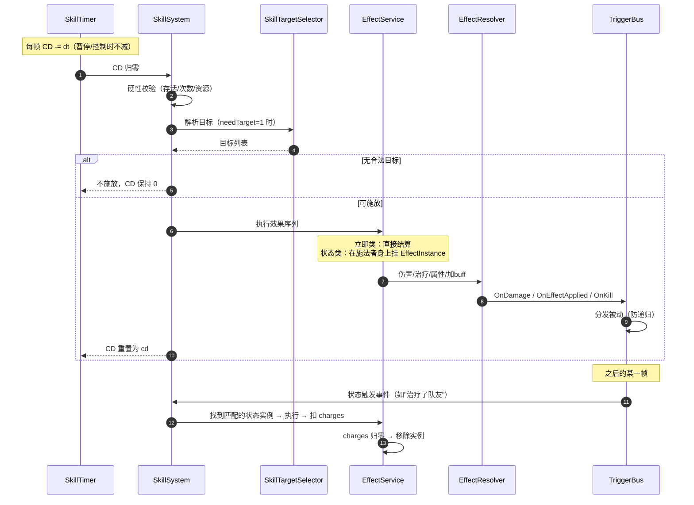

# 技能系统实现计划（自动战斗 · CD 触发 · 一维战场）

> 状态：**规划稿，未开始实现**
> 版本：**v2.3**（v2.2 的 MVC 对齐 + 本轮全部决策落地：CD 触发/状态机制/技能改写/敌人技能表）
> 依据：`策划文档/4-角色培养系统`（主动技能释放时机、被动技能影响作战风格）、`8-战斗系统`（伤害效果与释放顺序）、`Docs/系统制作规范.md`、现有 `skill/talent/buff` 表与 `RoleSystem`。
> 配套文档：`Docs/战斗系统实现计划.md`（战斗框架、状态机、指令、一维战场）。

---

## 0. 本版变更

### 0.1 相对 v1 的变化

| 维度 | v1（上一版计划） | v2（本版） |
|---|---|---|
| 谁决定放技能 | 玩家点技能按钮 | **CD 到点自动施放**（由技能计时器驱动，玩家不能手动放） |
| 目标怎么选 | 玩家点目标 | 由**状态命中**决定（例：下一次治疗的那个队友），无状态时按规则补选 |
| 技能的"CD"意义 | 玩家节奏控制 | **技能的施放节拍**：CD 一到就放，与行动条无关 |
| 技能效果 | 立刻结算 | 常以**"存在自身身上的状态"**形式暂存，满足条件才消耗（§1.2） |
| 被动技能 | 事件触发的效果集合 | **作战风格（AI 权重）+ 事件效果 + 属性修正** 三类能力块 |
| 战场 | 六边形瓦片 | **一维直线**，距离/前后排是真实概念 |
| 玩家参与 | 选技能、选目标 | 只能通过**指令**间接影响（集火/保持距离/优先治疗…） |
| 保留 | 作用域（Scope）、effect 原子效果层、EffectInstance 生命周期、天赋触发器总线 | 全部保留，只是接入口从"玩家"换成"技能计时器 + UnitBrain" |

### 0.2 必须先解决的建模问题：天赋 = 被动技能吗？

现在代码里有**两套**"被动"：

| 位置 | 字段 | 指向 |
|---|---|---|
| `RoleRecord.m_TalentId` | 天赋ID | `talent.xlsx`（表注释写"天赋配置表（**角色被动技能**）"） |
| `RoleRecord.m_PassiveSkillId` | 被动技能ID | `skill.xlsx`（表注释写"技能配置表（**角色主动技能**）"，但字段名是 passive） |

而 `RoleSnapshot` 同时暴露 `m_Talent`、`m_ActiveSkill`、`m_PassiveSkill` 三个对象；UI 上 `RoleInfoCom` 只显示"主动技能"和"被动天赋"两行。

**结论**：一个角色只有 **1 个主动 + 1 个被动**（文档 4），所以：

- `skill.xlsx` = 主动技能
- `talent.xlsx` = 被动技能（天赋就是被动，不需要两张表）
- `RoleRecord.m_PassiveSkillId` **废弃**，`RoleSnapshot.m_PassiveSkill` 删除

这不是洁癖问题：两套并存，策划会不知道该把被动配在哪张表，代码也会出现"天赋生效但被动技能不生效"的诡异 bug。**已拍板按合并处理（天赋 = 被动技能），列为 S1a 的清理项。**

---

## 1. 技能在新战斗中的定位

### 1.1 一个角色身上的三类东西

```
角色
├─ 主动技能（skill.xlsx）  1 条：CD 到点自动施放，效果常以"自身状态"形式暂存
├─ 被动技能（talent.xlsx） 1 条：影响作战风格 / 事件触发效果 / 属性修正
└─ 装备特效（equip/medal → effect）若干：常驻或条件触发
```

天赋（`m_TalentId`）与被动技能是同一个东西，合并到 `talent.xlsx`。

### 1.2 主动技能 = "CD 到点就放，把效果存成状态"

文档 4 说"释放时机由条件触发"，你的口径是：**CD 刷新立刻施放，施放后在自己身上存一个技能状态，状态按条件执行、执行后消耗**，CD 与状态消耗独立运行。

这两句其实是一回事——**条件从"技能"挪到了"状态"上**：

| 要素 | 说明 | 例子（30010 苦口药剂） |
|---|---|---|
| 施放触发 | **CD 到点**，自动施放，不需要条件 | 每 10 秒 |
| 施放时做什么 | 通常给施法者挂一个**待触发状态**（也可直接结算，如 30013 全体烧伤） | 挂【苦口药剂】：下一次用医疗品 +10% |
| 状态的触发条件 | 由 `effect` 的条件字段决定 | 使用医疗品治疗队友 |
| 状态的消耗 | `charges` 次数 / 时长 / 触发后移除 | 消耗一次即移除 |
| CD | **施放瞬间开始计时**，与状态是否消耗完无关 | 10 秒后再次施放，可叠加/刷新状态 |

文档 4 的原文例子（"队友 HP<20% 时治疗他"）现在这样落地：

```
CD 到 → 施放：给自己挂状态"下次有队友 HP<20% 时治疗他"（charges=1）
      → CD 立刻重新计时
      → 某帧有队友掉到 20% 以下 → 状态触发 → 治疗 → 状态消耗移除
```

好处：**CD 与条件解耦**。CD 决定"多久能给一次机会"，状态决定"这次机会什么时候兑现"，两者互不阻塞。

### 1.3 被动技能 = 作战风格 + 事件效果

文档 4 的例子：

> 当角色处于**后排位置**时，会**优先使用医疗消耗品**对队友展开治疗，被治疗的角色在 5 秒内受到攻击时，**仅此一次**生命值降低减少 20%。

一条被动里同时塞了三类东西：

1. **条件**：处于后排位置
2. **决策修正**：优先使用医疗消耗品（改 AI 权重）
3. **触发效果**：被治疗者获得"一次减伤"，持续 5 秒

因此 `talent.xlsx` 不能只有"触发器 + 效果"，必须有**决策参数**（详见 §3），且**全部表驱动**（已拍板）。

### 1.4 技能计时与 ATB 的关系

战斗有两个独立的时间轴：

| 时间轴 | 驱动什么 | 满了之后 |
|---|---|---|
| **ATB 行动条** | 普通攻击 / 换弹 / 道具 / 移动 | `UnitBrain.Think()` 选一个行动 |
| **技能 CD** | 主动技能 | **立即施放**，不等行动条 |

规则：

1. **技能不占行动条**：CD 到点即施放，施放完继续按武器间隔攒下一次普攻。
2. **技能会打断当前行动**：CD 到点时，正在进行的移动/普攻前摇会被打断，转入 `CastSkill`；施法结束行动条归零。
3. **同帧冲突时技能优先**：如果某帧技能 CD 到点、行动条也满了 → 先放技能，这次行动作废，不出现"技能 + 普攻"二连。
4. **前摇期间不能普攻**：`CastSkill` 状态内行动条暂停累积。
5. **控制的单位 CD 也停**：`Controlled`/`Downed` 时技能计时暂停（与行动条一致）。
6. **CD 不跨战斗**：每场战斗开始时所有技能 CD 归零（已拍板）。

---

## 2. 主动技能模型

### 2.1 施放触发：CD 到点

技能由**独立 CD 计时器**驱动，CD 归零即施放，不需要"条件满足"。施放前只做**硬性校验**（不是条件，是"能不能放"）：

| 校验 | 不通过时 |
|---|---|
| 施法者未死亡、未重伤、未被控制 | 本次不施放，CD **保持 0**，下一帧重试 |
| `useLimit` 未达上限 | 本场不再施放 |
| 需要目标时有合法目标（`targetRelation` 能选出至少 1 个） | 本次不施放，CD 保持 0，下一帧重试 |
| 资源足够（补给品/弹药/道具） | 本次不施放，CD 保持 0 |

所以 `skill.xlsx` 里**不再有** `triggerCondition`，只需要一个 `needTarget`（1 需要 / 0 不需要）。条件全部下沉到"状态"和"效果"上（§2.3）。

### 2.2 施放效果：立即结算 or 存成状态

| 形态 | 说明 | 例子 |
|---|---|---|
| **立即结算** | 施放时直接对目标执行效果 | 30013 敌方全体烧伤；30012 范围内队友加攻 |
| **存成状态** | 在施法者身上挂一个"技能状态"，条件满足时才执行并消耗 | 30010 苦口药剂；30011 危机感知；30004 炽热刀刃 |

"存状态"是本轮确定的核心机制：**CD 决定"多久给一次机会"，状态决定"这次机会什么时候兑现"**，两者互不阻塞。

用配置表达就是一条 `effect`：

```
type        = addBuff / skillState
condition   = 状态触发条件（§2.3）
charges     = 消耗次数（通常 1）
duration    = 兜底时长（超时未消耗则失效，0 = 永久直到消耗）
```

### 2.3 状态触发条件（`effect.stateTrigger`）

第一版用**枚举 + 参数**，不做表达式引擎：

| ID | 条件 | 参数 | 典型用法 |
|---|---|---|---|
| 0 | 立即 | — | 直接结算类 |
| 1 | 下一次造成伤害 | — | 附魔、强化下一击 |
| 2 | 下一次治疗队友 | — | 苦口药剂（+10% 治疗） |
| 3 | 受到伤害 | — | 肾上腺素、灵活身段 |
| 4 | 闪避成功 | — | 危机感知（闪避一次后消失） |
| 5 | 击杀目标 | — | 连杀类 |
| 6 | 自身 HP% < X | X | 低血触发 |
| 7 | 队伍中有人 HP% < X | X | 文档 4 的例子 |
| 8 | 使用道具 | itemType | 医疗品/投掷物 |
| 9 | 敌人进入距离 X | X | 反制 |
| 10 | 自身弹药为 0 | — | 换弹相关 |
| 11 | 自身处于第 N 排 | N | 站位相关 |
| 12 | 开局 N 秒内 | N | 开场一次性 |

一条状态可配多个条件 → `conditionLogic`（1=全部满足 / 2=任一满足）。

### 2.4 目标

明确**两段式**：

```
施放段：技能本身的目标（立即结算类用）
状态段：状态触发时的目标（存状态类用）
```

| 情况 | 例子 | 目标来自 |
|---|---|---|
| 立即结算 + 技能指定 | 30013 敌方全体 | `skill.targetRelation/targetShape` |
| 立即结算 + 范围 | 30012 半径 5 米内队友 | `skill.radius` + 形状 |
| 存状态 + 事件命中 | 苦口药剂：下一次治疗的那个队友 | 状态触发事件的**当事人** |
| 存状态 + 自身 | 危机感知 | 施法者自己 |

目标关系仍需支持**自己 / 队友 / 敌人 / 召唤物 / 中立**五类。一维战场下的选取规则见 §4。

### 2.5 冷却与抢占

| 参数 | 说明 | 建议默认 |
|---|---|---|
| `cd` | 冷却（秒），**从施放开始计时**（已拍板） | 10~20 |
| `castTime` | 前摇（秒），期间不普攻 | 0.3~1.0 |
| `useLimit` | 每场最多释放次数 | 0（不限） |
| `interruptible` | 前摇是否可被打断 | false（v1 不做打断） |
| `priority` | 多个技能同时到点时的优先级（敌人用） | 0 |
| `aiWeight` | 同优先级时的权重 | 100 |
| `needTarget` | 是否必须有合法目标才放 | 1 |

**行动条处理**：施放立即把行动条归零（同帧与普攻冲突时技能优先，行动条行动让位），避免"技能 + 普攻"二连。

### 2.6 释放与状态消耗时序



---

## 3. 被动模型（天赋）

### 3.1 三类能力块

一条天赋可以只配其中一类，也可以组合：

| 类型 | 作用 | 配置载体 | 例子 |
|---|---|---|---|
| **决策型** | 改 AI 的行动评分/目标偏好/站位倾向 | `talent.aiProfile` + 复用 `behaviorLogic` 字段 | 文档 4 的"后排优先用药" |
| **触发型** | 事件发生 → 施加效果 | `talent.triggerEvents + effectIDs` | 20002 愣头青（进场获得效果） |
| **修正型** | 常驻修改属性/免疫/时长 | `talent.effectIDs`（scope 绑定）+ `immunityBuffIDs` | 20007 枪械师（免疫某效果） |

文档 4 的例子就是"决策型 + 触发型"组合：条件（后排）+ 决策（优先用药）+ 触发（治疗目标获得一次减伤）。

### 3.2 决策型参数（`aiProfile`）

不复用一整张新表，直接在 `talent.xlsx` 上开列：

| 列 | 说明 |
|---|---|
| `aiPreferRange` | 期望作战距离（覆盖武器射程偏好） |
| `aiKeepDistance` | 是否主动风筝 |
| `aiTargetPriority` | 目标优先级（最低血/最近/最高威胁/后排） |
| `aiHealWeight` | 治疗行为权重加成（+50 = 更爱奶） |
| `aiItemWeight` | 道具使用权重加成 |
| `aiSkillWeight` | 技能权重加成 |
| `aiRetreatHpPercent` | 撤退血量阈值（覆盖默认） |
| `aiCondition` | 决策生效条件（1 总是 / 2 在后排 / 3 在前排 / 4 HP<X） |

### 3.3 触发型（TriggerBus）

| 事件 | 何时发 | 谁会用 |
|---|---|---|
| `EnterExplore` / `ExitExplore` | 进/出异常区域 | 20006、20009 |
| `EnterNode` | 进入新节点 | 20006 |
| `EnterBattle` / `ExitBattle` | 进/出战斗 | 20002、20010 |
| `BattleStart` | 倒计时结束 | 开场类 |
| `OnDamaged` / `OnHit` / `OnKill` | 战斗内 | 20001、30005、30009 |
| `OnDodge` | **闪避成功**（新增） | 30011 危机感知 |
| `OnHeal` | **治疗了队友**（新增） | 30010 苦口药剂、20003 |
| `OnItemUsed` | 使用道具 | 20003、20004 |
| `OnHpBelow` | 血量跨过阈值（只触发一次） | 30005 |
| `OnEffectApplied` / `OnEffectRemoved` | 效果挂上/移除 | 20001、20005 |
| `OnSkillCast` | 释放技能 | 被动联动 |
| `OnAllyDowned` | 队友重伤 | 决策型被动 |

> `OnDodge` / `OnHeal` 是这一版新增的，因为"闪避一次后消失""下一次治疗 +10%"这两类状态必须靠它们命中；没有事件，`addState` 的 `stateTrigger` 就无处兑现。

**防递归**：深度上限 8，同一次事件链内同一天赋只触发一次。

### 3.4 修正型

- `immunityBuffIDs`：施加效果前查表，命中就拒绝（枪械师/格斗家）。
- `durationOverride`：改写被施加效果的时长（老练猎手把恐惧改成 0.1s）。
- `attrMod`：常驻属性修正（随 scope 生效/失效）。

### 3.5 作用域（v1 的铁律，保留）

| Scope | 开 | 关 | 影响的例子 |
|---|---|---|---|
| `Battle` | 进战斗 | 退出战斗 | 20002 进场获得【跃跃欲试】 |
| `Explore` | 进异常区域 | 离开区域/任务结束 | 20006 感知 +10%、20009 生命上限 −5% |
| `Persistent` | 结算写回 | 治疗/恢复 | 伤残、瘫痪 |

关域 = 该域内所有效果实例一次性移除，**不依赖逐个倒计时**。

---

## 4. 目标系统（一维特化）

### 4.1 关系

```csharp
[Flags] enum TargetRelation { Self=1, Ally=2, Enemy=4, Summon=8, Neutral=16 }
```

| 关系 | 判定 |
|---|---|
| `Self` | 施法者 |
| `Ally` | 同阵营，含自己与否由 `includeSelf` 控制 |
| `Enemy` | 敌对阵营 |
| `Summon` | 召唤物（归属召唤者阵营，但可被单独选中） |
| `Neutral` | 中立单位（对双方都不是敌人） |

### 4.2 形状

| 形状 | 一维实现 |
|---|---|
| 单体 | 选 1 个 |
| 自身 | 就是施法者 |
| 多目标 | 选 N 个（按优先级） |
| 范围 | `[target.pos - radius, target.pos + radius]` 内的合法单位 |
| 全体 | 某阵营全部 |

### 4.3 优先级（一维特化）

| ID | 规则 | 实现 |
|---|---|---|
| 1 | 最近 | `min(|pos - target.pos|)` |
| 2 | 最远 | `max(...)` |
| 3 | 血量最低 | `min(hp)` |
| 4 | 血量最高 | `max(hp)` |
| 5 | 威胁最高 | 仇恨值 / 伤害贡献 |
| 6 | **最前**（最靠近敌方） | 阵营内 `pos` 最大/最小 |
| 7 | **最后**（最远离敌方） | 同上反向 |
| 8 | 随机 | 带种子可复现 |
| 9 | **被集火目标** | 读取 `BattleCommandService` 的当前集火目标 |

**后排/前排**在一维里就是"阵营内按 pos 排序的名次"，被动里"当角色处于后排"查的就是这个名次。

### 4.4 目标过滤

| 过滤 | 说明 |
|---|---|
| `includeDead` | 能否选中死亡单位（复活类技能） |
| `includeUntargetable` | 光学迷彩这类"不可被选中" |
| `onlySummon` | 只选召唤物 |
| `excludeSelf` | 排除自己（治疗他人） |

---

## 5. 效果与状态

### 5.1 `effect.xlsx` 类型（v1 沿用 + 扩展）

| 类型 | 用途 | 新增字段 |
|---|---|---|
| `damage` | 伤害 | `canCrit` / `ignoreDef` / `damageType` |
| `heal` | 治疗 | `healType` |
| `attrMod` | 属性修正 | `attrID` / `valueType` / `value` |
| `addBuff` / `removeBuff` | 施加/移除状态 | `buffID` / `stacks` |
| `addState` | **技能状态**（挂在施法者身上，条件满足才执行） | `stateTrigger` / `conditionParam` / `conditionLogic` / `charges` |
| `aggro` | 仇恨 | — |
| `move` | 位移 | **`moveDistance`（一维：正=朝敌，负=朝己）** |
| `summon` | 召唤 | `summonUnitId` |
| `flag` | 状态标记 | `flagID`（不可选中/免控/无法移动/无法攻击） |
| `modifyDuration` | 改写时长 | — |
| `addItem` | 给道具/补给品 | `itemID` / `count` |
| `reload` | 立刻换弹（新） | — |
| `clearAmmo` | 清空弹匣（新） | — |

> `addState` 是本轮新增的关键类型：**技能状态**是一个不会自动过期的 `EffectInstance`，靠 `stateTrigger` 命中事件后执行并扣 `charges`。它和 `addBuff` 的区别是——`buff` 是"挂在身上的持续修正"，`state` 是"等一个时机的一次性执行"。

### 5.2 一维位移

`move` 在一维上就是 `pos += moveDistance`（正方向朝敌）。要处理：

| 情况 | 规则 |
|---|---|
| 位移会出界 | clamp 到 `[0, L]` |
| "穿到敌方后排"（30002） | `moveDistance` 语义改为 `moveToRelation`（移动到指定关系单位的另一侧） |
| 被击退撞到边界 | 停止，不额外伤害 |

### 5.3 控制标记与状态机

| flag | 对 `UnitBrain` 的影响 |
|---|---|
| `untargetable` | 不能被选为目标，也不被范围效果命中 |
| `noMove` | 禁止 `Move/Retreat` |
| `noAttack` | 禁止 `Attack/CastSkill` |
| `noAction` | 强制 `Controlled` |
| `berserk` | 目标可为任意阵营 |

这几条直接对应文档 8 的骨折（5 层→无法移动）、眩晕（5 层→无法攻击）、瘫痪（无法移动+无法使用装备）。

### 5.4 效果实例（沿用 v1）

`EffectInstance` 依旧需要：层数、剩余时长、次数（charges）、来源（skill/talent/equip/item）、作用域、参数覆盖。

---

## 6. 行动模型：技能 / 普攻 / 道具 / 换弹 怎么排队

**技能不进行动队列**（已拍板）：

```
技能计时器（独立）：CD 到点 → 硬性校验 → 施放 → CD 重置
ATB 行动条（独立）：满了 → 按下面顺序选一个行动

1. 换弹（弹匣空）        —— 强制，否则后面都没法执行
2. 道具（血量低/被动偏好）—— 次高
3. 普通攻击             —— 兜底
4. 移动                 —— 不在行动条里，是持续行为（见战斗文档 §4.3）
```

- **同一帧两者都就绪**：技能先施放，**这次行动条行动让给技能**（行动条归零），不出现"技能 + 普攻"二连 → 这就是"主动技能优先级高于普通攻击"的落地方式。
- **被动不占任何队列**：事件驱动（受击/击杀/治疗）或常驻修正（属性/免疫），由 `TriggerBus` 直接分发。文档 8 的"主动技能>被动技能>普通攻击"因此是"**生效顺序**"而不是"行动槽竞争"。

---

## 7. 现有 15 技能 / 10 天赋复审

### 7.1 主动技能：在自动战斗下还成立吗？

| ID | 名称 | 原描述要点 | 新战斗下的判定 | 处置 |
|---|---|---|---|---|
| 30001 | 极速突击 | 无目标时靠近并选中敌人；有目标时攻击+2/+3 | 已拍板改写 | **改写为**：快速靠近距离自己最近的敌对目标，攻击力 +2 持续 3 秒 |
| 30002 | 暗影强袭 | 清仇恨 + 穿过敌群到最后排 | 一维可表达为"移动到敌方最远单位身后" + 清仇恨 | 保留（`moveToRelation`） |
| 30003 | 固若金汤 | 生命上限+20；低于新上限 80% 则回满到 80% | 成立 | 保留 |
| 30004 | 炽热刀刃 | 附魔，下次命中叠烧伤 | 成立（`addState` + `stateTrigger=下一次造成伤害` + charges=1） | 保留 |
| 30005 | 肾上腺素 | 低血回 70%，5s 后清空，可致死 | 成立（`stateTrigger=自身HP%<X`） | 保留 |
| 30006 | 灵活身段 | 掉血后 +80 敏捷 1s，向后方移动 | 成立（`stateTrigger=受到伤害` + move 负方向） | 保留 |
| 30007 | 应急补给包 | 恢复 1 份医疗补给品 | 已拍板改写 | **改写为**：自身立即恢复 1 份【医疗补给品】（`addItem`） |
| 30008 | 额外弹匣 | 恢复 1 份弹匣补给品 | 已拍板改写 | **改写为**：自身立即恢复 1 份【弹匣补给品】（`addItem`） |
| 30009 | 杀红眼 | 攻击 + 1×击杀数 | 成立（`valueSource=击杀数`） | 保留 |
| 30010 | 苦口药剂 | 下次用医疗品 +10% | 成立（`addState` + `stateTrigger=下一次治疗队友`） | 保留 |
| 30011 | 危机感知 | 敏捷设 100%，闪避 1 次后消失 | 成立（`setTo` + `stateTrigger=闪避成功` + charges=1） | 保留 |
| 30012 | 振奋人心 | 5 米内队友攻击+3 持续 5s | 成立（一维 radius） | 保留 |
| 30013 | 纵火犯 | 敌方全体 1 层烧伤 | 成立 | 保留 |
| 30014 | 光学迷彩 | 清仇恨 + 3s 不可选中 | 成立（flag untargetable） | 保留 |
| 30015 | 战斗兴奋剂 | 回 20% 血 + 攻击+1 + 敏捷+20% 3s | 成立 | 保留 |

**结论**：15 个里 12 个可用，3 个按你的口径改写（30001 / 30007 / 30008），改写后全部可配。

> 30007 / 30008 依赖"战斗内补给品"：角色自身携带、战前由机械骡分配（战斗文档 §2.3）。补给品本身是 `item.xlsx` 的一行，`addItem` 直接往 `m_CarriedItems` 里加。

### 7.2 被动天赋：需要补"决策型"参数

| ID | 名称 | 原效果 | 新模型下缺什么 |
|---|---|---|---|
| 20001 | 老练猎手 | 恐惧/混乱时长→0.1s + 获得沉着 5s | 触发型，字段够 |
| 20002 | 愣头青 | 进场获得【跃跃欲试】 | 触发型，够 |
| 20003 | 战地医师 | 对他人用医疗品 +10%，目标获伤愈 10s | 触发型 + 需要 `OnItemUsed` 与治疗量修正 |
| 20004 | 后勤官 | 对他人用补给，自身获 50% 回复量 | 需要"按实际治疗量百分比"的 valueSource |
| 20005 | 精英战斗员 | 眩晕→0.1s + 兴奋 5s | 触发型，够 |
| 20006 | 熟练调查员 | 进区域感知+10%，每进新节点再+2% | 需要 Explore scope + 节点事件 + 累加 |
| 20007 | 枪械师 | 免疫【跃跃欲试】 | `immunityBuffIDs` |
| 20008 | 格斗家 | 免疫【兴奋】 | 同上 |
| 20009 | 路过的普通人 | 进区域生命上限−5%，结束恢复 | Explore scope + 上限回滚 + HP 裁剪规则 |
| 20010 | 胆小鬼 | 进战斗获得【沮丧】 | 触发型，够 |

**缺的一类**：文档 4 说的"影响作战风格"（站位偏好、优先用什么道具、优先打谁）在现有 10 条天赋里**一条都没有**。这不是数据问题，是模型缺口 —— 必须补 `aiProfile` 那组列（§3.2），否则"被动影响作战风格"这句设计就是空的。

> **关于 20008**：你的回复写的是"20008 修改为：自身立即恢复 1 份【弹匣补给品】"，但 20008 现在是天赋【格斗家：免疫兴奋】，而"恢复弹匣"正是 30008【额外弹匣】的描述。我按**笔误**处理：把改写落在 **30008**，20008 保留"免疫【兴奋】"。如果确实要改 20008，告诉我一声，改一行即可（天赋也能配 `addItem`，只是它会变成一条"进场给弹匣"的被动）。

---

## 8. 配置表变化（相对 v1 的增量）

### 8.1 总览

| 表 | v1 计划 | v2 增量 |
|---|---|---|
| `__enums__.xlsx` | 10 个枚举 | **+4**：`StateTriggerCondition`、`ConditionLogic`、`SkillNeedTarget`、`EffectType` |
| `skill.xlsx` | +14 列（目标/形状/施法） | **+5 列**（`needTarget`、`aiWeight`、`priority`、`interruptible`、`resetActionTimer`）；**删掉** `triggerCondition` 系列（条件下沉到状态） |
| `talent.xlsx` | +11 列（触发器/免疫/作用域） | **+9 列**（aiProfile 决策参数）+ 类型字段 |
| `skill_effect.xlsx` | 新建 | 不变（字段够用） |
| `effect.xlsx` | 新建 | **+9 列**（`moveDistance`、`moveToRelation`、`damageType`、`healType`、`summonUnitId`、`reload`、`stateTrigger`、`stateConditionParam`、`stateConditionLogic`） |
| `buff.xlsx` | +8 列 | **+3 列**（controlFlags、affectAi、aiOverride） |
| **`skill_enemy.xlsx`** | 不存在 | **新建**：敌人技能独立表（已拍板，不复用 `skill`） |
| `role.xlsx` | +7 行战斗属性 | **撤销**（文档 4 只有 5 条属性，命中/闪避是派生值，不建行；只补 SAN） |

> v1 里"给 role.xlsx 加命中/闪避/暴击"的建议**作废**。文档 4 明确只有生命/攻击/敏捷/感知/SAN 五条，命中和闪避都是派生。

### 8.2 `skill.xlsx` 新增列（在 v1 基础上）

| ##var | ##type | 说明 |
|---|---|---|
| `needTarget` | bool | 施放是否必须有合法目标（1 是 / 0 否）。**没有条件列了**，条件在状态/效果上 |
| `aiWeight` | int | 同优先级技能的权重 |
| `priority` | int | 释放优先级（敌人多技能时用） |
| `interruptible` | bool | 前摇是否可打断 |
| `resetActionTimer` | bool | 释放后是否重置行动条（默认 true） |

v1 已列的（`category / targetRelation / targetShape / targetCount / range / radius / targetFilter / castTime / useLimit / cdGroup / cost* / anim / fx / sound / descParams`）继续保留；`priority` 挪到上面新增列里统一说明。

> **实际落地（2026-11-09）**：`skill.xlsx` 已按策划的表头落地为 **`target`**（`(list#sep=,),GameType.SkillTarget`，可选：不选定/自身/敌人/队友/中立/召唤物）与 **`scope`**（`(list#sep=,),GameType.SkillScope`：不指定/单体/群体）两列，`effect` 列也保留在技能行上。
> 本文 §2.4 / §4 里的 `targetRelation`、`targetShape` 视为同一语义的旧命名，**接入代码时以表为准**；`skill_effect.xlsx` 暂不启用（已建表但无数据），效果先用 `skill.effect` 列。

**删掉** v1 里的 `cdStart`：已拍板 CD 从**施放瞬间**开始计，不再是二选一。

### 8.3 `talent.xlsx` 新增列

在 v1 的 `scope/triggerEvents/triggerParams/triggerCondition/effectIDs/immunityBuffIDs/durationOverride/maxTriggers/triggerCd/triggerChance/stackMode` 基础上，**再加**：

| ##var | ##type | 说明 |
|---|---|---|
| `talentType` | int | 位标记：1 决策型 2 触发型 4 修正型（可组合） |
| `aiPreferRange` | float | 期望作战距离 |
| `aiKeepDistance` | bool | 是否风筝 |
| `aiTargetPriority` | int | 目标偏好 |
| `aiHealWeight` | int | 治疗权重加成（+50 = 更爱奶） |
| `aiItemWeight` | int | 道具权重加成 |
| `aiSkillWeight` | int | 技能权重加成 |
| `aiRetreatHpPercent` | int | 撤退血量阈值 |
| `aiCondition` | int | 决策生效条件（1 总是 2 后排 3 前排 4 HP<X） |

### 8.4 `skill_effect.xlsx`（新建，字段与 v1 一致）

`ID / skillID / effectID / order / group / conditionType / conditionParam / targetOverride / delay / chance / ovValue / ovDuration / ovStacks`

> 30001 这类"分条件给不同效果"就靠 `group + conditionType` 表达。

### 8.5 `effect.xlsx`（新建，v1 基础上扩展）

v1 字段：`ID / type / attrID / valueType / value / valueSource / valueSourceParam / buffID / stacks / duration / durationType / charges / tickInterval / tickEffectID / chance / canCrit / ignoreDef / stackPolicy / dispelType / flagID / desc`

v2 新增：

| ##var | ##type | 说明 |
|---|---|---|
| `moveDistance` | float | 一维位移量（正=朝敌，负=朝己） |
| `moveToRelation` | int | 0 无 / 1 最近敌人 / 8 敌方最后排（30002 用） |
| `damageType` | int | 1 物理 2 道具 3 异常（对应烧伤"受到道具伤害"） |
| `healType` | int | 1 药物 2 技能 3 其他 |
| `summonUnitId` | int | 召唤物 ID |
| `reload` | bool | 立刻装满弹匣 |
| `stateTrigger` | int | **技能状态触发条件**（§2.3 的 0~12），`type=addState` 时必填 |
| `stateConditionParam` | int | 状态条件参数（阈值 / itemType / buffID） |
| `stateConditionLogic` | int | 1 全部满足 / 2 任一满足 |

> `addState` 的 `duration` 语义和普通效果不同：`0` = **永久直到消耗**（典型用法），`>0` = 超时失效，`-1` = 跟随作用域。

### 8.6 `buff.xlsx`（v1 基础上）

v1：`effectIDs / duration / stackPolicy / dispelType / isPersistent / triggerEffectID / priority` + 补 `icon`

v2 新增：

| ##var | ##type | 说明 |
|---|---|---|
| `controlFlags` | int | 位标记：1 不可选中 2 禁止移动 3 禁止攻击 4 禁止行动 5 癫狂 |
| `affectAi` | bool | 是否影响 AI（如【沮丧】让角色倾向撤退） |
| `aiOverride` | int | 携带此效果时的行为逻辑覆盖 |

> 现有 20 条 buff 里，【眩晕】【瘫痪】【恐惧】【混乱】【沮丧】都直接改行为，需要 `controlFlags` 或 `aiOverride` 才落得下去。

### 8.7 与战斗文档表的交叉

| 本表 | 引用 | 方向 |
|---|---|---|
| `effect.stateTrigger` | `combatConst` 的阈值 | 状态触发读常量 |
| `talent.aiProfile` | `behaviorLogic` 同名字段 | 天赋覆盖行为逻辑 |
| `effect.moveToRelation` | `BattleField` 的排序 | 效果读战场 |
| `skill_enemy.effectID` | `effect.id` | 两个技能表共用效果层 |
| `encounter.enemySkills` | `skill_enemy.id` | 敌人走独立技能表（§8.9） |

### 8.8 枚举：配置表 vs 代码

与战斗文档 §9.4 同一规则：**策划要填的进 `__enums__.xlsx`，纯运行时的放 `Skill/Define/SkillDefine.cs`**。

| 用途 | 枚举 | 放哪 |
|---|---|---|
| 策划填表 | `StateTriggerCondition`（§2.3 的 0~12）、`ConditionLogic`（all/any）、`EffectType`、`StackPolicy`、`DurationType`、`DispelType`、`TargetRelation`、`TargetShape`、`TargetPriority`、`SkillNeedTarget` | `__enums__.xlsx` → `cfg.GameType.*` |
| 代码内部 | `TalentType`（flags：decision/trigger/modifier）、`EffectSource`、`ScopeType`（Battle/Explore/Persistent）、`SkillCastResult`、`SkillDenyReason` | `Skill/Define/SkillDefine.cs` |

> `MoveDirection` 不需要单独枚举：`effect.moveDistance` 用带符号 `float` 表达（正=朝敌、负=朝己）。
> `SkillDenyReason` 用于调试日志与 UI 提示（无目标 / 次数用完 / 资源不足 / 正在控制），必须枚举化，"为什么没放"要能一眼看出来。

### 8.9 `skill_enemy.xlsx`（新建，敌人技能专用）

已拍板：**敌人不走 `skill.xlsx`**。原因是玩家的技能表带着图标、描述、解锁这些"养成向"字段，而敌人技能只需要"AI 行为 + 数值"，混在一起会让表越来越脏。

| ##var | ##type | 说明 |
|---|---|---|
| `ID` | int | 敌人技能ID（建议段 90001-99999） |
| `name` | string | 内部名（不上 UI） |
| `cd` | float | 冷却（秒），从施放开始计 |
| `castTime` | float | 前摇 |
| `priority` | int | 同 CD 到点时的优先级（高者先放） |
| `aiWeight` | int | 同优先级时的随机权重 |
| `needTarget` | bool | 是否必须有目标 |
| `targetRelation` | int | 目标关系（位标记，同玩家技能） |
| `targetShape` | int | 单体/多目标/范围/全体 |
| `targetCount` | int | 多目标数量 |
| `range` | float | 施法距离（米） |
| `radius` | float | 范围半径（米） |
| `targetPriority` | int | 目标优先级 |
| `*effects` | (list#sep=,),int | 效果 ID 列表（`order` 用列表顺序） |
| `useLimit` | int | 每场次数上限 |
| `interruptible` | bool | 前摇能否被打断 |
| `desc` | string | 策划备注 |

与 `skill.xlsx` 的关系：

- **共享** `effect.xlsx`（同一个效果层），不共享行；
- **不共享** ID 段（90001 起，避免与 30001-39999 冲突）；
- 敌人可以有多个技能（`encounter` 里按 `enemyID` 关联，或直接在 `enemy.xlsx` 的 `skills` 列填 `skill_enemy` 的 ID）；
- 敌人技能**不需要** `icon/name/desc` 的玩家向文案，也**不需要** `useLimit` 之外的养成字段。

---

## 9. 模块与接口（按《系统制作规范》）

### 9.0 规范映射

> 规范：`Docs/系统制作规范.md`（2026-11-09 生效）。冲突以规范为准。

| 规范条款 | 要求 | 本计划落点 |
|---|---|---|
| §1.1 | 一个业务域一个系统、一个主模型 `<System>System` | `SkillSystem : ModelBase` |
| §1.3 | 一个 Data + 一个 Event 辅助模块 | `SkillData : SystemDataBase`、`SkillEvent` + `SkillMessage` |
| §3.1 | 目录 `Model / Data / Event / Define / View / Component / Debug` | §9.1（本期无独立界面，`View/`、`Component/`、`ViewData` 暂缺） |
| §3.3 | 命名：`XxxEvent`、`XxxViewData`、`Logic/` 不再新增 | `SkillEvent`，无 `Logic/` |
| §4.1 | `OnInit / OnStart / OnDestroy` 生命周期 | §9.5 |
| §4.3 | `ModelManager.LoadModels()` 注册，业务用 `Game.Model.Get<T>()` | §9.5 / §9.3 |
| §4.4 | Model 不引用 FairyGUI/UIWindow/场景对象；禁止 static 存运行时状态 | 技能模型只管规则与效果实例，表现由战斗/角色 View 出 |
| §4.5 | 纯函数允许 static | `SkillRule`（配置查询、免疫表查询、时长改写） |
| §5.3 | Data 写方法 `internal` | `SkillData` |
| §6.1 | 事件名只许常量 | `SkillEvent.OnSkillCast` 等 |

### 9.1 目录

```
Game/Skill/
├─ Model/
│  ├─ SkillSystem.cs          # ModelBase 主模型：唯一对外入口
│  ├─ SkillTriggerChecker.cs  # 触发条件判定
│  ├─ SkillTargetSelector.cs  # 目标解析（一维）
│  ├─ SkillCastFlow.cs        # 释放流程
│  ├─ EffectService.cs        # 效果实例：施加/叠层/到期/按来源清理
│  ├─ EffectResolver.cs       # 原子效果执行
│  ├─ TalentService.cs        # 被动：决策修正 + 触发 + 修正
│  ├─ TriggerBus.cs           # 事件路由（防递归）
│  └─ SkillRule.cs            # static 纯函数：配置查询、免疫/时长改写、公式
├─ Data/
│  ├─ SkillData.cs            # SystemDataBase 空壳：先占 skill.json，预留装配/等级（§9.6）
│  ├─ EffectInstance.cs       # 运行时值对象（不落盘）
│  └─ TalentState.cs          # 运行时值对象（不落盘）
├─ Event/
│  ├─ SkillEvent.cs
│  └─ SkillMessage.cs
├─ Define/
│  └─ SkillDefine.cs          # 枚举、ID 段、优先级常量
└─ Debug/
   └─ SkillDebug.cs           # 整文件 #if UNITY_EDITOR
```

> 本期技能**没有独立 FairyGUI 包**（技能条在 `Battle/Component`，技能详情在 `Role/Component`），所以不建 `View/`、`Component/` 与 `ViewData`。将来做技能图鉴时再按规范 §9 第 8、9 步补。

### 9.2 类清单与职责

| 类 | 类型 | 职责 | 是否注册 |
|---|---|---|---|
| `SkillSystem` | `ModelBase` | 唯一对外入口：`TryAutoCast` / `CanCast` / `ApplyAiProfile` / `ModifyAttr` / `IsImmune` / 作用域开合 | `ModelManager` |
| `SkillTriggerChecker` | 普通类 | 硬性校验（存活/次数/资源/目标）与状态触发条件判定 | 否 |
| `SkillTargetSelector` | 普通类 | 一维目标选取、过滤、优先级 | 否 |
| `SkillCastFlow` | 普通类 | 前摇 → 逐条效果 → （立即结算 or 挂状态）→ 事件 | 否 |
| `EffectService` | 普通类 | 效果/状态实例生命周期（绑在 `BattleUnit` 上） | 否 |
| `EffectResolver` | 普通类 | 单条 `effect` 的执行 | 否 |
| `TalentService` | 普通类 | 三类被动能力块 | 否 |
| `TriggerBus` | 普通类 | 事件分发 + 防递归 | 否 |
| `SkillRule` | `static` | 纯函数：`GetSkill/GetSkillEnemy/GetTalent/GetEffect`、免疫表查询、时长改写 | 否 |
| `SkillData` | `SystemDataBase` | 空壳：只存 `version`，预留技能等级/装配（§9.6） | `DataManager` |
| `EffectInstance` / `TalentState` | 普通 class | 运行时值对象，不落盘 | 否 |
| `SkillDebug` | `static` | 编辑器菜单 | 否 |

### 9.3 与战斗层的接口

技能 CD 由**战斗层 tick**（因为计时属于战斗状态），技能系统只负责"到点了能不能放、放什么"：

```csharp
// BattleSystem 每帧
foreach (BattleUnit kUnit in m_Field.Units)
{
    kUnit.TickSkillCd(dt);                    // CD 在 BattleUnit 上，暂停/控制时不减
    if (kUnit.SkillCd <= 0)
    {
        SkillSystem kSkill = Game.Model.Get<SkillSystem>();
        SkillDenyReason kReason;
        if (kSkill.CanCast(kUnit, out kReason))
        {
            kSkill.Cast(kUnit);               // 内部：选目标 → 立即结算 or 挂状态 → CD 重置为 cd
        }
        // 不能放时 CD 保持 0，下一帧重试（reason 只进调试日志）
    }
}

// 被动补丁（评分前后各一次）
kSkill.ApplyAiProfile(unit, ref kScore);
int   kAtk  = kSkill.ModifyAttr(unit, RoleAttrId.Atk, kAtk);
bool  kImm  = kSkill.IsImmune(unit, buffId);
float kTime = kSkill.ModifyDuration(unit, buffId, kTime);
```

约定：

- `BattleUnit` 定义在 `Battle/Data/`，技能层只读它的公开字段/方法，**不写** `BattleData`；
- 反过来 Battle 也不直接读 `skill/talent/effect` 表，配置查询一律走 `SkillSystem` / `SkillRule`；
- 禁止把 `SkillSystem` 存成 static 字段（规范 §4.4），View 里最多写一个只读属性转发 `Game.Model.Get<SkillSystem>()`；
- **技能不再有 `Evaluate`**：没有"要不要放"的决策，只有"能不能放"的校验。

### 9.4 与探索层的接口

探索域的被动（20006 / 20009）由 `ExploreSystem` 在进入区域/节点时广播 `ExploreEvent`，`SkillSystem` 订阅后挂效果；离开区域时按作用域批量清理。

```
ExploreSystem                 SkillSystem
  EnterZone  ──事件──▶  挂 Explore 域效果（scope=Explore, duration=-1）
  EnterNode  ──事件──▶  累加型效果（+2%）
  ExitZone   ──事件──▶  RemoveByScope(Explore)
```

两个系统只通过事件 + 对方 Model 的公开方法交互，**互相不读 Data**。

### 9.5 生命周期与注册

```csharp
public class SkillSystem : ModelBase
{
    private SkillData DB
    {
        get { return Game.Data.GetGameData<SkillData>(); }
    }

    protected internal override void OnInit()
    {
        Game.Event.Subscribe(ExploreEvent.OnEnterZone, OnEnterZone);
        Game.Event.Subscribe(ExploreEvent.OnEnterNode, OnEnterNode);
        Game.Event.Subscribe(ExploreEvent.OnExitZone, OnExitZone);
    }

    protected internal override void OnStart()
    {
        DB.Load();      // 技能/天赋装配与等级
    }

    protected internal override void OnDestroy()
    {
        Game.Event.UnSubscribe(ExploreEvent.OnEnterZone, OnEnterZone);
        Game.Event.UnSubscribe(ExploreEvent.OnEnterNode, OnEnterNode);
        Game.Event.UnSubscribe(ExploreEvent.OnExitZone, OnExitZone);
        ClearRuntimeEffects();   // 战斗域 + 探索域实例一并清掉
    }
}
```

```csharp
// DataManager.LoadGameData()
RegisterData<SkillData>();

// ModelManager.LoadModels()  —— 无依赖，可最先注册
Register<SkillSystem>();
```

### 9.6 `SkillData` 空壳（本期就建，先占位）

规范要求每个系统有一个 Data。技能/天赋的 **ID** 虽然存在 `RoleData` 的 `RoleRecord` 上，但技能等级、装配、解锁这些数据将来一定要落在技能系统自己身上。所以本期就建一个**能正常读写的空壳**，而不是留一个 `throw new NotImplementedException()`：

```csharp
/// <summary>
/// 技能系统的 Data（本期为空壳）。
/// 现在只存版本号，作用有三个：
///   1. 占住 skill.json，将来加字段不改注册、不改路径；
///   2. 留出读档版本号，后续字段变更时能按版本迁移；
///   3. 守住规范"一个系统一个 Data"的边界，避免以后为了放数据临时拆第二个 Data。
/// </summary>
public class SkillData : SystemDataBase
{
    public const string SaveFileName = "skill.json";
    private const int c_Version = 1;

    private int m_Version = c_Version;

    protected override string GetSaveFileName() { return SaveFileName; }
    protected override string GetLogTag() { return "技能"; }

    public override void Clear()
    {
        m_Version = c_Version;
    }

    protected override string ToJson()
    {
        JSONObject kRoot = new JSONObject();
        kRoot.Add("version", m_Version);
        return kRoot.ToString();
    }

    protected override bool FromJson(string _json)
    {
        JSONNode kRoot = JSON.Parse(_json);
        if (kRoot == null || !kRoot.IsObject)
        {
            return false;       // 坏档：保留现有数据（规范 §5.4）
        }

        m_Version = kRoot["version"] == null ? c_Version : kRoot["version"].AsInt;
        return true;            // 缺字段不算坏档
    }
}
```

落地注意：

- 文件顶部需要 `using SimpleJSON;`（项目已内置，`RoleData` 同款写法）；
- **不要**在这里放 `BattleUnit` / `EffectInstance` 之类的运行时态（规范 §5.3）；
- 写接口现在留空，等 S3/S4 真正要存技能等级时再补 `internal` 方法，不要提前编字段；
- `OnStart` 里 `DB.Load()` 首次读不到文件属正常，日志会打"没有找到存档（新档）"，不算错误。

---

## 10. 分期计划

依赖关系：技能 S1 可以和战斗 P1 并行；技能 S5 必须等战斗 P4/P5。

| 阶段 | 内容 | 验收 | 工期 |
|---|---|---|---|
| **S0 定案** | 本文档决策记录落地；天赋/被动两套模型的清理方案；表字段冻结 | 字段不再变 | 0.5d |
| **S1a 规范骨架** | 建 `Skill/{Model,Data,Event,Define,Debug}`；`SkillSystem : ModelBase`、`SkillData : SystemDataBase` 空壳（只写 version，见 §9.6）；两处注册；删 `GameClass` 里的 `SkillDataClass/TalentDataClass` 与 `RoleRecord.m_PassiveSkillId` | 编译 0 error；控制台出现 `[模型] 注册：SkillSystem`；`skill.json` 生成 | 1d |
| **S1b 配置层** | 枚举 + `skill/talent/buff/effect/skill_effect/skill_enemy` 扩列与新建；Luban 生成；`SkillDebug` 的 `Framework/技能/校验配置` | 校验 0 error；20 条 buff 按新字段填完作样本 | 2.5d |
| **S2 效果内核** | `EffectService` / `EffectResolver` / `EffectInstance`；`addState` 状态挂载与消耗；作用域开合；调试台 | 挂【苦口药剂】→ 治疗一次触发 +10% → 状态消失 | 3.5d |
| **S3 主动技能** | `SkillTriggerChecker`（硬性校验）/ `SkillTargetSelector`（一维）/ `SkillCastFlow`；CD 起算与重置 | CD 到点自动施放、无目标时跳过且 CD 不空转 | 3d |
| **S4 被动** | `TalentService` 三类能力块；`TriggerBus`；免疫/时长改写/aiProfile 决策参数 | 10 条天赋全部生效 | 3d |
| **S5 接入战斗** | `BattleSystem.TickSkillTimers` → `SkillSystem.CanCast/Cast`；指令覆盖（优先治疗/集火）；表现层（技能演出/图标/CD 环） | 自动战斗中技能按 CD 正确释放，与 ATB 不打架 | 3d |
| **S6 打磨** | 15 技能数据、`skill_enemy` 数据、数值联调 | 主观验收 | 2d |

合计约 **18.5 人日**（不含战斗框架本身）。S1a 对应规范 §9 的接入 Checklist，单独验收；S1a 必须先于 S1b，否则表生成了却没有地方放查询接口。

### 10.1 当前进度（滚动更新）

| 阶段 | 状态 | 落地位置 |
|---|---|---|
| S1a 规范骨架 | ✅ | `Skill/{Define,Data,Event,Model,Debug}`；`SkillData : SystemDataBase`（只存 version）；`DataManager`/`ModelManager` 两处注册 |
| S1b 配置层 | ⚠️ 部分 | 表已能生成；`effect.xlsx` 只填了 9 行样本（41001~41009），15 个技能里 6 个接上了 `effect` 列 |
| S2 效果内核 | ✅ | `EffectService` / `EffectResolver` / `EffectInstance`：挂载、叠层、到期、按来源/作用域清理 |
| S3 主动技能 | ✅ | `SkillTriggerChecker`（硬校验）/ `SkillTargetSelector`（一维）/ `SkillCastFlow`；CD 从施放起算、施放清空行动条 |
| S4 被动 | ⏳ 未开始 | `TalentService` / `TriggerBus` / aiProfile 决策参数 |
| S5 接入战斗 | ✅ | `BattleSystem.Tick` → `TickSkills` → `SkillSystem.TickBattle`；`ApplyEffectDamage` / `ApplyEffectHeal` 是技能落地的唯一出口 |
| S6 打磨 | ⏳ | 数值、`skill_enemy` 数据、技能演出 |

**已验证（Play 模式，2026-11-09）**：CD 到点自动施放（30007 每 10 秒 +1 医疗补给品，累积 1→2→3）；`move`（30001 突进 14.26→14.40）；`attrMod` 加算/百分比与到期还原（攻击 2→4→2、敏捷 23→28）；多目标 `addBuff`（30013 给 4 个敌人各挂 1 层烧伤）；`addState` + `onDealDamage` 触发 + payload（30004 挂状态 → 命中 → 给敌人挂烧伤 → `原因：消耗` 移除）；`heal`（30015 65/105 → 86/105）。

### 10.2 落地时定下的三条表约定（改表前先看这里）

1. **效果打谁由类型决定，表里没有 target 列**：
   `attrMod / addState / move / addItem / reload / clearAmmo / flag` 作用在**施法者**；
   `damage / heal / addBuff / removeBuff / aggro / summon` 作用在**技能选中的目标**（没选中则退回施法者）。
   多目标技能（`scope=MultiTarget`）的属性类效果打全体选中目标（30012 振奋人心）。
2. **`addState` 的 payload 复用 `tickEffectID` 列**：表里没有独立的 payload 列，状态触发后要执行的效果ID 填在 `tickEffectID`（41009 → 41005）。
3. **`addItem` 用 `valueSourceParam=itemID`、`value=数量`**：补给品 ID 暂时是代码常量 `SkillConst.SupplyId`（1 医疗 / 2 弹匣），等 supplies 表落地后换成表 ID。

另外两条实现偏离，写在这里免得后面误改：

- **效果实例不放 `BattleUnit`**：`EffectService` 用 unitId 做键持有，避免 `Battle/Data` 反向引用技能域类型；战斗层完全不需要知道"效果"这个概念。
- **`castTime` 暂不实现**：`skill.xlsx` 还没有这一列，施放按即时处理；补列后再把前摇接进 `UnitBrain`。

---

---

## 11. 决策记录（2026-11-09 已拍板）

原本的待确认清单已全部有结论，转为决策记录：

| # | 议题 | 结论 | 影响章节 |
|---|---|---|---|
| 1 | 主动技能能否手动放 | **不能**，全部由角色状态机/计时器判断 | §1.2、§2.1、§9.3 |
| 2 | 技能与普攻的优先级 | 同时可放时**技能优先**；技能不占行动条，同帧冲突时行动条让位 | §1.4、§6、§9.3 |
| 3 | 天赋与被动 | **等价**，合并到 `talent.xlsx`，删 `m_PassiveSkillId` 与 `SkillDataClass/TalentDataClass` | §0.2、§8.3、S1a |
| 4 | 技能改写 | 30001 = 靠近最近敌对目标 + 攻击力 +2 持续 3 秒；30007 = 立即恢复 1 份【医疗补给品】；30008 = 立即恢复 1 份【弹匣补给品】 | §7.1 |
| 5 | 战斗内补给品 | **有**，角色自身携带，战前由机械骡分配 | §7.1、战斗文档 §2.3 |
| 6 | 被动作战风格 | **表驱动**：全部参数进 `talent.aiProfile`，不写死在代码里 | §3.2、§8.3 |
| 7 | 技能 CD | **不跨战斗**，每场重置 | §1.4、§2.5 |
| 8 | 敌人技能 | **不复用 `skill.xlsx`**，新增 `skill_enemy.xlsx` | §8.9 |
| 9 | 系统边界 | `Skill` 独立系统，保留 `SkillData` 空壳 | §9.0、§9.6 |

> 关于 20008 的笔误处理见 §7.2 的提示（按 30008 落地，20008 仍是"免疫兴奋"）。

---

## 12. 风险

| 风险 | 影响 | 对策 |
|---|---|---|
| 主动技能"自动放"后玩家没参与感 | 战斗变看片 | 指令系统 + 技能释放特写演出 + 战报；技能 CD 环是玩家能读的唯一节奏 |
| 状态类技能太自由 | 策划填错导致状态永不触发/一触发就刷 | `SkillDebug` 校验 + 调试台日志（打印"状态为什么没触发/为什么没放"） |
| CD 空转 | 无合法目标时 CD 反复归零，实战胜率崩 | `needTarget` + "无目标不施放、CD 保持 0"的规则；调试日志统计空转次数 |
| 技能与 ATB 抢帧 | 同帧既技能又普攻，出现二连 | 技能先放 → 行动条归零（§1.4 第 2 条） |
| 天赋/被动两套模型不清理 | 数据分裂、bug 难查 | S0 定为 P0 清理项 |
| 一维位移出界 | 单位跑出战场 | 位移一律 clamp，调试台加断言 |
| 决策权重难调 | AI 行为看起来"蠢" | 权重全表配 + 战斗日志导出，先跑数据再调手感 |
| 与战斗文档的表冲突 | 两套字段各说各话 | 本文档 §8.7 明确交叉引用方向 |
| 技能效果塞进 `SkillData` | 存档里出现上一场战斗的临时效果 | 效果实例只挂在 `BattleUnit` / 探索运行时，`SkillData` 不存运行时态（规范 §5.3） |
| 用 static 单例做 `SkillSystem` | 违反规范 §4.4，热重载/多场战斗出错 | 一律 `Game.Model.Get<SkillSystem>()` |
| 技能层直接写 `BattleData` | 绕开战斗模型校验 | 只读 `BattleUnit` 公开成员，写入走 Battle 模型的公开方法 |
| 敌人技能与玩家技能字段漂移 | 效果层不共享，改一处要改两处 | 两张技能表**只共享 `effect`**，表中字段保持同构（§8.9），改字段时同步 |
| 忘记注册 | 运行时报"模型未注册 / 未找到 GameData" | S1a 验收：`[模型] 注册：SkillSystem` |

---

## 附：与 v1 的对应关系

| v1 内容 | v2 状态 |
|---|---|
| 作用域 Scope（Battle/Explore/Persistent） | **保留**，是 v2 的地基 |
| effect 原子效果层 | **保留**并扩展（+位移/换弹/伤害类型/**状态**） |
| EffectInstance 生命周期 | **保留**，`addState` 是"不自动过期、等事件消耗"的变体 |
| TriggerBus + 防递归 | **保留** |
| 目标关系（自己/队友/敌人/召唤物/中立） | **保留**，增加一维优先级 |
| "玩家选目标" | **删除**，改为 CD 触发 + 状态命中 + AI 规则 |
| role.xlsx 加命中/闪避/暴击 | **作废**（文档 4 只有 5 条属性） |
| 15 技能逐条映射 | **保留并更新**（§7.1，3 条按新口径改写） |

---

## 附：一句话总结

**主动技能 = "CD 到点自动放，把机会存成一个状态，等事件来兑现"；被动天赋 = "改 AI 权重 + 挂作用域的事件监听器"；两者共用 `effect` 原子效果与 `EffectInstance` 生命周期。**
