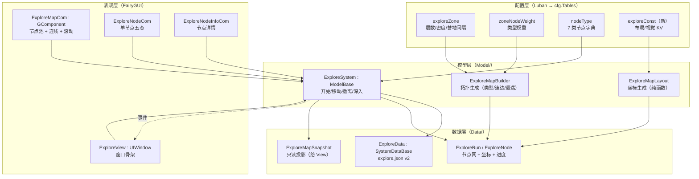
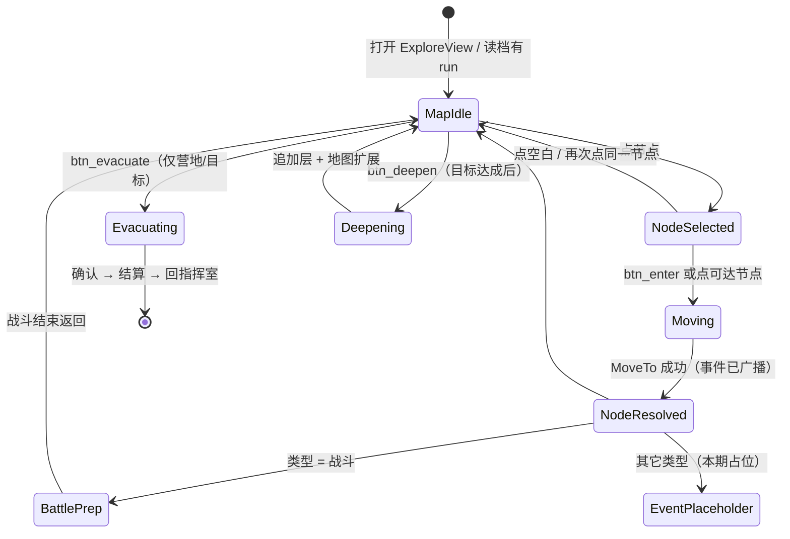

# 探索界面实现计划（节点网 · 随机生成 · FairyGUI 地图）

> 版本：**v1.0（计划，未实现）** · 2026-11-10
> 依据：`策划文档/8异常调查事务所-战斗系统.docx`（下称"文档 8"）＋ `Docs/战斗系统实现计划.md` §1.2（探索地图规则）＋ `Docs/系统制作规范.md`
> 适用系统：`Assets/HotUpdate/GameMain/Script/Game/Explore/`、`UIProject/assets/World`、`DataTable/exploreZone|nodeType|zoneNodeWeight`

---

## 0. 一页结论

| 项 | 结论 |
|---|---|
| 界面数量 | **1 主窗口**（ExploreView）＋**4 组件**（地图视口 / 节点 / 节点详情 / 队伍条）＋**2 弹窗**（撤离确认 / 节点事件占位） |
| 地图形态 | 分层 **DAG**，**纵向**推进：出发阵地在底、目标节点在顶；层内 x 随机、层间固定间距 |
| 随机来源 | 每局一个 `seed`：**类型**走 `zoneNodeWeight` 权重，**位置**走独立随机流（不干扰类型掷骰）；坐标**随存档持久化** |
| 配置结构 | 沿用 `exploreZone / nodeType / zoneNodeWeight` 三张表；**新增 `exploreConst`（KV）** 放布局与视觉参数；C# 里保留默认值兜底 |
| 新增代码 | `ExploreMapLayout`（纯函数）、`ExploreMapSnapshot`（只读投影）、`ExploreViewData`、`ExploreView`、`ExploreMapCom`、`ExploreNodeCom`、`ExploreNodeInfoCom`；`ExploreNode/ExploreRun/ExploreData` 扩字段 |
| 资源 | 复用已有 `World` 空壳包（WorldView / NodeCom / NodeView），补界面后发布；新增预制体 `ExploreView.prefab` ＋ Addressables 条目 |
| 工期 | 约 **14 人日**（不含非战斗节点的事件玩法、美术出图）；P3 资源与 P1/P2 可并行，两人并行约 9~10 个工作日 |

**一句话**：探索界面的核心不是"把节点摆好看"，而是**先把"节点在哪"变成模型层的持久化数据**，界面只做"读快照 → 摆位置 → 画连线 → 收点击"。位置一旦进了存档，界面就能随便换皮、换布局算法而不破坏已有进度。

---

## 1. 现状盘点：已有什么、缺什么

### 1.1 已有（可直接复用）

| 资产 | 位置 | 说明 |
|---|---|---|
| 探索模型/数据/事件/调试 | `Game/Explore/{Model,Data,Event,Define,Debug}` | `ExploreSystem : ModelBase`、`ExploreData : SystemDataBase` 已注册（`ModelManager` / `DataManager`） |
| 节点网生成器 | `Model/ExploreMapBuilder.cs` | 分层、每层 2~3 个节点、相邻层连边、每 `campInterval` 层保底露营地、战斗节点分配遭遇 |
| 存档 | `Data/ExploreData.cs` → `explore.json` | 已存节点 id/层/序号/类型/状态/连边/当前/目标/步数 |
| 战斗节点接入 | `ExploreSystem.StartBattleNode` | 进战斗节点直接调 `BattleSystem.StartBattle` |
| 调试菜单 | `Debug/ExploreDebug.cs` | 开始调查 / 走一步 / 打印节点网 / 撤离 |
| 界面基础 | `Framework/Script/UI/UIWindow`、`UIManager`、`Base/CommonBgCom`、`Base/CommonBtn`、`Base/PopupWindow` | 窗口、预制体、包加载、按钮、弹窗全套 |
| 探索 UI 空壳 | `UIProject/assets/World` | `WorldView`(1920×1080 空)、`NodeView`(空)、`NodeCom`(底图 116×116 + 图标 loader 100×100)、`ui_bg_node.png`、`ui_node_fight.png`、`ui_node_investigation.png`、`ui_node_ruins.png` |

### 1.2 缺口（本计划要补的）

| 编号 | 缺口 | 影响 | 处理阶段 |
|---|---|---|---|
| **G1** | **节点没有坐标**：`ExploreNode` 只有 `m_Layer/m_IndexInLayer`，没有 x/y | 界面无法"位置随机"，只能按层横排 | P1 |
| **G2** | **没有只读快照**：View 只能直接摸 `ExploreRun` 的可变字段 | 违反规范 §7（View 不读权威库、不拼配置） | P2 |
| **G3** | **没有任何 Explore View/Component/ViewData** | 无界面可开 | P3/P4 |
| **G4** | **三张探索表 0 行数据** | 全部走 `ExploreConst` 默认值（7 层 / 2~3 节点 / 权重 40-10-15-10-5-10-10），策划改不了 | P2 |
| **G5** | **回退到已探索的战斗节点会再次开战**：`MoveTo` 无条件 `HandleNode` | 文档 8"已探索节点无法重复探索"被破坏 | P2 |
| **G6** | **撤离没有地点限制**：`Evacuate` 任意位置可调 | 文档 8"中途除了露营地无法撤离"被破坏 | P2 |
| **G7** | `sanCostPerMove` / `nodeType.sanCost` 未生效 | 移动不掉 SAN | 后续（依赖角色 SAN） |
| **G8** | **"继续深入"未实现** | 文档 8 的目标后深度玩法缺失 | P6 |

---

## 2. 系统构成

### 2.1 分层架构



**依赖方向**：View → Model → Data；Data 只依赖配置与序列化；`ExploreMapLayout/Builder` 是无状态纯函数（规范 §4.5 允许 `static`）。

### 2.2 模块清单

| 层 | 文件 | 类型 | 职责 | 动作 |
|---|---|---|---|---|
| Define | `Explore/Define/ExploreDefine.cs` | 常量 | 补布局默认值、节点视觉色表、`c_MapVersion = 2` | 改 |
| Data | `Explore/Data/ExploreNode.cs` | 值对象 | **＋`m_X / m_Y`（虚拟像素）、`m_VisitCount`** | 改 |
| Data | `Explore/Data/ExploreRun.cs` | 值对象 | **＋`m_Depth`、`m_VisitedOrder`、`m_MapWidth/m_MapHeight`** | 改 |
| Data | `Explore/Data/ExploreMapSnapshot.cs` | 只读投影 | 给 View 的完整渲染数据（含解析后的类型名/图标 key/能否进入） | **新** |
| Data | `Explore/Data/ExploreData.cs` | `SystemDataBase` | 存档 v2：坐标/深度/路径；旧档补坐标 | 改 |
| Model | `Explore/Model/ExploreMapLayout.cs` | `static` | 分层随机坐标、最小间距、增量层、重建 | **新** |
| Model | `Explore/Model/ExploreMapBuilder.cs` | `static` | 调 `ExploreMapLayout`；坐标用独立随机流 | 改 |
| Model | `Explore/Model/ExploreSystem.cs` | `ModelBase` | ＋`BuildMapSnapshot / CanMoveTo / CanEvacuate / CanDeepen / ContinueDeeper`；修 G5/G6 | 改 |
| Event | `Explore/Event/ExploreEvent.cs` | 常量 | ＋`OnRunMapExtended`（深入追加层）、`OnNodeEventTriggered`（进入非战斗节点） | 改 |
| View | `Explore/View/ExploreViewData.cs` | `GameData` | 包注册（`ui://World/NodeCom` 等）＋选中节点/滚动位置 | **新** |
| View | `Explore/View/ExploreView.cs` | `UIWindow` | 窗口绑定、快照刷新、按钮、toast | **新** |
| Component | `Explore/Component/ExploreMapCom.cs` | `GComponent` | 节点池、连线层、坐标映射、滚动定位 | **新** |
| Component | `Explore/Component/ExploreNodeCom.cs` | `GComponent` | 单节点五态、点击、悬停 | **新** |
| Component | `Explore/Component/ExploreNodeInfoCom.cs` | `GComponent` | 右侧详情：类型/说明/消耗/按钮 | **新** |
| Component | `Explore/Component/ExploreTeamCom.cs` | `GComponent` | 底部队伍条（头像 + 血/SAN 只读） | **新**（可后置） |
| UI | `UIProject/assets/World/View/WorldView.xml` | FGUI | 主窗口布局 | 改 |
| UI | `UIProject/assets/World/Component/NodeCom.xml` | FGUI | 节点五态结构 | 改 |
| UI | `UIProject/assets/World/Component/NodeInfoCom.xml` | FGUI | 详情面板 | **新** |
| 接线 | `Framework/Script/UI/UIDefine.cs` | 常量 | ＋`Explore = "ExploreView"` | 改 |
| 接线 | `DataManager.LoadGameData()` | 注册 | ＋`RegisterData<ExploreViewData>()` | 改 |
| 接线 | `CommandRoom/BattleSetting` | 流程 | 出发 → `StartRun` → 开探索界面 | 改 |
| 资源 | `Assets/Res/Prefab/ExploreView.prefab` | 预制体 | `UIPanel.packageName = World`、`packageItem = WorldView` | **新** |

> **命名提醒**：FairyGUI 的 URL 前缀必须用**运行时包名**，即 `Assets/Res/UI/World_fui.bytes` 的 `World`，不是 C# 类名。注册写法：
> `UIObjectFactory.SetPackageItemExtension("ui://World/NodeCom", typeof(ExploreNodeCom));`

### 2.3 界面构成（1920×1080）

```
┌──────────────────────────────────────────────────────────────┐
│ com_top (0,0,1920,120)                                       │
│   txt_zone_name  异常区域 · 名称        txt_depth  深度 1/7   │
│   txt_goal       目标：抵达 L7 目标节点   btn_back  返回      │
├───────────────────────────────────────────┬──────────────────┤
│ com_map (40,140,1440,780)                 │ com_info         │
│  ├ com_links   连线层（GGraph，动态生成）  │  (1500,140,380,  │
│  ├ com_nodes   节点层（ExploreNodeCom 池） │   780)           │
│  └ com_token   小队棋子（当前节点上）      │  ├ 类型图标+名称 │
│    ScrollPane: vertical                   │  ├ 说明 desc     │
│                                           │  ├ 消耗/状态     │
│                                           │  └ btn_enter     │
├───────────────────────────────────────────┴──────────────────┤
│ com_bottom (40,940,1440,110)                                 │
│   com_team 队伍 4 人头像/血/SAN   btn_evacuate 撤离           │
│   btn_deepen 继续深入（目标达成后出现）   txt_tip 提示        │
└──────────────────────────────────────────────────────────────┘
```

**地图内容尺寸由快照给出**：`contentWidth = m_MapWidth`、`contentHeight = m_MapHeight`；`com_map.scrollPane.SetContentSize(...)` 后按节点坐标 1:1 摆放（虚拟像素 = FGUI 像素）。

**节点视觉（五态）**：

| 状态 | 视觉 | 交互 |
|---|---|---|
| `Locked`（不可达） | 整体 40% 灰、无描边 | 点击 → `txt_tip`「尚未打通路径」 |
| `Available`（相邻可达） | 亮色 + 呼吸描边 | 点击 → 移动 |
| `Current`（当前） | 高亮环 + 小队棋子 + 脉冲 | 点击无效果 |
| `Explored`（已探索） | 暗色 + 勾选角标 | 点击 → 移动（**不再触发事件**） |
| 目标节点 | 额外「目标」角标 | 抵达后 `btn_deepen` 出现 |
| 露营地 | 额外「营地」角标 | 抵达后 `btn_evacuate` 可用 |

### 2.4 交互流程



**操作约定（建议，待拍板）**：
- 点**可达节点**直接走（少一次确认，走路是高频操作）；点**锁定节点**只提示。
- 点**已探索节点**也直接走（文档 8：可以移动到已探索节点），但不触发事件。
- 移动时小队棋子沿直线 0.2s 补间到目标节点，落地后刷新状态。
- 撤离必须二次确认（`Base/PopupWindow`），确认后 `Evacuate(true)`。

---

## 3. 配置结构

### 3.1 表清单

| 表 | 状态 | 关键字段 | 在本界面里的用途 | 本计划动作 |
|---|---|---|---|---|
| `exploreZone.xlsx` | 已建，**0 行** | `layerCount / nodesPerLayerMin / nodesPerLayerMax / campInterval / encounterPool / sanCostPerMove / anomalyType / goalEncounterID` | 层数、每层密度、营地间隔、目标节点、区域名/描述 | 补 1 行（区域 1） |
| `nodeType.xlsx` | 已建，**0 行** | `name / icon / desc / canRest / canUseMule / canEvacuate / sanCost / autoResolve` | 节点图标、名称、说明、可用操作、是否可撤离 | 补 7 行 |
| `zoneNodeWeight.xlsx` | 已建，**0 行** | `zoneID / nodeTypeID / weight` | 节点类型随机权重 | 每个区域补 7 行 |
| `exploreConst.xlsx` | **待建（KV）** | `key / value / desc` | 布局与视觉参数（见 3.2） | 新建 + 注册 `__tables__.xlsx` |

> 为什么用 KV 而不是往 `exploreZone` 加列：布局参数是**全局视觉常量**，不是区域玩法差异；KV 与 `combatConst.xlsx` 的做法一致，调参不用改代码、不用动区域数据，也不会让每行区域数据背一堆美术参数。

### 3.2 `exploreConst.xlsx`（新增，KV）

| key | 默认 | 说明 |
|---|---|---|
| `mapWidth` | 1400 | 地图画布宽（虚拟像素） |
| `mapPaddingX` | 120 | 左右留白 |
| `mapPaddingY` | 120 | 上下留白 |
| `layerGap` | 380 | 层间纵向距离 |
| `nodeJitterX` | 60 | 层内横向随机抖动幅度 |
| `nodeMinGap` | 90 | 同层节点最小间距（不足时自动缩 jitter / 扩画布） |
| `nodeSize` | 116 | 节点直径（与 `NodeCom` 对齐） |
| `linkWidth` | 4 | 连线粗细 |
| `scrollSpeed` | 40 | 滚轮速度 |
| `deepDiveLayers` | 3 | 每次「继续深入」追加的层数 |
| `maxNodesPerLayer` | 4 | 每层节点上限（防止画布挤爆） |

**兜底**：表不存在或 key 缺失时用 `ExploreConst` 里的同名常量（现有类扩展），保证没配表也能跑通。

### 3.3 节点类型 → 视觉与行为映射

| ID | 类型 | 图标 key（`nodeType.icon`） | 主色 | 进入行为 | 可撤离 | 自动结算 |
|---|---|---|---|---|---|---|
| 1 | 战斗 | `ui_node_fight`（已有） | 红 `eb414e` | 打开战前整备 → 自动战斗 | 否 | 否 |
| 2 | 救援 | `ui_node_rescue`（**缺图**） | 蓝 `3d66eb` | 节点事件（后续） | 否 | 是 |
| 3 | 物资搜索 | `ui_node_supply`（**缺图**） | 绿 `43ee94` | 节点事件（后续） | 否 | 是 |
| 4 | 异常考察 | `ui_node_investigation`（已有） | 紫 `cd40e7` | 节点事件 + SAN（后续） | 否 | 是 |
| 5 | 异常物品回收 | `ui_node_recover`（**缺图**） | 橙 `ed9c1c` | 节点事件（后续） | 否 | 是 |
| 6 | 场景事件 | `ui_node_scene`（**缺图**，可先用 `ui_node_ruins`） | 白 `E1DDE9` | 选项式事件（后续） | 否 | 否 |
| 7 | 露营地 | `ui_node_camp`（**缺图**） | 黄 `ed9c1c` | 露营地操作：恢复/换人/机械骡/撤离 | **是** | 是 |

> `icon` 列存**包内图片名**，View 拼成 `ui://World/<icon>`；缺图时回退 `ui_bg_node` 并打一条 warning，绝不空白。

### 3.4 运行时数据与存档（v2）

```csharp
// ExploreNode 新增
public float m_X;          // 虚拟像素，地图左上为原点
public float m_Y;
public int   m_VisitCount; // 首次进入才触发事件

// ExploreRun 新增
public int  m_Depth;       // 深入次数（0 = 首次）
public float m_MapWidth;
public float m_MapHeight;
public readonly List<int> m_VisitedOrder = new List<int>(); // 行走路径（画轨迹/调试）
```

`explore.json` 结构变化：

```json
{
  "version": 2,
  "run": {
    "zoneId": 1, "seed": 123456, "layerCount": 7, "depth": 0,
    "mapWidth": 1400, "mapHeight": 2680,
    "currentNodeId": 3, "goalNodeId": 12, "steps": 2, "goalReached": false,
    "visitedOrder": [1, 3],
    "nodes": [
      { "id": 1, "layer": 0, "index": 0, "type": 7,
        "x": 700, "y": 2560, "state": 3, "encounter": 0, "links": [3, 4] }
    ]
  }
}
```

**兼容**：读到 `version == 1` 或节点缺 `x/y` 时，用 `seed` 走 `ExploreMapLayout` 重建一次坐标并 `Save()`；不重建类型、不重建连边（旧档的玩法状态一律保留）。

### 3.5 配置校验（Debug 菜单）

`ExploreDebug` 增加一条 `Framework/探索/校验配置`：

- `exploreZone` 至少 1 行；`layerCount >= 2`；`nodesPerLayerMin <= nodesPerLayerMax`；
- `nodeType` 必须有 1~7 共 7 行，`icon` 非空；
- 每个区域 `zoneNodeWeight` 至少 1 行，权重和 > 0；
- `exploreConst` 的 `nodeMinGap > nodeSize`（否则同层节点会压住）；
- 输出「区域 N：层数/每层节点/权重分布」的可读摘要。

---

## 4. 位置随机生成

### 4.1 坐标系

- 地图用**虚拟像素**：左上角 `(0,0)`，x 向右、y 向下（与 FairyGUI 一致）。
- **出发阵地在最下、目标在最上**：`y = mapHeight - paddingY - layer * layerGap`，纵向滚动阅读顺序符合"推进"。
- 画布宽 `mapWidth`（默认 1400，可被 `maxNodesPerLayer` 撑大），高 `mapHeight = paddingY*2 + (maxLayer-1)*layerGap`。
- 坐标存**虚拟像素**而非 0~1 归一化：本界面是固定宽度画布 + 滚动，像素最直接；改布局参数时旧档坐标依旧有效（只是可能不铺满新宽度）。

### 4.2 生成步骤（`ExploreMapLayout.Build`）

1. 取 `layerCount`、每层节点数（`ExploreMapBuilder` 已定），先算 `maxNodesPerLayer`；
2. `mapWidth = max(配置宽, maxNodesPerLayer * (nodeSize + nodeMinGap) + 2*paddingX)`；
3. 每层节点按层内序号排"槽位"：`slot = (mapWidth - 2*paddingX) / max(1, count-1)`；
4. `x = paddingX + i*slot + rng(-jitter, +jitter)`，并 clamp 到 `[paddingX, mapWidth-paddingX]`；
5. 若 `slot - 2*jitter < nodeMinGap`，本次抖动幅度按比例缩小（保证不重叠）；
6. 单节点层（出发/目标）固定 `x = mapWidth/2`；
7. 写入 `node.m_X/m_Y`，最后写 `run.m_MapWidth/m_MapHeight`。

### 4.3 随机流与可复现

- **独立随机流**：`layoutRandom = new System.Random(seed * 31 + 7919)`，不复用 `ExploreMapBuilder` 里掷类型/连边的那个 `Random`。
  这样**调整节点权重不会改变已有布局**，调布局参数也不会改变节点类型分布。
- 同 `seed` + 同 `exploreConst` → 坐标完全一致（可写单元测试/调试断言）。
- **坐标进存档**是最终事实：布局参数改了，旧档也不挪窝。

### 4.4 继续深入（增量）

- `ContinueDeeper()`：在现有最上层之上追加 `deepDiveLayers` 层，**只给新层算坐标**（`y = 现有最小 y - layerGap`），已存在节点一个都不动；
- `layerCount/m_MapHeight` 变大，`ExploreMapLayout` 只做"扩展"不做"重排"；
- 新层同样走类型权重、保底露营地、连边（新层与旧顶层相连）。

### 4.5 示例（7 层 / 每层 2~3 节点 / 宽 1400）

| 层 | 节点数 | x（示例） | y |
|---|---|---|---|
| L1 出发阵地 | 1 | 700 | 2560 |
| L2 | 3 | 214 / 683 / 1180 | 2180 |
| L3 | 2 | 402 / 1007 | 1800 |
| L4 | 3 | 176 / 744 / 1225 | 1420 |
| L5 | 2 | 520 / 921 | 1040 |
| L6 | 3 | 260 / 700 / 1140 | 660 |
| L7 目标 | 1 | 700 | 280 |

---

## 5. 计划表

### 5.1 分期总览

| 阶段 | 目标 | 交付物 | 工期 |
|---|---|---|---|
| **P0 决策** | 拍板 5 项、列出缺图 | 决策记录 + 图标清单 | 0.5d |
| **P1 数据层** | "位置"成为数据 | 坐标字段、布局算法、存档 v2 | 1.7d |
| **P2 模型层** | 界面只需要"读快照 + 调操作" | 快照、`CanMoveTo/CanEvacuate/CanDeepen`、G5/G6 修复、表数据、Debug | 1.7d |
| **P3 UI 资源** | 有界面可开、节点可显示 | `World` 包实做、预制体、Addressables | 2.3d |
| **P4 视图层** | 地图看得懂、点得动 | View/MapCom/NodeCom/InfoCom | 3.2d |
| **P5 流程接线** | 从指挥室出发能走完一次调查 | 入口、战斗往返、撤离结算 | 1.5d |
| **P6 露营/深入** | 文档 8 的营地与深度玩法 | 露营地面板、追加层 | 2d（可后置） |
| **P7 打磨验收** | 手感、性能、回归 | 动画/音效/日志/清单 | 1.5d |

### 5.2 任务明细

| 编号 | 阶段 | 任务 | 产出 | 依赖 | 验收 | 人日 |
|---|---|---|---|---|---|---|
| T0 | P0 | 拍板 §7 的 5 项；确认缺图由谁补 | 决策记录 | — | 5 项都有结论 | 0.5 |
| T1 | P1 | `ExploreNode/ExploreRun` 扩字段（坐标/深度/路径/画布尺寸） | 两个值对象 | T0 | 编译 0 error | 0.3 |
| T2 | P1 | `ExploreMapLayout`：分层随机坐标、最小间距、画布尺寸、增量扩展 | 纯函数类 + 单测式断言 | T1 | 同 seed 两次结果一致；节点不重叠 | 0.8 |
| T3 | P1 | `ExploreMapBuilder` 接入布局，坐标用独立随机流 | 生成器 | T2 | 权重变化不影响坐标 | 0.2 |
| T4 | P1 | `ExploreData` v2 序列化 + 旧档补坐标 + `ExploreConst` 默认值 | 存档 | T1 | 重启后坐标不变；v1 档可读 | 0.4 |
| T5 | P2 | `ExploreMapSnapshot` + 节点类型视图（名称/图标 key/说明/能否撤离） | 只读投影 | T1 | View 不碰 `cfg.Tables` | 0.5 |
| T6 | P2 | `CanMoveTo/CanEvacuate/CanDeepen`；**修 G5**（首次进入才触发事件）、**修 G6**（撤离限营地/目标） | `ExploreSystem` 接口 | T5 | 回退已探索战斗节点不再开战 | 0.5 |
| T7 | P2 | 补三张表的数据（区域 1 + 7 类节点 + 7 条权重），跑 Luban | 表数据 | — | 校验菜单 0 error | 0.4 |
| T8 | P2 | `ExploreDebug`：打印坐标/快照、校验配置、一键走到目标 | 调试菜单 | T5 | 不打开 UI 能走完一轮 | 0.3 |
| T9 | P3 | `WorldView` 布局：顶栏/地图视口/右侧详情/底部（含 ScrollPane） | FGUI 主窗口 | T0 | 1920×1080 不错位 | 0.8 |
| T10 | P3 | `NodeCom` 五态：底图/高亮环/图标/状态遮罩/文字/角标 | FGUI 组件 | T9 | 五态肉眼可辨 | 0.6 |
| T11 | P3 | `NodeInfoCom`：图标+名称+说明+消耗+按钮 | FGUI 组件 | T9 | 长描述不溢出 | 0.4 |
| T12 | P3 | 发布包 → `Assets/Res/UI/World_*`；注册 Addressables；做 `ExploreView.prefab`；加 `UIDefine.Explore` | 资源与预制体 | T9 | `ShowWindow` 能打开空窗口 | 0.5 |
| T13 | P4 | `ExploreViewData`：包注册 + 选中节点/滚动位置 | `GameData` | T12 | 节点组件类正确实例化 | 0.2 |
| T14 | P4 | `ExploreMapCom`：节点池、坐标映射、连线层（GGraph 矩形条+旋转）、滚动定位 | 地图组件 | T13 | 30 节点绘制无卡顿 | 1.2 |
| T15 | P4 | `ExploreView`：绑定、快照刷新、顶栏/底部、按钮、toast | 窗口 | T14 | 界面数据与快照一致 | 0.8 |
| T16 | P4 | `ExploreNodeCom/NodeInfoCom` 逻辑：五态、点击、悬停、移动补间 | 组件逻辑 | T15 | 点可达节点会走；锁定有提示 | 0.7 |
| T17 | P4 | 事件订阅/退订（Enter/Leave/Destroy 成对）+ 刷新节流 | 视图刷新 | T15 | 隐藏后不再刷新 | 0.3 |
| T18 | P5 | 入口：指挥室「开始行动」→ 战前整备 → 确认 **出发** → `StartRun(zoneId)` → ExploreView | 流程接线 | T17 | 能从指挥室进地图 | 0.5 |
| T19 | P5 | 战斗节点往返：进节点 → 战前整备（带遭遇）→ 战斗 → 回地图并标记已探索 | 流程接线 | T18 | 打完能接着走 | 0.6 |
| T20 | P5 | 撤离/完成/失败：确认弹窗 → `Evacuate` → 简报 → 回指挥室 | 结算界面 | T19 | 三种结局都能回指挥室 | 0.4 |
| T21 | P6 | 露营地弹窗：撤离 / 恢复 / 换人 / 机械骡（先接已有系统，缺的占位） | 弹窗 | T19 | 营地能撤离、能用已有恢复接口 | 1.0 |
| T22 | P6 | 「继续深入」：追加层、地图扩展、深度显示、评分占位 | 功能 | T21 | 目标后能继续走 3 层 | 1.0 |
| T23 | P7 | 表现打磨：呼吸/脉冲/棋子补间/音效/目标高亮 | 表现 | T22 | 观感验收 | 0.8 |
| T24 | P7 | 性能与健壮性：节点池复用、重绘次数、空图标/空表兜底、日志 | — | T23 | 30 节点重绘 < 16ms | 0.4 |
| T25 | P7 | 回归清单执行（§8） | 验收记录 | T24 | 全项通过 | 0.3 |

**合计 ≈ 14 人日**（P3 可与 P1/P2 并行）。

### 5.3 里程碑

| 里程碑 | 达成标志 | 对应任务 |
|---|---|---|
| M1 数据可复现 | 同 seed 坐标一致；重启后不挪窝 | T1–T4 |
| M2 逻辑闭环 | 不打开 UI，用 Debug 菜单走完一次调查 | T5–T8 |
| M3 资源就绪 | 空窗口能打开，节点按坐标显示 | T9–T12 |
| **M4 界面可用（本期主交付）** | 地图可看、可点、可走、可回退 | T13–T17 |
| M5 流程闭环 | 指挥室 → 出发 → 目标 → 撤离 → 指挥室 | T18–T20 |
| M6 玩法补全 | 露营地 + 继续深入 | T21–T22 |
| M7 验收 | §8 清单全绿 | T23–T25 |

---

## 6. 风险与对策

| 风险 | 影响 | 对策 |
|---|---|---|
| 坐标不进存档 | 读档后布局变化、节点重叠 | 坐标是 `ExploreRun` 的一部分（T1/T4），布局参数只是"生成时输入" |
| 布局参数一改，旧档重排 | 玩家进度看起来"变了" | 现场只对新层算坐标，旧节点永不重排（§4.4） |
| 类型随机与位置随机互相干扰 | 调权重导致地图大变 | 两条独立随机流（§4.3） |
| 包名/URL 写错 | 节点组件静默失效（不报错、只显示空白） | `ui://World/...` 与 `World_fui.bytes` 对齐；T12 打开空窗口先验证 |
| 层内节点多导致压字/重叠 | 地图不可读 | `nodeMinGap` + 画布自适应扩宽 + `maxNodesPerLayer` |
| 连线数量 | 每边一个 GGraph，30 条边以内可接受 | 超过 40 条改为单个 GGraph 多边形批绘；本期不做 |
| 回退已探索节点重复触发 | 重复战斗/重复奖励 | G5 修复 + `m_VisitCount` 判断（T6） |
| 撤离任意位置可调 | 破坏文档 8 的紧张感 | G6 修复：`nodeType.canEvacuate` + 目标节点特例（T6） |
| View 直接读 `ExploreRun` | 改 UI 影响存档、状态错乱 | 只读快照（T5）；View 禁止 `Game.Data.Get...` |
| 图标缺失 | 节点空白 | 回退 `ui_bg_node` + warning（§3.3） |
| 隐藏界面仍在刷新 | 无谓开销/空引用 | `Leave/Destroy` 成对退订（T17） |
| 与 `Base` 包的缩放/层级冲突 | 界面整体错位 | 预制体按现有 `DontDestroy` 层规则做，不挂缩放 Canvas |

---

## 7. 待拍板（含推荐）

| # | 议题 | 推荐 | 备选 | 影响 |
|---|---|---|---|---|
| 1 | 地图方向 | **纵向**（出发在底、目标在顶） | 横向（左→右） | 布局算法、滚动轴、`WorldView` 结构 |
| 2 | 用哪个 FGUI 包 | **复用 `World`**（已有 NodeCom/NodeView 骨架与 2 张图） | 新建 `Explore` 包 | 资源路径、URL 前缀、美术迁移 |
| 3 | 点击交互 | **点可达节点直接走**；锁定只提示；已探索可回退 | 点节点→右侧详情→点"前往" | 操作手感、组件数量 |
| 4 | 本期范围 | **地图 + 移动 + 战斗入口 + 撤离**；露营地与深入放 P6 | 一次做全 | 工期（±2d） |
| 5 | 队伍条 | **P7 打磨再上**（先只读头像，血/SAN 依赖 Role 接口） | 本期做完整条 | 跨系统依赖（Role/BattleSetting） |
| 6 | 节点可见性 | **全可见 + 灰化**（无迷雾） | 只显示已探索相邻 | 玩法与表现 |

---

## 8. 验收清单

**数据**
- [ ] 同一 `seed` 连续生成两次，节点坐标完全一致；
- [ ] 关掉游戏重进，地图布局与节点位置不变；
- [ ] v1 旧档能读，且补完坐标后自动保存；
- [ ] `exploreConst` 改 `layerGap` 后，**新局**间距变化、旧局不变。

**生成**
- [ ] 7 层：首层 1 个出发阵地、末层 1 个目标、每 3 层至少 1 个露营地；
- [ ] 同层节点不重叠、不出画布；
- [ ] 类型分布与 `zoneNodeWeight` 大致吻合（跑 100 次统计）；
- [ ] 每个非首层节点至少有一条来自上一层的边。

**界面**
- [ ] 打开界面时自动定位到当前节点；
- [ ] 五种状态肉眼可辨（锁定/可达/当前/已探索/目标）；
- [ ] 点可达节点会移动；点锁定节点有提示；点已探索节点会回退；
- [ ] 右侧详情与所点节点一致；图标缺失时显示兜底图；
- [ ] 窗口隐藏后不再刷新（日志验证）。

**流程**
- [ ] 指挥室 → 出发 → 地图 → 战斗节点 → 战前整备 → 战斗 → 回地图（节点变已探索）；
- [ ] 回退到已探索的战斗节点**不会**再次开战；
- [ ] 露营地/目标节点可撤离，其它节点撤离按钮置灰并给出原因；
- [ ] 目标达成后出现「继续深入」，点击后地图向上扩展 3 层；
- [ ] 撤离 → 简报 → 回指挥室；存档清空、`completedRuns +1`。

---

## 9. 不在本计划内（依赖/后续）

| 项 | 原因 | 依赖 |
|---|---|---|
| 救援/物资/考察/回收/场景的事件内容与结算 | 需要掉落表、选项表、SAN 规则 | 策划文档 + 新表 |
| 移动扣 SAN、癫狂 | `RoleRecord` 的 SAN 与异常适应性 | Role 系统 |
| 深入后的评分与额外奖励 | 经济/结算系统 | 事务所收益系统 |
| 战斗表现（P4 战斗文档） | 独立计划 | `Docs/战斗系统实现计划.md` P4 |
| 战争迷雾 / 路径动画 / 地图缩放 | 打磨项 | M4 之后 |

---

## 10. 本轮落地记录（2026-11-10）

### 10.1 已完成

| 计划项 | 状态 | 落点 |
|---|---|---|
| P1 节点坐标 + 存档 v2 | ✅ | `ExploreNode/m_X,m_Y`、`ExploreRun/m_Depth,m_MapWidth,m_MapHeight,m_VisitedOrder`、`ExploreMapLayout`、`ExploreData` v2（旧档自动补坐标） |
| P1 全战斗测试开关 | ✅ | `ExploreConst.TestAllBattle = true`：除出发阵地外全战斗、跳过营地保底、层数压到 4 |
| P2 只读快照 | ✅ | `ExploreMapSnapshot / ExploreNodeSnapshot`、`ExploreSystem.BuildMapSnapshot()` |
| P2 可达/撤离判定 + 首访才触发 | ✅ | `CanMoveTo / CanEvacuate / EnterCurrentNode`、`ExploreNode.m_VisitCount/m_Resolved`（修 G5/G6） |
| P2 战斗节点改为广播 | ✅ | `ExploreEvent.OnBattleNodeEntered` + `ExploreBattleNodeMsg`，不再直接 `StartBattle` |
| P3 探索场景界面 | ✅ | `ExploreView`（World/WorldView）：节点池、连线、拖拽、自动定位、点击移动 |
| P3 战斗节点布阵界面 | ✅ | `NodeSettingView`（World/NodeSettingView）+ `NodeBattleCom` + `RoleBattleCom`（Base） |
| P4 包注册 / UIDefine / 预制体 / Addressables | ✅ | `ExploreViewData`、`UIDefine.Explore/NodeSetting`、`Assets/Res/Prefab/ExploreView|NodeSettingView.prefab`、World 分组 |
| P5 入口接线 | ✅（部分） | 指挥室 → 战前整备（按钮改为「出发」）→ `ConfirmAndDepart` → 探索界面；战斗结束自动回地图 |

### 10.2 与计划的偏差（重要）

| 偏差 | 原因 | 影响 / 处理 |
|---|---|---|
| 地图节点名用短名（出发/目标/战斗） | `NodeCom.txt_name` 只有 56px 宽 | 避免换行/溢出 |
| 撤离 / 继续深入没有界面按钮 | 上传的 `WorldView` 只有地图 + 返回，没有撤离按钮 | 测试期用菜单 `Framework/探索/撤离（结束调查）`；正式按钮留给 P5/P6 |
| 战斗节点不再走 `BattleSettingView` | 上传的 `NodeSettingView` 就是战斗前布阵 | `BattleSettingView` 改为「出发」入口；直接开战仍可用 `BattleSettingDebug` 菜单 |
| 测试期战败不结束调查 | 全灭按文档 8 应结束任务，但测试时一场失败就被踢回指挥室，没法连续测 | `ExploreConst.TestKeepRunOnDefeat = true`：只标记节点已结算并保留进度；正式版改 `false` 恢复"全灭结束调查" |

> **FairyGUI 发布坑（已解决）**：发布时只包含"导出(exported)或被其它元件引用"的资源。第一次发布时 `NodeCom`、`ui_bg_node`、`ui_bg_light` 没导出，被裁掉了，运行时 `CreateObject` 拿不到；美术在 13:23 重新导出后已切回 FGUI 的 `NodeCom`（`ExploreNodeCom` 恢复 `ConstructFromXML` 绑定）。后续新增"运行时动态创建"的组件，务必在 FGUI 里勾「导出」。

### 10.3 下一步（按计划顺序）

1. **P5 收尾**：撤离确认弹窗 + 结算简报（需要新的 FGUI 弹窗）；
2. **P6**：露营地弹窗、继续深入（`ExploreMapLayout.Extend` 已预留）；
3. **P7**：节点动画、音效、性能、回归清单；
4. **配置**：补 `exploreZone / nodeType / zoneNodeWeight` 三张表的数据；新增 `exploreConst`（KV）后把 `ExploreConst` 里的布局默认值改成读表。

### 10.4 战斗表现（2026-11-10 · BattleView 外壳版）

战斗界面独立成 `Battle/BattleView` 窗口（美术提供空外壳，细节后续在 FGUI 里加）：

| 界面 | 表现 |
|---|---|
| 布阵（World/NodeSettingView） | 每名队员一张 `Base/RoleBattleCom`（Spine **0.5**），可左右拖动卡片改站位；松开后写 `BattleSettingData.positions` 并存档 |
| 战斗（Battle/BattleView） | 代码在空外壳里搭最小一维战场：己方 `RoleBattleCom`（Spine **0.6**，按 `BattleUnit.m_Pos / field.Length` 横向移动、血条、死亡压暗）；敌方用红色细条 + 血条占位；顶部一行状态文字 |

- 开战：`NodeSettingView` → `BattleSystem.StartBattle/StartDebugBattle` → `BattleSettingSystem.ApplyPositionsToBattle()` → `ShowWindow(UIDefine.Battle)`；
  - 站位统一按**卡片中心**归一化（布阵 `(x + cardWidth/2) / layerWidth`，战斗 `中心 = margin + t * areaWidth`），两边才对得上；
  - 调试编成必须把队伍角色 ID 一起传进 `StartDebugBattle`，否则生成的是 `m_SourceId = 0` 的合成队友，`ApplyPositions` 按角色 ID 找不到站位；
- `BattlePresentation.s_FguiActive` 置 true，`BattleDebugView` 只 Tick 不画 IMGUI；
- 战斗结束（胜负）由 `BattleView` 收尾：清战斗现场 → 回探索地图；战败按 `ExploreConst.TestKeepRunOnDefeat` 决定是否保留调查；
- 改名：`RoleBattleCom` 文本节点 `n8` → `txt_name`（代码已同步 + 旧名兜底）；`SpineAnimCom` 挂点找不到 `GameObjectGo` 时退取第一个 graph 子节点；FGUI 里 `World/WorldView` → `World/ExploreView`、`World/NodeCom` → `World/ExploreNodeCom`，预制体 `ExploreView.prefab`、`ExploreViewData`、`UIPackage.CreateObject` 已同步；
- 日志：`CommonItemCom` / 出发按钮在 `UIConfig.tooltipsWin` 未配置时不再挂 `tooltips`（之前 hover 会刷 `UIConfig.tooltipsWin not defined`）；战斗的重伤/死亡日志降为 Info，`combatConst` 空表提示只打一次。

### 10.5 探索结算 / 角色卡动画（2026-11-10 晚）

| 项 | 实现 |
|---|---|
| 结算界面 | `World/ExploreSuccessWindow`、`World/ExploreFailWindow` → `ExploreSuccessWindow` / `ExploreFailWindow`（**UIPopup** + 同名预制体，`UIDefine.ExploreSuccess/ExploreFail`） |
| 结算判定 | `ExploreSettlement.Show(msg)`：`m_Success && m_GoalReached` → 成功，否则失败；失败原因按 `m_Success` 分【全员失踪】/【未达成目标】 |
| 触发 | 目标节点战斗胜利 → `Evacuate(true)`（临时自动完成，等"继续深入/撤离"选择界面接管）；全灭 → `Evacuate(false)`（`TestKeepRunOnDefeat = false`）；调试撤离走同一入口 |
| 关闭 | `btn_back` / `com_popup.btn_close` / 点空白 → `Close()`；`Leave` 里统一回指挥室 |
| 角色卡 | `Base/RoleCardCom` 立绘改为 `com_anim`（RoleAnimCom）：role1 骨架、皮肤 01~03 轮换、`SetFit(Contain, 190×300, BottomCenter)` |
| 战斗错位 | `BattleView` 按 `BattleUnit.m_TeamIndex` 三档错开卡片（y ±18 / x ±6），敌方细条也按序号错开，避免完全重叠 |

> 结算界面的奖励列表 `list_item` 先清空，等掉落/奖励系统接好后按 `numItems + itemRenderer` 填。

### 10.6 按 nodeType 表生成节点（2026-11-10 晚）

| 项 | 实现 |
|---|---|
| 类型集合 | `ExploreMapBuilder.LoadTypeWeights` 读 `nodeType.DataList`，表里有几类就能出几类（含新加的 8 强敌）；表为空时退回 1~7 |
| 权重 | 优先 `zoneNodeWeight`（按区域）；没有配置时用 `ExploreConst.DefaultWeights`（已扩到 8 项，战斗 40 / 强敌 5） |
| 战斗类型 | `ExploreConst.IsBattleType()`：1 战斗 + 8 强敌都进战斗流程；目标节点表里有 8 时用强敌 |
| 测试开关 | `ExploreConst.TestAllBattle = false`（之前强制全战斗导致"只有战斗节点"） |
| 数据 | `Assets/StreamingAssets/Data/gamedata_explore_nodetype.json` 已按表同步 8 行；以后改表走 `Framework/配置表导入` |
| 显示 | 地图节点用两字短名（`NodeTypeShortNames`），完整名称/说明仍读表；`ui_node_rescue` 还没出图，缺图时回退 `ui_node_evacuate` 并只提示一次 |

> 旧存档里已经生成好的节点不会改变类型；要看新生成规则，需要先撤离/结束当前调查再重新「出发」。

### 10.7 物资搜索面板（2026-11-10 晚）

| 项 | 实现 |
|---|---|
| 卡片 | `World/InvestigationCom` → [InvestigationCom.cs](Assets/HotUpdate/GameMain/Script/Game/Explore/Component/InvestigationCom.cs)：名称 / 说明 / 可能获得的物品 / 「开始调查 成功率 xx%」 |
| 面板 | `World/NodeInvestigationCom` → [NodeInvestigationCom.cs](Assets/HotUpdate/GameMain/Script/Game/Explore/Component/NodeInvestigationCom.cs)：`list_investigation` 横向排调查点卡片 |
| 接线 | `NodeSettingView.load_com` 按节点类型切换：战斗/强敌 → NodeBattleCom，**物资搜索 → NodeInvestigationCom**；`ExploreView` 收到 `OnNodeEventTriggered`（type 3）后打开 NodeSettingView |
| 结算 | 点「开始调查」→ `ExploreSystem.ResolveCurrentNodeEvent()` 标记节点已结算 → 回探索地图；未结算时再点当前节点可重新打开 |
| 数据 | 目前没有调查点配表，`NodeSettingView.BuildInvestigationInfo` 先按节点类型生成 3 个调查点（成功率 75/60/50）；奖励列表留空，等掉落表接 `InvestigationSiteInfo.m_ItemIds`（`CommonItemCom.SetItem(id)` 会把 `item.icon` 解析后加载到 `load_icon`） |

> 其它非战斗类型（救援 / 考察 / 回收 / 场景 / 营地）还没有面板，进入后只广播事件，等后续逐类补。
