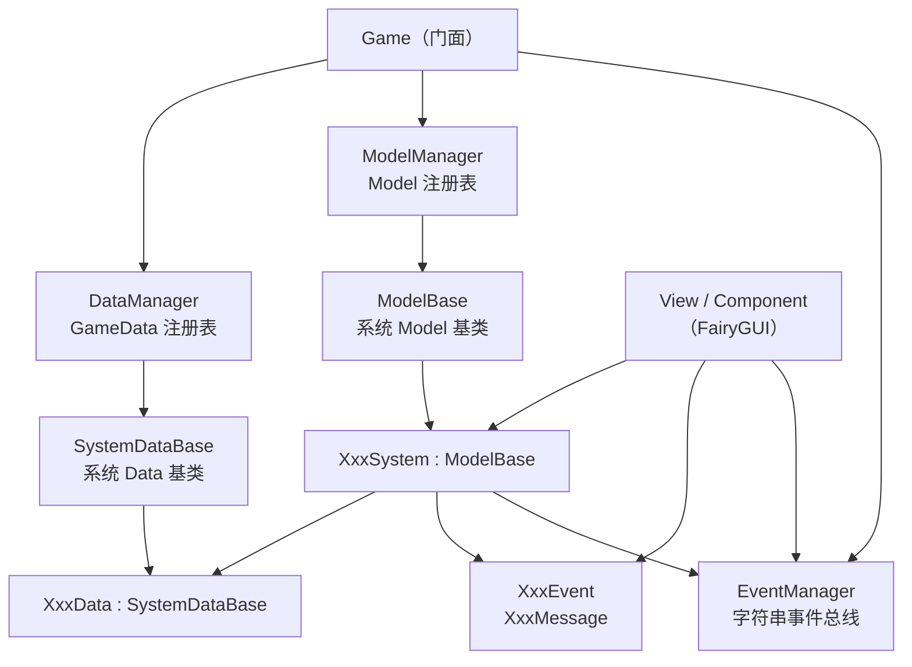
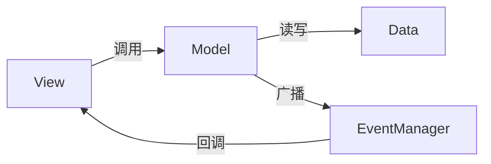
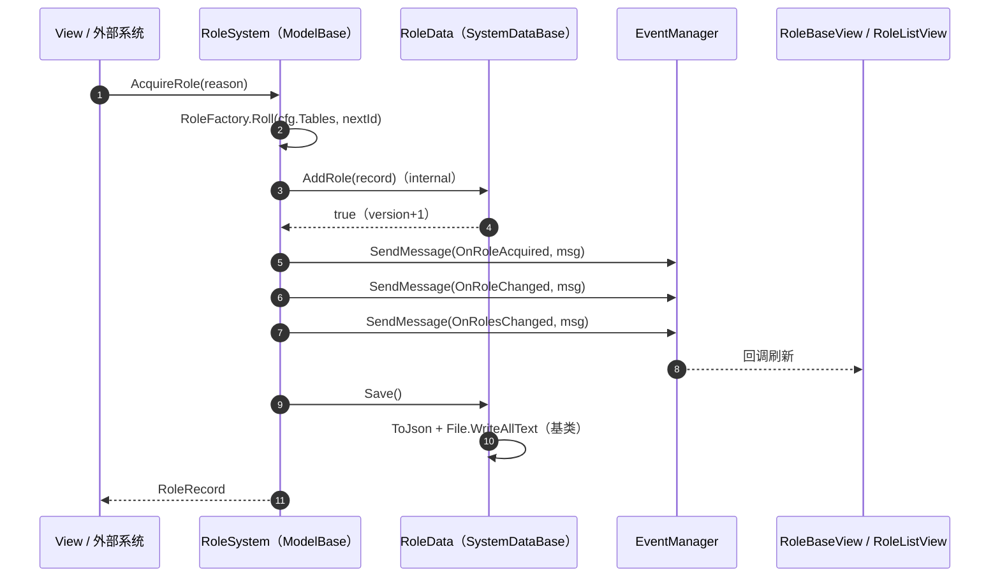

# 系统制作规范（MVC / ModelBase / ModelManager）

> **适用范围**：`Assets/HotUpdate/GameMain/Script/Game/` 下的所有业务系统（Role / BattleSetting / Inventory / TalentAcquisition / Battle …）。
> **关联文档**：`Docs/业务框架与类图.md`（框架层总览，其中"13 个管理器 / RoleSystemData"等描述是本次改造前的快照）、`Docs/战斗系统实现计划.md`、`Docs/技能系统实现计划.md`、`Docs/仓库系统实现说明.md`。
> **落地状态**：Role / BattleSetting / Inventory 已按本规范完成改造；TalentAcquisition / Battle 等仍是旧结构，迁移时按本文执行。原 Warehouse 已并入 Inventory（道具权威数据在 `InventoryData`，旧 `warehouse.json` 会自动迁移）。

---

## 1. 术语与总体约定

### 1.1 系统（System）

一个**业务域**就是一个系统，例如角色养成（Role）、仓库（Inventory）、人才招募（TalentAcquisition）。

- 一个系统对应 `Game/<System>/` 一个目录；
- 一个系统有且只有一个**主模型**，命名为 `<System>System`，继承 `ModelBase`，由 `ModelManager` 注册；
- 一个系统有且只有一个**Data 辅助模块**（权威数据 + 持久化），以及一个**Event 辅助模块**（事件名 + 消息体）。

### 1.2 MVC 模块

一个系统内部可以存在多个 MVC 模块。本项目的划分方式：

| 层 | 本项目落点 | 说明 |
|---|---|---|
| **M（Model）** | `Model/<System>System.cs` 及同目录下的子模型 | 业务规则、数据读写、事件广播，全部由 `ModelManager` 管理 |
| **V（View）** | `View/<System>View.cs`、`Component/<System>XxxCom.cs` | FairyGUI 窗口 / 组件，只做展示与输入 |
| **C（Controller）** | 不单独建文件，由 View 的事件回调承担 | 输入 → 调 Model 用例；流程复杂时把编排下沉到 Model，不堆在 View |

**模块边界**：一个窗口（或一组强相关窗口 + 页签）通常就是一个 MVC 模块；多个模块共用同一个系统主模型和 Data。系统变大后可以拆子模型（见 3.4），但不要拆出第二个 Data。

### 1.3 辅助系统

每个系统的目录下固定有两个辅助模块：

- **Data**：本系统权威数据 + 持久化。继承 `SystemDataBase`，文件 IO 全部由基类完成；
- **Event**：本系统的事件名与消息体。事件名收敛在 `<System>Event`，消息体收敛在 `<System>Message.cs`。

> 业务代码只认 Model 的公开接口；Data / Event 是 Model 的内部协作方，View 不允许直接写 Data。

---

## 2. 架构总览



### 2.1 依赖方向（只允许向下）



- View 可以调 Model、订阅 Event；**不能**直接调 Data 的写接口，也不能直接改 Model 的内部字段；
- Model 可以读写 Data、广播 Event；**不能**引用任何 View / FairyGUI / Unity UI 类型；
- Data 只依赖配置表、序列化、日志；**不能**引用 Model / View；
- Event 只放常量与消息体；**不能**引用 Model / View。

### 2.2 启动顺序

`Game.StartGame()` 的预热顺序（`Game.cs`）：

```
Manager.Init(this)  →  Res  →  Data  →  Model  →  Logic  →  Operate  →  Sound  →  UI
```

- `Data` 必须先于 `Model`：`Model.OnInit / OnStart` 里要 `Game.Data.GetGameData<T>()`；
- `Model` 必须先于 `Logic / Operate / UI`：界面与逻辑第一次访问模型时，模型必须已经注册并读完档；
- 新系统**不需要**改 `Game.cs`，只需要在 `DataManager.LoadGameData()` 和 `ModelManager.LoadModels()` 各加一行注册。

---

## 3. 目录规范

### 3.1 标准结构

```
Assets/HotUpdate/GameMain/Script/Game/<System>/
├── Model/                         # M：模型（ModelBase 子类）
│   ├── <System>System.cs          # 主模型，<System> 系统的唯一对外入口
│   ├── <System>Factory.cs         # 纯生成器 / 无状态算法（允许 static）
│   └── <System><子域>Model.cs     # 子系统模型（可选，复杂系统才拆）
├── Data/                          # 辅助：权威数据 + 持久化
│   ├── <System>Data.cs            # SystemDataBase 子类，唯一权威库
│   ├── <System>Record.cs          # 单条记录 / 值对象
│   └── <System>Snapshot.cs        # 只读聚合视图（可选）
├── Event/                         # 辅助：事件名 + 消息体
│   ├── <System>Event.cs           # 事件名常量
│   └── <System>Message.cs         # 事件参数
├── Define/                        # 枚举、常量、规则、ID 表
│   └── <System>Define.cs
├── View/                          # V：FairyGUI 窗口
│   ├── <System>View.cs
│   └── <System>ViewData.cs        # 包注册 + 界面状态（GameData）
├── Component/                     # V：窗口内组件（GComponent）
│   └── <System>XxxCom.cs
└── Debug/                         # 编辑器调试入口
    └── <System>Debug.cs           # 整文件包在 #if UNITY_EDITOR 里
```

### 3.2 目录职责与基类对照

| 目录 | 职责 | 基类 / 形式 | 命名 | 注册位置 |
|---|---|---|---|---|
| `Model/` | 业务规则、校验、读写 Data、广播 Event | `ModelBase` | `<System>System` | `ModelManager.LoadModels()` |
| `Model/`（工具） | 纯函数：生成、计算、格式化 | `static class` | `<System>Factory` / `<System>Rule` | 不注册 |
| `Data/` | 权威数据、序列化 | `SystemDataBase` | `<System>Data` | `DataManager.LoadGameData()` |
| `Data/`（记录） | 单条记录 / 快照 | 普通 class / struct | `<System>Record` / `<System>Snapshot` | 不注册 |
| `Event/` | 事件名、消息体 | `static class` / 普通 class | `<System>Event` / `<System>Message` | 不注册 |
| `Define/` | 枚举、ID 常量、规则常量 | `enum` / `static class` | `<System>Define` | 不注册 |
| `View/` | 窗口展示、输入、订阅事件 | `UIWindow` | `<System>View` | `UIDefine` + 预制体 |
| `View/`（包注册） | FairyGUI 包组件绑定 + 界面状态 | `GameData` | `<System>ViewData` | `DataManager.LoadGameData()` |
| `Component/` | 窗口内可复用组件 | `GComponent` | `<System>XxxCom` | `ViewData.Init()` 里注册 |
| `Debug/` | 编辑器菜单 | `static class` | `<System>Debug` | 不注册 |

### 3.3 命名与文件

- 一个文件一个主类型，文件名与类名一致；
- 事件名常量类叫 `<System>Event`（不再使用 `XxxEventDefine`）；
- 界面包注册 + 界面状态类叫 `<System>ViewData`（不再叫 `XxxData`，避免和权威数据混淆）；
- 权威数据类叫 `<System>Data`，存档文件名 `<system>.json`（全小写、下划线分隔）；
- 旧系统的 `Logic/` 目录不再新增；`GameLogic` 只保留给战斗等已有逻辑使用，新系统不要再用 `GameLogic` 当模型。

### 3.4 多个 Model 的拆分规则

满足以下任意一条时，把主模型按子域拆成多个 `ModelBase`：

- 单个模型的**业务方法**（不含 `Describe` / `BuildSnapshot` / 配置查询这类纯函数）超过约 800 行，且能清晰切成两块互不依赖的规则；
- 子域有独立的生命周期 / 独立的配置表或状态块；
- 子域需要单独被别的系统引用（避免引用一个巨大的主模型）。

> `RoleSystem` 现在约 1600 行，其中一半是快照组装和调试描述等纯函数，业务方法仍在一个模型内；后续新增子域时再按本规则拆。

拆分后：

```csharp
// ModelManager.LoadModels()
Register<RoleSystem>();       // 主模型
Register<RoleGrowthModel>();  // 子模型（示例）
```

主模型可以持有子模型的引用，但**只能通过 `Game.Model.Get<T>()` 获取**，不要 `new`，也不要用静态字段缓存实例。

---

## 4. Model 层规范

### 4.1 `ModelBase` 生命周期

`Framework/Script/Model/ModelBase.cs`：

```csharp
public abstract class ModelBase
{
    public bool IsInited { get; }
    public bool IsStarted { get; }
    public string GetName();

    protected internal virtual void OnInit();    // 注册时执行一次
    protected internal virtual void OnStart();   // 全部模型注册完成后执行一次
    protected internal virtual void OnDestroy(); // ModelManager 销毁时执行一次
}
```

| 回调 | 时机 | 适合做什么 | 不适合做什么 |
|---|---|---|---|
| `OnInit` | 本模型注册到 `ModelManager` 时 | 初始化内存结构、订阅本系统长期事件 | 读存档（用 `OnStart`）、访问别的模型 |
| `OnStart` | 全部模型注册完成、`StartAll()` 时 | **读本系统存档**、建立跨模型引用、补默认数据 | 打开界面、加载资源 |
| `OnDestroy` | `ModelManager.DestroyAll()` 时 | 退订事件、释放句柄 | 写存档（退出前应显式 `Save()`） |

### 4.2 `ModelManager` API

`Framework/Script/Manager/ModelManager.cs`：

```csharp
Game.Model.Register<T>();     // 注册（重复注册返回已有实例）
Game.Model.StartAll();        // 启动全部模型（LoadModels 内部调用）
Game.Model.Get<T>();          // 取模型；未注册会打 error 并返回 null
Game.Model.Has<T>();          // 是否已注册
Game.Model.GetAll();          // 全部模型（调试用）
Game.Model.DestroyAll();      // 逆序销毁
```

业务代码**只使用 `Get<T>()`**；`Register` / `StartAll` / `DestroyAll` 只在框架或调试代码里使用。

### 4.3 注册与访问

新系统在 `ModelManager.LoadModels()` 里注册，顺序即 `OnInit / OnStart` 的执行顺序：

```csharp
private void LoadModels()
{
    Register<RoleSystem>();
    // Register<TalentAcquisitionSystem>();
    StartAll();
}
```

业务侧取模型：

```csharp
RoleSystem kRole = Game.Model.Get<RoleSystem>();
kRole.AcquireRole(RoleAcquireReason.StoryReward);
```

界面里调用频繁时，可以在类内加一个只读属性，避免每行都写长表达式：

```csharp
private static RoleSystem Role
{
    get { return Game.Model.Get<RoleSystem>(); }
}
```

> `Get<T>()` 返回 null 只可能是"忘记注册"或"注册顺序错误"，属于接线错误；业务代码不要为它写兜底分支，让错误尽早暴露。

### 4.4 模型职责

**必须做**：

- 校验输入（配置是否存在、数值范围、槽位、次数、货币是否足够）；
- 读写本系统 Data（Data 的写方法应为 `internal`，只对同程序集的模型开放）；
- 在数据变化成功后广播 Event；
- 在写操作成功后调用 `Data.Save()`（批量操作可在最后一次统一保存）；
- 提供只读查询 / 快照接口给 View 和别的系统。

**禁止做**：

- 引用 `UnityEngine.UI`、`FairyGUI`、`UIWindow`、`GComponent` 等表现层类型；
- 直接写 `File.*`、`PlayerPrefs`、`Application.persistentDataPath`（持久化归 Data）；
- 直接操作场景对象、特效、音频；
- 在模型里保存 View 的引用；
- 用 `static` 字段保存运行时状态（模型实例由 `ModelManager` 持有）。

### 4.5 纯函数例外

不依赖运行时存档、不广播事件、不产生副作用的函数**可以**保留 `static`，例如：

- `RoleSystem.Describe(record, tables)`、`RoleSystem.BuildSnapshot(...)`；
- `RoleSystem.GetSkill(id)` / `GetTalent(id)` / `GetBuff(id)` 等配置查询；
- `RoleFactory.Roll(...)` 等生成器。

这样编辑器预览（游戏未启动）也能直接调用。判断标准：**函数只依赖入参和配置表，不读 `RoleData`、不写事件**。

---

## 5. Data 辅助模块规范

### 5.1 `SystemDataBase` 提供什么

`Framework/Script/Data/SystemDataBase.cs`：

| 成员 | 作用 |
|---|---|
| `GetSaveFileName()` | 子类返回存档文件名，如 `"role.json"` |
| `GetLegacySaveFileName()` | 子类返回旧版存档文件名（可选），新文件不存在时自动读旧文件并另存；返回 `null` 表示不需要迁移 |
| `GetLogTag()` | 子类返回日志前缀，如 `"角色"` |
| `Clear()` | 清空内存数据（新档 / Destroy 时调用） |
| `GetSavePath()` | `persistentDataPath/GameMain/Data/<文件名>` |
| `Save()` | 写文件（UTF-8 JSON），失败打日志不抛异常 |
| `Load()` | 读文件 + `FromJson`，文件不存在返回 false |
| `DeleteSave()` | 删除存档 |
| `ToJson()` | **子类实现**：内存 → JSON |
| `FromJson(string)` | **子类实现**：JSON → 内存，失败不得破坏现有数据 |

`GameData` 的 `Init()` 已被基类接管：注册时先 `Clear()`，再打一条初始化日志。

### 5.2 标准写法

```csharp
public class XxxData : SystemDataBase
{
    private readonly Dictionary<int, XxxRecord> m_Records = new Dictionary<int, XxxRecord>();
    private long m_Version;

    protected override string GetSaveFileName() { return "xxx.json"; }
    protected override string GetLogTag() { return "xxx"; }

    public override void Clear()
    {
        m_Records.Clear();
        m_Version = 0;
    }

    // 查询：public；写入：internal（只给本系统 Model）
    internal bool AddRecord(XxxRecord _record) { ... m_Version++; return true; }
    internal void MarkDirty() { m_Version++; }

    protected override string ToJson() { ... }
    protected override bool FromJson(string _json) { ... }
}
```

### 5.3 权威数据规则

- **唯一写入口**：本系统 Model。View 只能通过 Model 的查询接口拿数据，或拿只读快照；
- **写方法 `internal`**：同程序集内只有 Model 能调，别的系统想改必须走 Model 的公开接口；
- **每次变化递增 `m_Version`**：UI 用版本号判断是否需要重绘；
- **不广播事件**：事件由 Model 在写成功后统一广播，避免 Data 和 Model 各发一遍；
- **不做业务校验**：数量是否足够、槽位是否已满等规则属于 Model；Data 只做结构合法性与范围兜底。

### 5.4 存档规则

| 项 | 约定 |
|---|---|
| 路径 | `Application.persistentDataPath/GameMain/Data/<system>.json` |
| 编码 | UTF-8 |
| 格式 | JSON，字段名小驼峰；数组/字典保持稳定顺序 |
| 读档时机 | `Model.OnStart()` 调 `DB.Load()`；不要在 `OnInit` 或 Data 的 `Init` 里读 |
| 新档 | 文件不存在返回 false，不报错，模型用默认值继续 |
| 坏档 | `FromJson` 返回 false，保留现有数据；必要时打 warning 并备份坏档 |
| 字段兼容 | 新字段读取时给默认值；旧存档缺字段不能让整份存档失败 |
| 改名/迁移 | 系统或文件改名时用 `GetLegacySaveFileName()` 声明旧文件名；只有新文件不存在才会读旧文件，读入后立刻另存为新文件 |
| 删除 | 只通过 `Data.DeleteSave()`，不要在业务侧拼路径 |

### 5.5 UI 状态不进系统 Data

界面页签、滚动位置、临时输入等**不落盘**的状态，放在 `<System>ViewData`（`GameData` 子类，`View/` 目录）：

- `<System>ViewData.Init()` 里做 FairyGUI 包组件注册（`UIObjectFactory.SetPackageItemExtension`）；
- 界面状态只在本系统 View 之间共享；
- 不要把这些状态塞进 `<System>Data`，否则存档会混入表现层字段。

### 5.6 配置表使用

- Data 可以读配置表做结构校验 / 补默认值，但配置表缺失时不要抛异常；
- Model 负责"配置是否存在"的业务判断；
- 配置 ID 常量统一放 `Define/`，不要散落在 Model 和 View 里。

---

## 6. Event 辅助模块规范

### 6.1 事件名常量

`Event/<System>Event.cs`：

```csharp
public static class RoleEvent
{
    public const string OnRoleAcquired = "OnRoleAcquired";
    public const string OnRoleChanged = "OnRoleChanged";
    public const string OnRolesChanged = "OnRolesChanged";
    public const string OnMainRoleChanged = "OnMainRoleChanged";
}
```

规则：

- **只允许用常量**，业务代码禁止写 `"OnRoleChanged"` 字面量；
- 常量名 = 字符串值，便于日志和搜索；
- 全局唯一，推荐 `On + 系统 + 对象/动作 + 变化`，例如 `OnRoleChanged`、`OnInventoryChanged`；
- 一个事件一个常量，不要用枚举/数字当事件名；
- 事件名一旦发布不要改名（外部可能已经按字符串存档/埋点）。

### 6.2 消息体

`Event/<System>Message.cs`：

```csharp
public class RoleChangedMsg
{
    public int m_RoleId;
    public RoleChangeOp m_Op;
    public object m_OldValue;
    public object m_NewValue;

    public override string ToString() { ... }
}
```

规则：

- 消息体是**只读快照**：发送后不再修改（请求/回执型消息除外，需在注释里写清楚）；
- 字段用 `m_` 前缀，类型尽量是值类型 / 不可变引用；
- 必须重写 `ToString()`，方便日志排查；
- 消息体可以引用本系统的 Record / 枚举，但不要引用 Model / View。

### 6.3 订阅与退订

```csharp
private bool m_Subscribed;

private void Subscribe()
{
    if (m_Subscribed) return;
    Game.Event.Subscribe(RoleEvent.OnRoleChanged, OnRoleChanged);
    m_Subscribed = true;
}

private void UnSubscribe()
{
    if (!m_Subscribed) return;
    Game.Event.UnSubscribe(RoleEvent.OnRoleChanged, OnRoleChanged);
    m_Subscribed = false;
}
```

- 成对出现：`Enter` 订阅 / `Leave` 退订，`Init` 订阅 / `Destroy` 退订；
- 用 `m_Subscribed` 防重复订阅；
- 窗口隐藏（`Leave`）后不再刷新，避免隐藏界面做无用功；
- 事件回调只做刷新，不做重业务；重业务回 Model。

### 6.4 同步与线程

- `EventManager.SendMessage` 是**同步遍历**，回调里不要做耗时操作；
- 不要在执行事件回调的过程中增删订阅（需要延后一帧）；
- 事件只在主线程收发，不要从子线程 `SendMessage`；
- 同步结果用返回值表达，事件只做"已经发生变化"的通知。别用事件模拟函数调用。

---

## 7. View 层规范（摘要）

View 层已有独立的 FairyGUI 约定，这里只列和系统规范相关的部分：

- View / Component 只做三件事：绑定节点、展示数据、把输入转成 Model 调用；
- 取数据统一走 `Game.Model.Get<XxxSystem>()`，不要直接 `Game.Data.GetGameData<XxxData>()` 读权威库；
- 需要整体数据时优先用 Model 提供的 `Snapshot`，不要在 View 里拼配置表和加成；
- 订阅事件刷新，退订成对；
- 节点字段绑定不判空（项目约定）；业务数据为空、未实现页签才判空；
- 新增页签组件：补 `View` 里的 URL 表 + `RefreshPageCom()` 分支 + `<System>ViewData.Init()` 的包注册。

### 7.1 弹窗界面（UIPopup）

普通界面继承 `UIWindow`（`ShowWindow` 会隐藏上一个界面）；弹窗继承 `UIPopup`（`UIWindow` 的子类，结构一致）：

| 项 | 约定 |
|---|---|
| 打开 | `Game.UI.ShowPopup(UIDefine.Xxx, o)`，不隐藏当前界面，挂到 T 层（sortingOrder 200+） |
| 跳转 | 弹窗之间跳转 / 弹窗打开普通界面时，旧弹窗自动关闭（`ShowWindow` 会 `CloseAllPopups`） |
| 关闭自己 | 子类里调 `Close()`；主体上的 `btn_close` 已自动绑定 |
| 空白点击 | Inspector 的 `m_CloseOnBlank`：开启=点弹窗主体（`com_popup`）外关闭；关闭=不响应且隐藏 `txt_tip` |
| 背景模糊 | `m_BlurBackground` 默认开：抓一帧屏幕 → 逐级降采样/放大 → 铺在弹窗内容最底层（同时是空白点击命中区） |
| 弹窗主体 | FGUI 里名为 `com_popup` 的组件（`Base/PopupWindow`），点它不关闭 |

弹窗的 `o` 参数用来传上下文（例如 `RoleListSelectContext`），不要用静态字段传参。

---

## 8. 编码与命名约定

| 项 | 约定 | 示例 |
|---|---|---|
| 类 / 枚举 / 方法 | PascalCase | `RoleSystem` / `RoleChangeOp` / `AcquireRole` |
| 私有字段 | `m_` + PascalCase | `m_Roles` / `m_Version` |
| 方法参数 | `_` + camelCase | `_roleId` / `_reason` |
| 局部变量 | `k` + PascalCase（项目既有风格） | `kRole` / `kDB` |
| 私有常量 | `c_` + PascalCase | `c_DailyTitleScoreCap` |
| 公开常量 | PascalCase | `EuroPerContract` / `OnRoleChanged` |
| 日志前缀 | `[系统]` | `[角色] 获得新角色：…` |
| 文件编码 | UTF-8 | — |
| 区域 | 用 `#region` 按"获得/查询/存档"分组 | — |
| 注释 | 类头写清职责边界、数据流、禁止事项 | 参考 `RoleSystem` / `RoleData` |

**空值策略**：

- UI 节点字段：不判空（项目约定）；
- 业务数据（角色、配置、存档记录）：必须判空并给出可读日志；
- 模型实例：不判空（未注册属于接线错误）。

---

## 9. 新系统接入 Checklist

按顺序做完，缺一不可：

1. **建目录**：`Game/<System>/` 下建 `Model / Data / Event / Define / View / Component / Debug`；
2. **Define**：枚举、ID 常量、规则常量写进 `<System>Define.cs`；
3. **Event**：`<System>Event.cs` 写事件名；`<System>Message.cs` 写消息体（含 `ToString()`）；
4. **Data**：`<System>Data.cs : SystemDataBase`，实现 `GetSaveFileName / GetLogTag / Clear / ToJson / FromJson`；
5. **注册 Data**：`DataManager.LoadGameData()` 里 `RegisterData<XxxData>();`（有 ViewData 也在这里注册）；
6. **Model**：`<System>System.cs : ModelBase`，实现业务接口；`OnStart()` 里 `Load()`；
7. **注册 Model**：`ModelManager.LoadModels()` 里 `Register<XxxSystem>();`；
8. **View / Component**：只调 `Game.Model.Get<XxxSystem>()`，订阅事件并成对退订；
9. **ViewData**：FairyGUI 包注册 + 界面状态；在 `DataManager` 注册；
10. **Debug**：`<System>Debug.cs`，整文件 `#if UNITY_EDITOR`，菜单挂 `Framework/<系统>/…`；
11. **验证**：
    - Unity 编译 0 error；
    - Play 后控制台出现 `[模型] 注册：XxxSystem`、`[模型] 启动完成`；
    - 存档文件生成在 `persistentDataPath/GameMain/Data/`；
    - 重启后数据能还原；
    - 界面开关、事件刷新正常。

---

## 10. 数据流示例（Role 获得角色）



关键点：

- View 不碰 `RoleData`，只拿 `RoleRecord` / `RoleSnapshot`；
- 存档由 Data 的基类完成，Model 只调 `Save()`；
- 事件在数据写入成功后广播，保证订阅方读到的是新数据。

---

## 11. 迁移状态

| 系统 | Model | Data | Event | 状态 |
|---|---|---|---|---|
| **Role** | `RoleSystem : ModelBase` | `RoleData : SystemDataBase` | `RoleEvent` + `RoleMessage` | ✅ 已规范化 |
| **BattleSetting**（战前整备） | `BattleSettingSystem : ModelBase` | `BattleSettingData : SystemDataBase` | `BattleSettingEvent` + `BattleSettingMessage` | ✅ 已规范化 |
| **Inventory**（仓库） | `InventorySystem : ModelBase` | `InventoryData : SystemDataBase`（inventory.json） | `InventoryEvent` + `InventoryMessage` | ✅ 已规范化 |
| ~~Warehouse~~（旧仓库） | ~~`WarehouseSystem`（static）~~ | ~~`WarehouseData : GameData`~~ | ~~`WarehouseEventDefine`~~ | ✅ 已并入 Inventory，旧存档自动迁移 |
| TalentAcquisition | `TalentAcquisitionSystem`（static，待迁移） | `TalentAcquisitionData : GameData`（兼 UI 注册） | `TalentAcquisitionEventDefine` | ⏳ 待迁移 |
| Battle / TestFight / FightProcess | `BattleLogic` 等（GameLogic 体系） | `BattleData` 等 | — | ⏳ 待评估 |

迁移顺序建议：TalentAcquisition → Battle。每迁移一个系统，同步更新本表。

Role 的最终目录：

```
Game/Role/
├── Model/        RoleSystem.cs、RoleFactory.cs
├── Data/         RoleData.cs、RoleRecord.cs、RoleSnapshot.cs
├── Event/        RoleEvent.cs、RoleMessage.cs
├── Define/       RoleDefine.cs
├── View/         RoleBaseView.cs、RoleListView.cs、RoleViewData.cs
├── Component/    RoleInfoCom.cs、RoleSkillCom.cs、RoleAttrCom.cs、RoleTitleCom.cs、RoleTabBtn.cs
└── Debug/        RoleDebug.cs
```

BattleSetting 的最终目录（按本规范做的第二个系统，可作为模板）：

```
Game/BattleSetting/
├── Model/        BattleSettingSystem.cs
├── Data/         BattleSettingData.cs（battle_setting.json）、BattleSettingSnapshot.cs
├── Event/        BattleSettingEvent.cs、BattleSettingMessage.cs
├── Define/       BattleSettingDefine.cs
├── View/         BattleSettingView.cs、BattleSettingViewData.cs
├── Component/    BattleSettingACCom.cs、BattleSettingRoleCom.cs、BattleSettingSupportCom.cs、BattleSettingItemCom.cs
└── Debug/        BattleSettingDebug.cs
```

Inventory（仓库，由旧 Warehouse 迁移而来）的最终目录：

```
Game/Inventory/
├── Model/        InventorySystem.cs
├── Data/         InventoryData.cs（inventory.json）、InventoryItemStack.cs、InventorySnapshot.cs
├── Event/        InventoryEvent.cs、InventoryMessage.cs
├── Define/       InventoryDefine.cs
├── View/         InventoryView.cs、InventoryViewData.cs
├── Component/    InventoryTabBtn.cs
└── Debug/        InventoryDebug.cs
```

> 迁移要点：旧 Warehouse 的"事件请求 → Data 监听写库"改成了"Model 校验并写 Data → Model 广播事件"；
> 军械库 / 战前整备 / 指挥室原来调 `WarehouseSystem` 的地方统一改成 `Game.Model.Get<InventorySystem>()`，
> 旧 `warehouse.json` 通过 `InventoryData.GetLegacySaveFileName()` 自动迁移成 `inventory.json`。

---

## 12. 常见错误

| 现象 | 原因 | 处理 |
|---|---|---|
| `[模型] 未注册：XxxSystem` | 忘记在 `ModelManager.LoadModels()` 注册 | 补 `Register<XxxSystem>()` |
| `未找到GameData实例：XxxData` | 忘记在 `DataManager.LoadGameData()` 注册 | 补 `RegisterData<XxxData>()` |
| 读档时事件监听方收不到 | Model 的 `OnStart` 早于 UI 创建 | 正常；UI 在 `Enter` 里主动 `Refresh()` 一次 |
| 存档字段加了但读不回来 | `FromJson` 没加兼容分支 | 补字段 + 默认值，保持旧档可读 |
| 事件发两次/刷新两次 | Data 和 Model 都广播 | 只保留 Model 广播 |
| 界面关闭后还在刷新/报空 | `Leave` 没退订 | 成对 `UnSubscribe` |
| 同系统两个存档文件 | 拆了第二个 Data | 一个系统只能有一个 Data；子域数据合并进同一份 JSON |
| 编辑器预览菜单报空 | 预览用了实例接口 | 预览改用纯函数（`RoleFactory` / `Describe`） |

---

## 13. 附录：模板代码

### 13.1 Model

```csharp
using Framework.Script.Model;

namespace GameMain.Script.Xxx
{
    public class XxxSystem : ModelBase
    {
        private XxxData DB
        {
            get { return Game.Data.GetGameData<XxxData>(); }
        }

        protected internal override void OnStart()
        {
            Load();
        }

        public bool DoSomething(int _id)
        {
            XxxRecord kRecord = DB.GetRecord(_id);
            if (kRecord == null)
            {
                Game.Log.LogWarning("[Xxx] 记录不存在：" + _id);
                return false;
            }

            // 1. 校验  2. 写 Data  3. 广播 Event  4. 存档
            DB.MarkDirty();
            Game.Event.SendMessage(XxxEvent.OnXxxChanged, new XxxChangedMsg(_id));
            Save();
            return true;
        }

        public bool Save() { return DB.Save(); }

        public bool Load(XxxChangeReason _reason = XxxChangeReason.Load)
        {
            XxxData kDB = DB;
            if (!kDB.Load())
            {
                return false;
            }
            Game.Event.SendMessage(XxxEvent.OnXxxChanged, new XxxChangedMsg(0));
            return true;
        }
    }
}
```

### 13.2 Data

```csharp
using System.Collections.Generic;
using Framework.Script.Data;
using SimpleJSON;

namespace GameMain.Script.Xxx
{
    public class XxxData : SystemDataBase
    {
        private readonly Dictionary<int, XxxRecord> m_Records = new Dictionary<int, XxxRecord>();

        protected override string GetSaveFileName() { return "xxx.json"; }
        protected override string GetLogTag() { return "xxx"; }

        public override void Clear() { m_Records.Clear(); }

        public XxxRecord GetRecord(int _id)
        {
            XxxRecord kRecord;
            return m_Records.TryGetValue(_id, out kRecord) ? kRecord : null;
        }

        internal bool AddRecord(XxxRecord _record) { ... }

        protected override string ToJson() { ... }
        protected override bool FromJson(string _json) { ... }
    }
}
```

### 13.3 Event

```csharp
namespace GameMain.Script.Xxx
{
    public static class XxxEvent
    {
        public const string OnXxxChanged = "OnXxxChanged";
    }

    public class XxxChangedMsg
    {
        public int m_Id;
        public XxxChangedMsg(int _id) { m_Id = _id; }
        public override string ToString() { return "{ id:" + m_Id + " }"; }
    }
}
```

### 13.4 注册

```csharp
// DataManager.LoadGameData()
RegisterData<XxxViewData>();   // 有 FairyGUI 包注册才需要
RegisterData<XxxData>();

// ModelManager.LoadModels()
Register<XxxSystem>();
```
