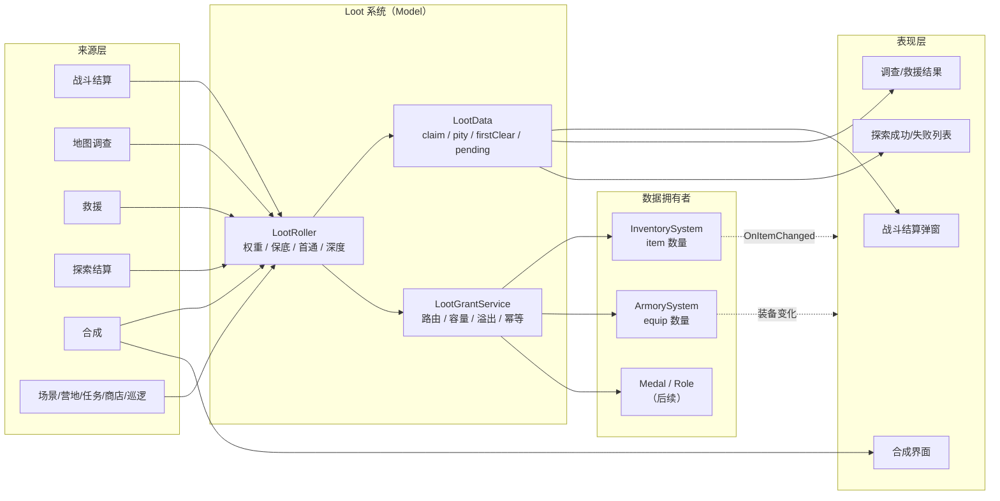
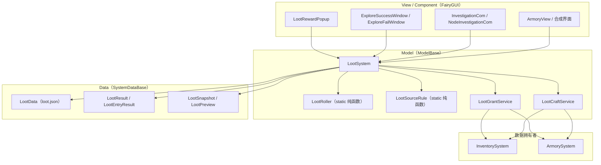
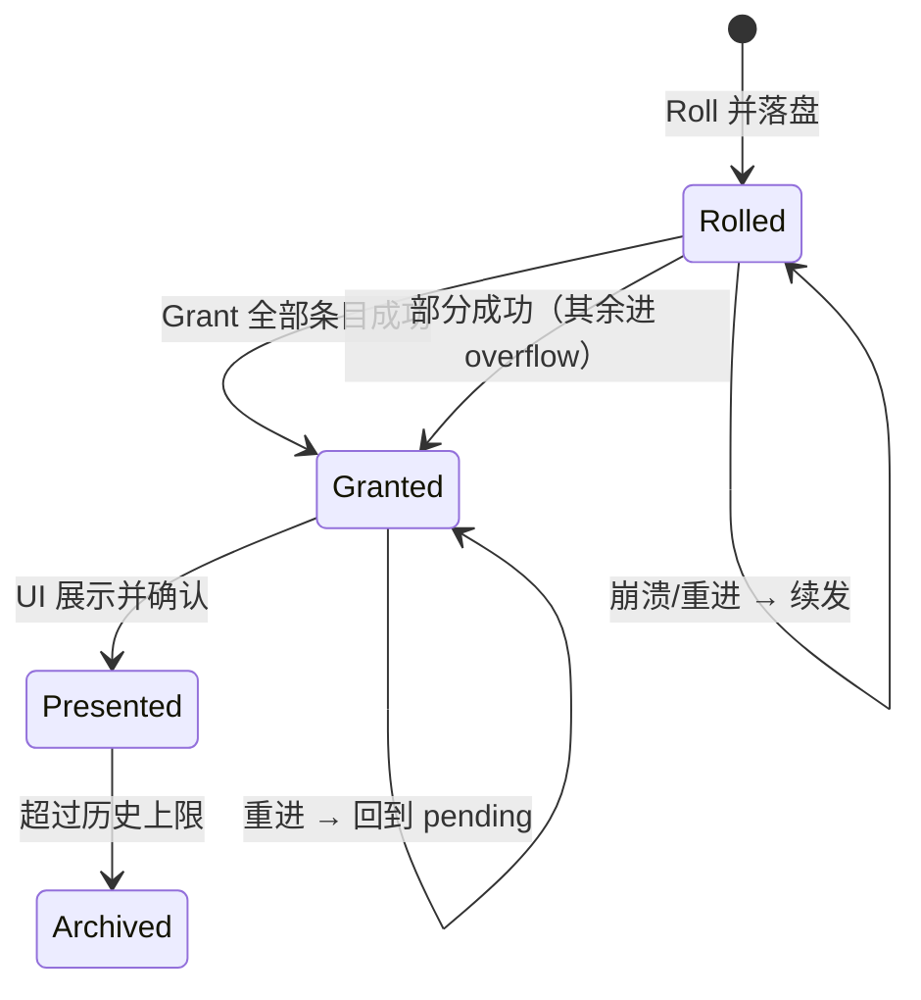
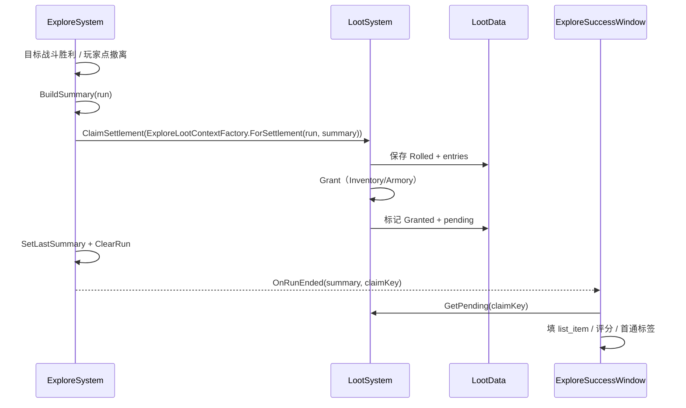
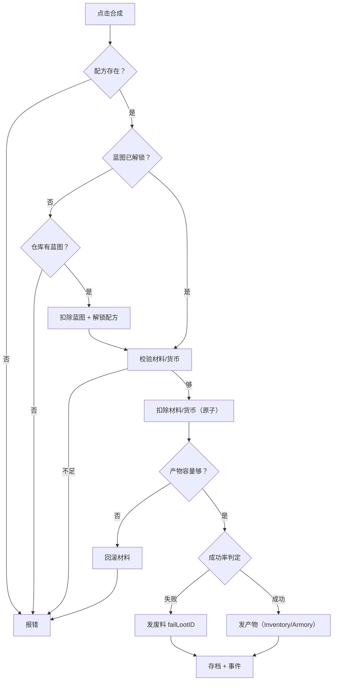

# 道具产出系统实现计划（掉落 · 调查 · 救援 · 结算 · 合成）

> 版本：**v1.0（计划，未实现）** · 2026-11-11
> 依据：`策划文档/1异常调查事务所-项目介绍.docx`、`2…资源.docx`、`5…装备系统.docx`、`7…仓库系统.docx`、`8…战斗系统.docx`；`Docs/战斗系统实现计划.md` §7、`Docs/探索界面实现计划.md` §3/§10、`Docs/仓库系统实现说明.md`、`Docs/军械库实现说明.md`、`Docs/系统制作规范.md`
> 适用落点：`Assets/HotUpdate/GameMain/Script/Game/Loot/`、`DataTable/lootTable|lootEntry|lootSource|lootConst|nodeEvent|craftRecipe|craftCost`、`UIProject/assets/Base|World`
> 配套表：`Docs/道具产出系统计划表.xlsx`（产出方式矩阵、配置表字段、预算、任务、验收、风险）

---

## 0. 一页结论

| 项 | 结论 |
|---|---|
| 系统数量 | **1 个新系统 `Loot`**（MVC：Model / Data / Event / Define / View / Debug），不新建第二个道具权威库 |
| 核心管线 | **Roll（掷骰）→ Grant（入库）→ Present（展示）** 三段分离，任何来源都不允许自己随机、自己写库 |
| 产出来源 | 用户指定 5 类（战斗 / 调查 / 救援 / 探索结算 / 合成）+ 补充 9 类，共 **14 类 / 24 个具体入口** |
| 配置 | 新增 **7 张表**（lootTable / lootEntry / lootSource / lootConst / nodeEvent / craftRecipe / craftCost），改造 item / equip / encounter / `__tables__` |
| 关键规则 | 深度与危险分层、跨局保底、首通一次性、claimKey 幂等、仓库满转 overflow、合成原子扣料 |
| 首个可见成果 | 战斗胜利、调查完成、探索成功/失败三个界面能显示**真实奖励列表**，不再是空列表 |
| 工期 | 核心 P0–P2 约 **12.5 人日**；含合成 P3 约 **16.5 人日**；全量（任务/商店/巡逻）约 **29 人日**；两人并行约 **15 个工作日** |
| 最大风险 | 蓝图语义（解锁 vs 消耗）、目标奖励时点、`Evacuate` 清档顺序、item 表内容不足 |

**一句话**：产出系统不是“写一张掉落表”，而是把“谁在什么时点、用什么上下文、掷哪张表、发给谁、怎么防重复”变成一条统一管线；表只描述内容，管线保证一致性、可追溯和可调参。

---

## 1. 现状盘点：已有什么、缺什么

### 1.1 已有（可直接复用）

| 资产 | 位置 | 说明 |
|---|---|---|
| 道具权威数据 | `Game/Inventory/Data/InventoryData.cs` + `Model/InventorySystem.cs` | `item` 表道具的唯一写入口，`inventory.json`；已有 `AddItem / RemoveItem / AddItems / TryExchange / CanAdd` |
| 装备持有 | `Game/Armory/Data/ArmoryData.cs` + `Model/ArmorySystem.cs` | `equipId → count`，`armory.json`；已有 `GrantEquip` |
| 军械库合成 | `ArmorySystem.Craft` | 临时规则：1 蓝图 + 1~3 材料，蓝图名字去掉“蓝图”= `equip.name`；**每次合成消耗蓝图** |
| 战斗结算产物 | `Game/Battle/Data/BattleResult.cs`、`BattleSettlement.cs` | `BattleResult` 只汇总单位结果，不写别的系统 Data；`BattleEvent.OnBattleEnded` 已广播 |
| 战斗奖励字段 | `DataTable/encounter.xlsx` → `rewardLoot` | **字段已存在**，但没有 lootTable、没有消费方，表也是 0 行 |
| 探索事件 | `Game/Explore/Model/ExploreSystem.cs`、`Event/ExploreEvent.cs` | `OnBattleNodeEntered`、`OnNodeEventTriggered`、`OnRunEnded`、`OnRunChanged`；节点有 `m_Resolved`、`m_VisitCount` |
| 探索结算壳 | `ExploreSuccessWindow / ExploreFailWindow / ExploreSettlement` | 界面已能打开，`list_item` 目前固定清空，等奖励系统填 |
| 调查点壳 | `NodeSettingView.BuildInvestigationInfo`、`InvestigationCom` | 已能显示 3 个调查点、成功率 75/60/50；**硬编码、无配表、无奖励** |
| 通用物品格 | `Game/ComponentUI/CommonItemCom.cs` | `SetItem / SetEquip / SetCount`，品质底图与图标已可用 |
| 基础配置 | `DataTable/item.xlsx`（30 行道具）、`equip.xlsx`（12 行）、`nodeType.xlsx`（8 行） | 货币、材料、蓝图、普通/炼金/异常装备的 ID 已成型 |

### 1.2 缺口（本计划要补的）

| 编号 | 缺口 | 影响 | 处理阶段 |
|---|---|---|---|
| **G1** | 没有 `Loot` 系统 / Data / Event | 每个来源都会重复写“随机 + 发奖 + 存档”，数值无法统一调 | P1 |
| **G2** | `encounter.rewardLoot` 没有表、没有消费方 | 战斗胜利没有任何掉落 | P2 |
| **G3** | 调查点是硬编码 3 个、成功率 75/60/50 | 策划改不了；不同区域/节点类型无法差异化 | P2 |
| **G4** | 救援节点没有面板、没有奖励 | 节点类型 2 进入后只广播事件，玩家看不到结果 | P2 |
| **G5** | 探索结算没有 summary / grade / 奖励 | 成功/失败界面列表为空；无法做 S/A/B 评分与首通 | P2 |
| **G6** | 没有配方表；军械库按名字匹配、每次消耗蓝图 | 蓝图语义与文档 2“使用蓝图解锁制造权限”冲突；配方不可配 | P3 |
| **G7** | 没有首通、保底、领取幂等 | 重复领奖 / 读档重掷 / 稀有物品无兜底 | P1/P2 |
| **G8** | 仓库容量默认 0（不限），没有溢出处理 | 一旦开启容量，奖励会静默丢失 | P2/P4 |
| **G9** | `itemUse` 为空，item 表没有消耗品/救援凭证/炼金蓝图 | 掉落表只能掉现有材料，内容单薄 | P0（内容） |
| **G10** | `ArmoryData` 只有数量，没有装备实例 | “全灭遗失装备、下次回收”无法精确实现 | P4（依赖） |

### 1.3 三个关键判断

1. **产出必须独立成系统**：`InventorySystem` 只管“持有数量”，`ExploreSystem` 只管“节点进度”，`BattleSystem` 只管“战斗结果”。如果掉落逻辑塞进任何一个现有系统，第二个来源就会复制一套随机与发奖代码，数值再也对不齐。
2. **`Loot` 不拥有道具/装备数据**：它只做“掷骰 + 路由 + 记录”，最终写入仍然走 `InventorySystem.AddItem` / `ArmorySystem.GrantEquip`。这样不会出现第二个 `inventory.json`。
3. **产出要可复现、可审计**：同一 `claimKey` 必须掷出同一结果；掷骰结果先落盘再发奖；发奖按条目逐条标记。否则玩家 Alt+F4 就能重掷，出问题也无法排查。

---

## 2. 设计目标与原则

| 原则 | 落地要求 |
|---|---|
| **单一入口** | 所有产出必须经过 `LootSystem`；禁止在 View / Explore / Battle 里直接 `new Random()` 或直接改 `InventoryData` |
| **配置驱动** | 掉落表、条目、来源映射、节点事件、配方全部进表；代码里只允许出现枚举与默认兜底，不写死物品 ID |
| **三段分离** | `Roll` 只读配置和数据、产出 `LootResult`；`Grant` 只负责入库；`Present` 只负责 UI。任何一段失败都不影响另外两段 |
| **确定性 + 幂等** | `claimKey → seed → 结果` 固定；`Grant` 对同一条目重复调用不重复加数量；结算奖励一局只发一次 |
| **先落盘后发奖** | `Rolled` 状态先存档，再逐条发放；崩溃后重进可以续发，不会重掷 |
| **表现与规则分离** | Model 不引用 FairyGUI；奖励列表只读 `LootResult` / `LootSnapshot`，不自己查配置拼掉落 |
| **可观测** | 每次产出有日志、有历史、有 `Dump()`；Debug 菜单能模拟 1 万次掉落看分布 |
| **可扩展** | 新来源只加 `LootSourceType` + 一行 `lootSource`，不改管线；新产物类型只加 `LootOutputType` 分支 |

---

## 3. 产出方式总表

### 3.1 用户指定的 5 类（核心）

| 编号 | 产出方式 | 子类型 / 触发 | 产出物 | 规则要点 | 配置 | 展示 | 阶段 |
|---|---|---|---|---|---|---|---|
| **A1** | 战斗结算 | 普通战斗胜利（nodeType 1） | 材料、欧元、消耗品、低概率蓝图 | 1~2 次权重抽取；`encounter.rewardLoot` 优先，`riskTier` 回退 | `encounter.rewardLoot` + `lootSource` | 战斗结算弹窗 / toast | P2 |
| **A2** | 战斗结算 | 强敌胜利（nodeType 8） | 进阶材料、异常材料、黄金、蓝图 | 2~3 次抽取；首通额外；蓝图保底计数 | `lootSource` + `lootTable` | 同上 | P2 |
| **A3** | 战斗结算 | 目标节点战斗胜利 | 高价值材料、蓝图、异常材料 | 3~4 次抽取；必出 1 蓝以上；完成调查时立即结算 | `lootSource` + `lootTable` | 目标完成弹窗 | P2 |
| **B1** | 地图调查 | 物资搜索（nodeType 3） | 材料、欧元、消耗品 | 每节点 2~3 个调查点；成功率 50%~80%；感知解锁隐藏发现 | `nodeEvent` | 调查点卡片 → 结果弹窗 | P2 |
| **B2** | 地图调查 | 异常现象考察（nodeType 4） | 异常材料、情报道具、SAN 相关 | 消耗 SAN；成功给异常材料，失败给情报/空；可触发 SAN 事件 | `nodeEvent` | 同上 | P3（依赖 SAN） |
| **B3** | 地图调查 | 异常物品回收（nodeType 5） | 异常材料、异常装备 | 深度/危险门槛；异常装备只在深入或高感知时出现 | `nodeEvent` | 同上 | P3 |
| **C1** | 救援 | 救援人员（nodeType 2） | 欧元、消耗品、蓝图、招募合同 | 2~3 个救援目标；成功率受感知/队伍影响；失败给少量谢礼 | `nodeEvent` | 救援结果弹窗 | P2 |
| **C2** | 救援 | 失联人员 / 遗失物 | 失踪角色、上局遗失装备 | 依赖角色失踪状态与装备实例；不是 P2 范围 | `nodeEvent.specialType` | 特殊结果 | P4 |
| **D1** | 探索结算 | 完成调查（goal reached） | 完成奖励、首通奖励、评分奖励 | 目标达成**立即**发完成奖励；S/A/B 评分 | `lootSource` + `lootTable` | 成功结算列表 | P2 |
| **D2** | 探索结算 | 中途撤离 | 无完成奖励；已获得物资保留 | 保存进度；只显示总结，不再补发 | 无 | 失败/撤离结算 | P2 |
| **D3** | 探索结算 | 全灭 | 无结算奖励；装备遗失 | 已入库物资保留；装备遗失记录（P4） | 无 | 失败结算 | P2 |
| **D4** | 探索结算 | 继续深入（depth 1~3） | 高阶材料、彩金、欧泊、异常装备 | 每层额外抽取；撤离时按最大深度发深入结算 | `lootSource.minDepth` | 深入结算 | P2/P3 |
| **E1** | 道具合成 | 材料进阶（制造处） | 彩钢、高密度聚合物、拟刚体等 | 配方消耗基础材料；即时版先做，排程版后做 | `craftRecipe` + `craftCost` | 合成界面 | P3 |
| **E2** | 装备合成 | 普通装备（军械库） | 5001~5007 | 蓝图解锁 + 材料；产物直接进 `ArmoryData` | `craftRecipe` + `craftCost` | 军械库 | P3 |
| **E3** | 装备合成 | 炼金装备（炼金工房） | 5008~5009 | 炼金蓝图 + 进阶材料；工房界面后置 | `craftRecipe` | 炼金工房 | P4 |

### 3.2 视情况补充的 9 类

| 编号 | 产出方式 | 触发 | 产出物 | 为什么值得加 | 阶段 |
|---|---|---|---|---|---|
| **F1** | 场景事件 | nodeType 6，选项式 | 道具、货币、SAN 变化、负面效果 | 节点类型 6 已有定义，不能只有“战斗/搜索”两种玩法 | P3 |
| **F2** | 露营地补给 | nodeType 7，每营地 1 次 | 消耗品、弹药、少量材料 | 露营地已有 `canRest/canUseMule/canEvacuate`，补给是它最自然的功能 | P3 |
| **F3** | 首通 / 图鉴 | 区域首次完成、Boss 首杀、节点类型首次发现 | 蓝图、货币、唯一收藏品 | 给长线目标；不需要新系统，只需 `LootData` 标记 | P2 |
| **F4** | 遗失装备回收 | 全灭后，下次探索的救援/回收节点 | 上局遗失装备 | 对应文档 8“装备遗失在异常区域，可下一次回收” | P4 |
| **F5** | 任务 / 委托 | 任务提交、主线/支线 | 固定或权重奖励 | 文档 1 的任务系统是资源循环的一环 | P5 |
| **F6** | 商店 / 黑市 | 购买 | 装备、材料、消耗品 | 产出系统的“反向出口”；也用于回收欧元/彩金 | P5 |
| **F7** | 挂机巡逻 | 时间结算 | 材料、欧元、少量蓝图 | 文档 1 的挂机巡逻系统；给离线收益 | P5 |
| **F8** | 授勋结算 | 探索完成，按表现 | 勋章（medal） | 文档 4“完成调查后颁发勋章”；是结算的一部分 | P4（依赖 medal） |
| **F9** | 活动 / 邮件 | 活动、补偿、运营 | 任意 | 预留接口，不在本期实现 | P6 |

### 3.3 产出管线总图



---

## 4. 产出规则设计

### 4.1 分层：深度 × 危险

产出强度由两个维度决定，避免“一张表打天下”：

| 维度 | 取值 | 来源 | 作用 |
|---|---|---|---|
| **depth** | 0 首次调查 / 1 深入 I / 2 深入 II / 3 深入 III | `ExploreRun.m_Depth` | 解锁 `lootEntry.minDepth`；每层给 `weightGrowth` 加成；深入结算单独加表 |
| **riskTier** | 0 普通 / 1 精英 / 2 强敌 / 3 目标/深入 | 节点类型 + encounter | 解锁 `lootEntry.minRisk`；强敌/目标用更高档表 |

**深度规则（建议）**：

| depth | 名称 | 开放条件 | 掉落偏向 | 风险 |
|---|---|---|---|---|
| 0 | 首次调查 | 从指挥室出发 | 基础材料、欧元、低概率蓝图 | 普通 |
| 1 | 深入 I | 目标达成后选择继续 | 进阶材料、黄金、蓝图 | SAN 持续消耗 |
| 2 | 深入 II | 深入 I 后继续 | 异常材料、彩金、欧泊（低概率） | 高 |
| 3 | 深入 III | 深入 II 后继续 | 异常装备、异常核心、欧泊 | 极高 |

> 文档 8：目标奖励**即时结算**；继续深入的代价与收益由事务所承担，额外奖励与人员伤亡、装备损失无关。因此 `D1` 在目标达成时发，`D4` 在撤离时按最大深度发，两者不要混在一个表里。

### 4.2 品质与价值口径

- **品质不随机**：`item.quality` / `equip.quality` 是配置值，掉落只做“按品质过滤/展示”，不做“白装随机升紫”。这样数值可控，也避免同一物品两种品质的存档问题。
- **价值口径**：预算用 `item.sellPrice` 作为“回收底价”；装备按配方材料成本估算。`sellPrice` 不是制造成本，高级材料卖价低但不代表它便宜（它是装备门槛）。
- 后续如要做埋点/预算，建议给 `item` 加一列 `value`（仅统计用，不参与买卖），不要复用 `sellPrice`。

**品质档位（只影响底图/播报，不代表价值）**：

| 品质 | ID | 用途 |
|---|---|---|
| 白 | 1 | 普通底图；低阶材料/消耗品 |
| 绿 | 2 | 普通底图 |
| 蓝 | 3 | 蓝底；合成油/坍缩液等 |
| 紫 | 4 | 紫底；蓝图/异常气泡等 |
| 金 | 5 | 金底；钢/彩钢/异常晶髓等 |
| 橙 | 6 | 橙底；拟刚体/相变/坍缩态等 |
| 红 | 7 | 红底；欧泊/异常核心/异常装备 |

> 注意：当前 `item.quality` 与价值**不是线性对应**——钢是金品质但只卖 20，欧泊是红品质卖 1000。预算一律按 `sellPrice`，品质只用于 UI 和播报；不要用品质带反推掉率。

### 4.3 保底

| 组 | 触发条件 | 计数 | 保底池 | 适用 |
|---|---|---|---|---|
| 1 蓝图 | 8 次“有稀有资格”的抽取未出蓝图 | 每次战斗/调查/救援的 rare 判定失败 +1；出蓝图重置 | `lootTable 10100`（随机蓝图池） | 所有含 `rare` 蓝图的表 |
| 2 异常装备 | 5 次强敌/深入未出异常装备 | 只在 riskTier≥2 或 depth≥1 时计数 | `lootTable 10200`（异常装备池） | 强敌/深入 |

规则细节：

- 只有“这张表里存在 `rare=true` 且本次上下文满足 `minDepth/minRisk` 的条目”时才计数，避免在低级表里空转。
- 保底触发时**额外**发放 `pityLootID` 的一次抽取，不替代本次正常抽取。
- 计数器存 `LootData`，跨局保留；出稀有重置；读档恢复。
- UI 第一版不显示保底进度，只在 Debug 菜单打印；后续可在结算页加“保底 x/8”。

### 4.4 首通

| 首通类型 | key 示例 | 奖励 | 说明 |
|---|---|---|---|
| 区域首次完成 | `zone:1` | `lootSource.firstClearLoot`（固定表） | 每个区域一次 |
| Boss 首杀 | `boss:9001` | 首通表 + 保底蓝图 | 每个 encounter 一次 |
| 节点类型首次发现 | `nodetype:5` | 少量材料/图鉴条目 | 可选，P4 |
| 难度/深度首次 | `depth:3` | 深入专属表 | 可选 |

- `LootData.m_FirstClear` 存 `HashSet<string>`，账号级，不随 run 清空。
- `lootEntry.firstOnly=true` 的条目只在首通标记未设置时参与。
- 首通奖励和普通奖励合并成一个 `LootResult`，UI 打“首通”角标，不单独弹两次窗。

### 4.5 重复限制与防刷

| 场景 | 规则 |
|---|---|
| 探索节点 | 每个节点 `m_Resolved` 后不再触发；回退已探索节点不给掉落 |
| 战斗 | 同一节点同一场战斗只结算一次；`BattleSystem` 的阶段守卫 + `claimKey` 双保险 |
| 调查/救援 | 每节点按 `nodeEvent.maxPerNode`；默认 1 次；失败也算用掉 |
| 结算 | 一局只发一次完成奖励、一次深入结算；`ExploreData` 清 run 前先写 summary + claimKey |
| 商店/巡逻/任务 | `maxPerRun / maxPerDay / stock` 由各自表控制 |
| Save-Scum | `claimKey` 哈希出 seed；`Rolled` 结果先落盘；发奖逐条标记；重进不重掷 |

**claimKey 格式**：

```text
v1|{sourceType}|{runSeed}|{nodeId}|{sourceId}|{seq}
```

示例：

- 战斗：`v1|1|123456|7|9001|0`
- 调查：`v1|2|123456|7|40001|0`
- 救援：`v1|3|123456|7|40003|0`
- 完成结算：`v1|4|123456|-1|1|0`
- 深入结算：`v1|4|123456|-1|1|1`
- 合成：`v1|5|0|0|50004|{craftSeq}`

`runSeed` 来自 `ExploreRun.m_Seed`；非探索来源用 0 + 自增 `m_Seq` 或日期（任务/商店）。

### 4.6 失败与全灭

| 结果 | 战斗掉落 | 完成奖励 | 深入结算 | 已入库物资 | 装备 |
|---|---|---|---|---|---|
| 胜利 | ✅ | 目标达成时 ✅ | 撤离时 ✅ | 保留 | 保留 |
| 主动撤离 | ❌（无战斗） | ❌ | 按已到达深度 ✅ | 保留 | 保留 |
| 全灭 | ❌ | ❌ | ❌ | **保留**（已经拿到手的） | **遗失**（P4 记录，可回收） |
| 撤退/Abort | ❌ | ❌ | 按已到达深度 ✅ | 保留 | 保留 |

> 当前 `ExploreConst.TestKeepRunOnDefeat = true` 时战败不结束调查；正式版改 `false` 后再接全灭结算。测试期不要因为“保留进度”而重复发战斗掉落——`m_Resolved` + claimKey 已经能防住。

### 4.7 仓库容量与溢出

- `InventoryData` 的 `maxSlots / maxWeight` 默认 0（不限）。本计划**不主动开启上限**，但管线必须支持。
- 发放前逐条 `CanAdd`；能放下的直接发，放不下的进 `LootData.m_Overflow`，并广播 `OnLootOverflowChanged`。
- 溢出条目在仓库界面加“临时回收箱”入口（P4）；取出时再走一次 `Grant`，不重复掷骰。
- `maxOverflow` 默认 100 条；超过后拒绝新奖励并打 error（宁可报错，不要静默丢）。
- 装备不受 `InventoryData` 容量限制（`ArmoryData` 目前无上限）；如果以后加装备格，再在 `LootGrantService` 里补。

### 4.8 角色属性的作用边界

| 属性 | 作用 | 不作用 |
|---|---|---|
| 感知 | 调查/救援的**隐藏发现**：达到 `perceptionThreshold` 才掷 `hiddenLootID` | 不影响基础掉率、不影响战斗掉落 |
| SAN | 节点/移动消耗；归零触发癫狂/失踪 | 不作为掉落倍率 |
| 职称/评分 | 结算评分、授勋 | 不直接加掉率 |
| 死亡/重伤 | 结算 grade、装备遗失 | 不把已获得物资扣掉（避免双重惩罚） |

> 这样设计的原因：感知是“探索发现”属性，如果它同时加掉率，会把角色强度和经济直接绑定，后期很难调。隐藏发现是“额外一扇门”，可控得多。

### 4.9 合成规则

| 项 | 规则 |
|---|---|
| 配方来源 | `craftRecipe` + `craftCost`；不在代码里写“名字去掉蓝图” |
| 蓝图 | **推荐永久解锁**：首次合成消耗 1 张蓝图，写入 `LootData.m_UnlockedRecipes`；之后只扣材料 |
| 成功率 | `successRate` 万分比；10000 = 必成；失败消耗材料，给 `failLootID`（废料/副产品） |
| 原子性 | 先校验全部材料/货币/产物容量，再扣；扣完发不出则回滚（装备表找不到属于配置错误，必须在扣之前校验） |
| 批量 | `TryCraft(recipeId, count)` 循环，失败即停；UI 显示“最大可做” |
| 产物 | 道具走 `InventorySystem`，装备走 `ArmorySystem`；配方本身不直接写 Data |
| 排程生产 | 制造处“安排角色 + 时间”是 P5/P6；先做即时版，复用同一 `craftRecipe` |

---

## 5. 系统架构

### 5.1 分层与依赖



**依赖方向**：View → LootSystem → LootData；LootSystem → InventorySystem / ArmorySystem；`LootRoller / LootSourceRule` 只依赖配置与入参，允许 `static`（规范 §4.5）。

### 5.2 目录与文件清单

```text
Assets/HotUpdate/GameMain/Script/Game/Loot/
├── Model/
│   ├── LootSystem.cs              # 唯一对外入口：Roll / Grant / Claim / Preview / Craft
│   ├── LootRoller.cs              # 纯函数：权重、次数、保底、首通、深度、确定性随机
│   ├── LootSourceRule.cs          # 纯函数：sourceType + param → lootSource 匹配
│   ├── LootGrantService.cs        # 产物路由、容量检查、溢出、逐条幂等
│   └── LootCraftService.cs        # 配方校验、扣料、成功率、产物发放
├── Data/
│   ├── LootData.cs                # SystemDataBase：pity / firstClear / claims / pending / overflow / history
│   ├── LootResult.cs              # 一次产出结果（含 claimKey / grade / entries）
│   ├── LootEntryResult.cs         # 单条结果（outputType / id / count / quality / flags / granted）
│   ├── LootContext.cs             # 掷骰上下文（来源、节点、深度、危险、感知、战斗结果）
│   └── LootSnapshot.cs            # 给 UI 的只读投影 + Preview
├── Event/
│   ├── LootEvent.cs               # OnLootRolled / OnLootGranted / OnLootPendingChanged / OnLootOverflowChanged
│   └── LootMessage.cs             # 消息体 + ToString
├── Define/
│   └── LootDefine.cs              # LootSourceType / LootOutputType / LootMode / LootGrade / 常量
├── View/
│   ├── LootRewardPopup.cs         # 通用奖励弹窗（UIPopup）
│   └── LootViewData.cs            # 包注册 + 弹窗队列（如需要）
├── Component/
│   └── LootItemRender.cs          # static：把 LootEntryResult 渲染到 CommonItemCom
└── Debug/
    └── LootDebug.cs               # 菜单：模拟、发放、清保底、校验、打印
```

> 第一版**不新建 FairyGUI 包**：奖励弹窗用 `Base/PopupWindow` + `Base/CommonItemCom`，预制体放 `World` 组；等 UI 稳定后再考虑独立 `Loot` 包。

### 5.3 核心类职责

| 类 | 职责 | 禁止 |
|---|---|---|
| `LootSystem` | 生命周期、对外 API、编排 Roll/Grant/Present、广播事件 | 不写 `InventoryData`；不引用 FairyGUI |
| `LootRoller` | 纯计算：匹配表、算次数、按权重抽、保底、首通、深度/危险过滤、生成 `LootResult` | 不读 `LootData` 以外的运行时状态；不写库 |
| `LootSourceRule` | 把 `LootContext` 映射到 `lootSource` 行；处理优先级/通配/`minDepth` | 不掷骰 |
| `LootGrantService` | 按 `outputType` 路由到 Inventory/Armory/Medal/Role；容量与溢出；逐条标记 `granted` | 不决定掉什么 |
| `LootCraftService` | 配方查询、材料校验、扣料、成功率、产物/废料 | 不持有装备数据 |
| `LootData` | 权威持久化：pity / firstClear / claims / pending / overflow / unlockedRecipes / history | 不广播事件（由 Model 广播） |

### 5.4 生命周期与注册

```csharp
// DataManager.LoadGameData()
RegisterData<LootData>();

// ModelManager.LoadModels()
Register<InventorySystem>();
Register<ArmorySystem>();
Register<LootSystem>();   // 依赖 Inventory/Armory，放最后
```

- `LootData.Init()` 由基类 `Clear()`；`LootSystem.OnStart()` 调 `DB.Load()`。
- `LootSystem.OnInit()` 只订阅自己长期需要的事件（如果有）；本计划**不订阅** `BattleEvent`，避免和 `ExploreSystem` 重复结算。
- `OnDestroy()` 退订；`Save()` 由 Model 在写成功后调用。

### 5.5 与现有系统的边界

| 系统 | Loot 怎么用 | 不做什么 |
|---|---|---|
| `ExploreSystem` | 战斗结束/节点结算/撤离时构造 `LootContext`，调 `LootSystem` | 不自己随机、不直接发道具 |
| `BattleSystem` | 只产出 `BattleResult`；不调 Loot | 不关心掉落表 |
| `InventorySystem` | `AddItem / AddItems / CanAdd / RemoveItem` | 不感知“掉落来源”以外的逻辑；`InventoryChangeReason` 只做日志 |
| `ArmorySystem` | `GrantEquip / GetEquipCount`；合成时作为产物出口 | 不再自己匹配配方（P3 重构） |
| `RoleSystem` | 救援失踪角色时 `RecoverRole`（P4） | 不参与普通掉落 |
| `MedalSystem`（未建） | 授勋结算输出（P4） | 没有系统前，`outputType=3` 打 warning 并跳过 |

---

## 6. 数据模型与存档

### 6.1 `LootContext`

```csharp
public class LootContext
{
    public LootSourceType m_SourceType;
    public int m_SourceId;        // encounterId / nodeEventId / questId / recipeId
    public int m_ZoneId;
    public int m_RunSeed;
    public int m_NodeId;
    public int m_NodeTypeId;
    public int m_Depth;
    public int m_RiskTier;
    public string m_ClaimKey;
    public int m_Perception;
    public bool m_IsFirstClear;
    public BattleOutcome m_BattleOutcome;
    public int m_AllyDeaths;
    public float m_BattleDuration;
    public int m_Grade;           // 结算用：D=1 / C=2 / B=3 / A=4 / S=5
    public int m_RollAdd;         // 战斗评分/难度带来的额外抽取次数
}
```

> **边界**：`LootContext` 是纯 DTO，不引用 `ExploreRun / ExploreNode / BattleResult` 等外来类型；这些字段由来源侧（`Explore/Model/ExploreLootContextFactory`）填好再传给 `LootSystem`。这样 `Loot` 不反向依赖 Explore/Battle，避免两个系统互相引用。
>
> 工厂放在 Explore 侧，示例：`ExploreLootContextFactory.ForBattle(run, node, battleResult)`、`ForNodeEvent(run, node, eventId)`、`ForSettlement(run, summary)`；`Loot` 只认 `LootContext`。

### 6.2 `LootResult` / `LootEntryResult`

```csharp
public class LootEntryResult
{
    public LootOutputType m_OutputType; // Item / Equip / Medal / Role
    public int m_OutputId;
    public int m_Count;
    public int m_Quality;
    public bool m_IsRare;
    public bool m_IsFirstClear;
    public bool m_IsPity;
    public bool m_IsHidden;
    public bool m_Granted;              // 逐条幂等标记
}

public class LootResult
{
    public string m_ClaimKey;
    public int m_LootTableId;
    public LootSourceType m_SourceType;
    public int m_SourceId;
    public LootGrade m_Grade;
    public bool m_IsChoice;             // mode=3 时，entries 是选项
    public readonly List<LootEntryResult> m_Entries = new List<LootEntryResult>();
    public bool IsEmpty { get; }
    public int GetTotalValue();         // 预算/日志用
}
```

**枚举（`LootDefine.cs`，配置表里用 int，代码里用枚举）**：

| 枚举 | 值 |
|---|---|
| `LootSourceType` | 1 Battle / 2 Investigation / 3 Rescue / 4 Settlement / 5 Craft / 6 Scene / 7 Camp / 8 Quest / 9 Shop / 10 Patrol / 11 FirstClear / 12 Salvage / 13 Goal / 14 EventMail（预留） |
| `LootOutputType` | 1 Item / 2 Equip / 3 Medal / 4 Role |
| `LootMode` | 1 Weighted / 2 Fixed / 3 ChooseOne |
| `LootGrade` | 1 D / 2 C / 3 B / 4 A / 5 S（0 None） |
| `LootGrantReason` | Battle / Investigation / Rescue / Settlement / Craft / Quest / Shop / Patrol / Overflow / Debug |

### 6.3 `LootData` 存档（`loot.json`）

```json
{
  "version": 1,
  "seq": 12,
  "pity": [
    { "group": 1, "counter": 3 },
    { "group": 2, "counter": 1 }
  ],
  "firstClear": ["zone:1", "boss:9001"],
  "unlockedRecipes": [50004, 50001],
  "claims": [
    {
      "key": "v1|1|123456|7|9001|0",
      "tableId": 10002,
      "state": 2,
      "entries": [
        { "t": 1, "id": 1021, "c": 1, "q": 5, "g": 1 },
        { "t": 1, "id": 2000, "c": 1, "q": 4, "g": 1 }
      ]
    }
  ],
  "pending": [
    {
      "key": "v1|4|123456|-1|1|0",
      "title": "调查成功",
      "entries": [{ "t": 1, "id": 1002, "c": 1, "q": 5 }]
    }
  ],
  "overflow": [
    { "t": 1, "id": 1007, "c": 3 }
  ],
  "history": []
}
```

- `claims` 只保留最近 50 条；`pending` 最多 8 条；`overflow` 最多 100 条；`history` 最多 50 条。
- `state`：0 None / 1 Rolled / 2 Granted / 3 Presented / 4 Archived。
- `entries[].g`：该条是否已发放；`1` 后重试跳过。
- `unlockedRecipes` 也可以放 `ArmoryData`，但“一个系统一个 Data”，放 `LootData` 更符合规范；`ArmorySystem` 通过 `LootSystem.IsRecipeUnlocked` 查询。

### 6.4 Claim 状态机



- `Roll` 成功即写 `Rolled` + 结果；此时还没有加道具。
- `Grant` 逐条处理：成功标 `g=1`，失败进 overflow 也标 `g=1`（表示“已处理”）；全部处理完写 `Granted`。
- `Present` 只做 UI 消费，不改库存；`ConsumePending(key)` 后写 `Presented`。
- 读档时：`Rolled` → 自动补发；`Granted` 未展示 → 放回 `pending`；`Presented` → 不再弹。

### 6.5 版本与兼容

- `loot.json` 首版 `version=1`；以后加字段一律给默认值，缺字段不能让整份存档失败。
- 旧档没有 `loot.json`：新档，保底 0、首通空、配方空。
- 如果以后把 `unlockedRecipes` 移到 `ArmoryData`，用 `GetLegacySaveFileName()` 或一次性迁移标记；首版不做。

---

## 7. 配置表设计

### 7.1 表清单

| 表 | 状态 | 主键 | 用途 | 阶段 |
|---|---|---|---|---|
| `lootTable.xlsx` | **新建** | ID | 一次抽取的规则（次数、模式、保底、空奖） | P0 |
| `lootEntry.xlsx` | **新建** | ID | 条目（产物、权重、数量、深度/危险/首通限制） | P0 |
| `lootSource.xlsx` | **新建** | ID | 来源 → 掉落表映射（战斗/结算/任务/商店） | P0 |
| `lootConst.xlsx` | **新建（KV）** | ID | 全局参数（上限、加成、播报品质） | P0 |
| `nodeEvent.xlsx` | **新建** | ID | 非战斗节点内容（调查/救援/场景/营地） | P0 |
| `craftRecipe.xlsx` | **新建** | ID | 配方（材料/装备、成功率、蓝图、时间） | P0 |
| `craftCost.xlsx` | **新建** | ID | 配方材料明细（一料一行） | P0 |
| `item.xlsx` | 改造 | ID | 补消耗品/救援凭证/炼金蓝图；可选 `value` 列 | P0 |
| `equip.xlsx` | 改造 | ID | 补炼金装备的配方关联；异常装备仍走掉落表 | P3 |
| `encounter.xlsx` | 改造 | ID | `rewardLoot` 填 `lootTable.ID`；表当前 0 行，需补内容 | P0/P2 |
| `__tables__.xlsx` | 改造 | — | 注册 7 张新表 | P0 |
| `__enums__.xlsx` | 可选 | — | 如果要把枚举导出给策划；否则枚举只放 `LootDefine.cs` | P0 |

> **Luban 坑**：`DataTable/__tables__.xlsx` 与 `__enums__.xlsx` 当前第一行多了一行“列1…列13”标题，Luban 要求 A1 以 `##` 开头（见 `Docs/军械库实现说明.md` §4）。加表前先修好，或使用去掉该行、合并枚举表头的副本，否则 `Framework/配置表导入` 会报“不包含有效的单元薄”。

### 7.2 `lootTable.xlsx`

| 字段 | 类型 | 说明 |
|---|---|---|
| `ID` | int | 掉落表 ID，建议 10000 起 |
| `name` | string | 内部名（英文/拼音，日志用） |
| `mode` | int | 1 权重抽取 / 2 固定 / 3 任选一 |
| `rollCount` | int | 基础抽取次数（mode=1） |
| `rollPerDepth` | int | 每深入 1 层额外次数 |
| `noRepeat` | bool | 同次抽取不重复同一条目 |
| `pityGroup` | int | 保底组（0 无） |
| `pityCount` | int | 触发保底所需次数 |
| `pityLootID` | int | 保底时额外掷的表（0 无） |
| `emptyWeight` | int | 空奖权重（0 不空） |
| `maxEntries` | int | 单次结果最多合并条目数（防 UI 爆） |
| `announceQuality` | int | ≥ 该品质播放高亮/音效 |
| `desc` | string | 说明 |

**示例**：

| ID | name | mode | rollCount | rollPerDepth | noRepeat | pityGroup | pityCount | pityLootID | emptyWeight | maxEntries | announceQuality | desc |
|---|---|---|---|---|---|---|---|---|---|---|---|---|
| 10001 | battle_normal | 1 | 2 | 0 | true | 1 | 8 | 10100 | 0 | 6 | 4 | 普通战斗 |
| 10002 | battle_boss | 1 | 3 | 0 | true | 1 | 8 | 10100 | 0 | 8 | 5 | 强敌/目标 |
| 10003 | supply_search | 1 | 1 | 0 | true | 0 | 0 | 0 | 0 | 4 | 4 | 物资搜索 |
| 10004 | rescue | 1 | 1 | 0 | true | 0 | 0 | 0 | 0 | 4 | 4 | 救援 |
| 10005 | settle_s | 1 | 2 | 0 | true | 0 | 0 | 0 | 0 | 8 | 5 | 完成 S/A/B 共用 |
| 10006 | deep_settle | 1 | 2 | 1 | true | 2 | 5 | 10200 | 0 | 8 | 5 | 深入结算 |
| 10100 | pity_blueprint | 1 | 1 | 0 | true | 0 | 0 | 0 | 0 | 1 | 5 | 保底蓝图池 |
| 10200 | pity_anomaly | 1 | 1 | 0 | true | 0 | 0 | 0 | 0 | 1 | 6 | 保底异常装备池 |

### 7.3 `lootEntry.xlsx`

| 字段 | 类型 | 说明 |
|---|---|---|
| `ID` | int | 条目 ID，建议 20000 起 |
| `lootID` | int | 所属 `lootTable.ID` |
| `group` | int | 组内互斥（0 不分组）；同组最多出一条 |
| `outputType` | int | 1 道具 / 2 装备 / 3 勋章 / 4 角色 |
| `outputID` | int | item/equip/medal/role ID |
| `minCount` | int | 最少数量 |
| `maxCount` | int | 最多数量 |
| `weight` | int | 权重（mode=1） |
| `quality` | int | 0=运行时读配置；>0 用于展示/过滤 |
| `rare` | bool | 是否稀有（参与保底计数） |
| `guaranteed` | bool | 必定发放（不占权重；mode=1 也生效） |
| `firstOnly` | bool | 仅首通 |
| `minDepth` | int | 最小深入层 |
| `maxDepth` | int | 最大深入层（0 不限） |
| `minRisk` | int | 最小危险等级（0 不限） |
| `limitPerRun` | int | 每局上限（0 不限） |
| `weightGrowth` | float | 每深入 1 层权重加成（0.15 = +15%/层） |
| `desc` | string | 说明 |

**示例（节选）**：

| ID | lootID | outputType | outputID | minCount | maxCount | weight | rare | guaranteed | firstOnly | minDepth | minRisk | desc |
|---|---|---|---|---|---|---|---|---|---|---|---|---|
| 20001 | 10001 | 1 | 1007 | 1 | 2 | 400 | false | false | false | 0 | 0 | 钢 |
| 20002 | 10001 | 1 | 1009 | 1 | 2 | 300 | false | false | false | 0 | 0 | 聚合物 |
| 20003 | 10001 | 1 | 1001 | 30 | 60 | 500 | false | false | false | 0 | 0 | 欧元 |
| 20004 | 10001 | 1 | 2000 | 1 | 1 | 15 | true | false | false | 0 | 0 | 匕首蓝图 |
| 20005 | 10002 | 1 | 1021 | 1 | 1 | 250 | false | false | false | 0 | 1 | 异常气泡 |
| 20006 | 10002 | 1 | 1008 | 1 | 1 | 200 | false | false | false | 0 | 1 | 彩钢 |
| 20007 | 10002 | 1 | 1002 | 1 | 1 | 120 | false | false | false | 0 | 1 | 黄金 |
| 20008 | 10002 | 1 | 2000 | 1 | 1 | 60 | true | false | false | 0 | 1 | 蓝图 |
| 20009 | 10002 | 1 | 1021 | 2 | 3 | 0 | false | true | false | 0 | 1 | 保底异常气泡 |
| 20010 | 10002 | 1 | 2006 | 1 | 1 | 20 | true | false | false | 1 | 1 | 炼金蓝图（深入） |
| 20011 | 10005 | 1 | 1002 | 1 | 2 | 0 | false | true | false | 0 | 2 | 完成必给黄金 |
| 20012 | 10005 | 1 | 1021 | 1 | 2 | 0 | false | true | false | 0 | 2 | 完成必给异常材料 |
| 20014 | 10006 | 1 | 1004 | 1 | 1 | 30 | true | false | false | 2 | 2 | 欧泊（深潜） |
| 20015 | 10006 | 2 | 5010 | 1 | 1 | 10 | true | false | false | 3 | 3 | 全知之眼（极低） |

> `guaranteed=true` 的条目在每个 `LootResult` 里只出现一次；`weightGrowth` 只对 `weight>0` 的条目生效；`quality=0` 时 UI 用 `item/equip` 的真实品质。首通奖励统一走 `lootSource.firstClearLoot`（示例里的 10101/10102 为首通表，未展开），不要同时再在普通表里放 `firstOnly` 条目，否则会双发。

### 7.4 `lootSource.xlsx`

| 字段 | 类型 | 说明 |
|---|---|---|
| `ID` | int | 映射 ID，建议 30000 起 |
| `sourceType` | int | 1 战斗 / 2 调查 / 3 救援 / 4 探索结算 / 5 合成 / 6 场景 / 7 营地 / 8 任务 / 9 商店 / 10 巡逻 / 11 首通 / 12 回收 / 13 目标完成 / 14 活动邮件（预留） |
| `param1` | int | 一级参数（zoneID / encounterID / questID / recipeID；0 任意） |
| `param2` | int | 二级参数：战斗 = riskTier（0 普通 / 1 精英 / 2 强敌 / 3 目标/深入）；结算 = grade（1~5）；其它来源 = 子类型或 0 |
| `lootID` | int | 主表 |
| `extraLootID` | int | 附加表（0 无；结果合并） |
| `priority` | int | 匹配优先级，大者优先 |
| `rollAdd` | int | 额外抽取次数 |
| `weightScale` | float | 权重倍率（评分/难度） |
| `firstClearLoot` | int | 首通额外表（0 无） |
| `maxPerRun` | int | 每局上限（0 不限） |
| `requireWin` | bool | 仅胜利时生效 |
| `minDepth` | int | 最小深入层 |
| `desc` | string | 说明 |

**示例**：

| ID | sourceType | param1 | param2 | lootID | extraLootID | priority | rollAdd | weightScale | firstClearLoot | maxPerRun | requireWin | minDepth | desc |
|---|---|---|---|---|---|---|---|---|---|---|---|---|---|
| 30001 | 1 | 9001 | 0 | 10002 | 0 | 100 | 0 | 1.0 | 10101 | 1 | true | 0 | 指定遭遇 9001 |
| 30002 | 1 | 0 | 0 | 10001 | 0 | 50 | 0 | 1.0 | 0 | 0 | true | 0 | 普通战斗回退 |
| 30003 | 1 | 0 | 2 | 10002 | 0 | 50 | 0 | 1.0 | 10101 | 0 | true | 0 | 强敌回退 |
| 30007 | 1 | 0 | 3 | 10002 | 0 | 60 | 0 | 1.0 | 10101 | 1 | true | 0 | 目标节点回退 |
| 30004 | 4 | 1 | 5 | 10005 | 0 | 100 | 0 | 1.0 | 10102 | 1 | false | 0 | 区域 1 S 级 |
| 30005 | 4 | 1 | 0 | 10006 | 0 | 80 | 0 | 1.0 | 0 | 1 | false | 1 | 区域 1 深入 |
| 30006 | 8 | 7001 | 0 | 10007 | 0 | 100 | 0 | 1.0 | 0 | 1 | false | 0 | 任务 7001 |

> 示例里的 `10101/10102` 是首通表（`lootTable`），未在 §7.2 展开；`10007` 是任务表，同理。匹配时先按 `sourceType + param1 + param2 + minDepth` 过滤，再按 `priority` 取第一条；`param2=0` 是通配，所以“指定遭遇”优先级必须高于“riskTier 回退”。

**匹配规则**（`LootSourceRule`）：

1. `sourceType` 必须相等；
2. `param1` 为 0 或相等；`param2` 为 0 或相等；
3. `minDepth <= ctx.m_Depth`；
4. 按 `priority` 降序，再按“非通配字段多”优先；
5. 取第一条；找不到打 warning 并返回空结果（不崩）。

### 7.5 `lootConst.xlsx`（KV）

| key | 默认 | 说明 |
|---|---|---|
| `pityResetOnHit` | 1 | 出稀有是否重置保底 |
| `maxPending` | 8 | 待展示队列上限 |
| `maxOverflow` | 100 | 溢出箱上限 |
| `historyMax` | 50 | 历史条数 |
| `battleNoDeathExtraRoll` | 1 | 战斗 0 死亡额外抽 1 次 |
| `battleFastWinSeconds` | 30 | 快速胜利判定 |
| `battleFastWinExtraRoll` | 1 | 快速胜利额外抽 1 次 |
| `depthWeightGrowth` | 0.15 | 全局深度权重加成（叠在条目上） |
| `announceQuality` | 4 | 默认播报品质 |
| `claimVersion` | 1 | claimKey 版本 |
| `autoGrant` | 1 | 生成后立即发放（0=先挂起，调试用） |
| `maxRollsPerClaim` | 20 | 单次最大抽取数（防配错） |

### 7.6 `nodeEvent.xlsx`

| 字段 | 类型 | 说明 |
|---|---|---|
| `ID` | int | 事件 ID，建议 40000 起 |
| `zoneID` | int | 区域（0 通用） |
| `nodeTypeID` | int | `nodeType.ID`（2 救援 / 3 物资 / 4 考察 / 5 回收 / 6 场景 / 7 营地） |
| `weight` | int | 同节点内抽取权重 |
| `title` | string | 调查点/救援目标标题 |
| `desc` | string | 说明 |
| `successRate` | int | 基础成功率，万分比（7500=75%） |
| `sanCost` | int | 尝试消耗 SAN |
| `lootID` | int | 成功掉落表 |
| `failLootID` | int | 失败掉落表（0 无） |
| `hiddenLootID` | int | 隐藏发现表（0 无） |
| `perceptionThreshold` | int | 感知阈值（0 不限） |
| `maxPerNode` | int | 每节点可尝试次数（默认 1） |
| `specialType` | int | 0 无 / 1 回收失踪角色 / 2 回收遗失装备 / 3 招募 |
| `specialParam` | int | 角色/装备/招募表 ID（0 随机） |
| `icon` | string | 图标 key |
| `optionGroup` | int | 选项组（0=直接结算；>0 走 `nodeEventOption`，P3 场景事件用） |

**示例**：

| ID | zoneID | nodeTypeID | weight | title | successRate | sanCost | lootID | failLootID | hiddenLootID | perceptionThreshold | maxPerNode | specialType | specialParam | icon |
|---|---|---|---|---|---|---|---|---|---|---|---|---|---|---|
| 40001 | 1 | 3 | 100 | 废弃补给箱 | 7500 | 1 | 10003 | 10003 | 10008 | 120 | 1 | 0 | 0 | ui_node_ruins |
| 40002 | 1 | 3 | 80 | 倒塌的货架 | 6000 | 1 | 10003 | 0 | 10008 | 110 | 1 | 0 | 0 | ui_node_ruins |
| 40003 | 1 | 2 | 100 | 被困的调查员 | 7000 | 2 | 10004 | 0 | 0 | 0 | 1 | 1 | 0 | ui_node_rescue |
| 40004 | 1 | 5 | 100 | 异常物品残骸 | 6500 | 3 | 10009 | 0 | 10010 | 120 | 1 | 0 | 0 | ui_node_recycle |

> `specialType` 的实现在 P4；P2 先支持 0，遇到 1/2/3 打 warning 并当普通奖励处理，避免阻塞主流程。

### 7.7 `craftRecipe.xlsx` / `craftCost.xlsx`

**craftRecipe**

| 字段 | 类型 | 说明 |
|---|---|---|
| `ID` | int | 配方 ID，建议 50000 起 |
| `type` | int | 1 材料合成 / 2 装备制造 |
| `name` | string | 配方名 |
| `station` | int | 1 制造处 / 2 军械库 / 3 炼金工房 / 4 异常博物馆 |
| `outputType` | int | 1 道具 / 2 装备 |
| `outputID` | int | 产物 ID |
| `outputCount` | int | 产物数量 |
| `currencyID` | int | 货币 ID（0 无） |
| `currencyCost` | int | 货币数量 |
| `blueprintID` | int | 蓝图 ID（0 无；首合消耗并解锁） |
| `successRate` | int | 成功率，万分比（10000 必成） |
| `failLootID` | int | 失败废料表（0 无） |
| `craftTime` | int | 秒（0 即时；排程版用） |
| `desc` | string | 说明 |

**craftCost**

| 字段 | 类型 | 说明 |
|---|---|---|
| `ID` | int | 明细 ID，建议 51000 起 |
| `recipeID` | int | `craftRecipe.ID` |
| `itemID` | int | 材料 ID |
| `count` | int | 数量 |

**示例**：

| ID | type | name | station | outputType | outputID | outputCount | currencyID | currencyCost | blueprintID | successRate | failLootID | craftTime | desc |
|---|---|---|---|---|---|---|---|---|---|---|---|---|---|
| 50001 | 1 | 彩钢 | 1 | 1 | 1008 | 1 | 0 | 0 | 0 | 10000 | 0 | 0 | 10 钢 + 1 合成油 |
| 50002 | 1 | 高密度聚合物 | 1 | 1 | 1010 | 1 | 0 | 0 | 0 | 10000 | 0 | 0 | 10 聚合物 + 1 合成油 |
| 50003 | 1 | 拟刚体聚合物 | 1 | 1 | 1011 | 1 | 0 | 0 | 0 | 10000 | 0 | 0 | 5 高密度 + 2 合成油 + 1 欧泊 |
| 50004 | 2 | 匕首 | 2 | 2 | 5001 | 1 | 0 | 0 | 2000 | 10000 | 0 | 0 | 蓝图解锁 |
| 50005 | 2 | 手枪 | 2 | 2 | 5003 | 1 | 0 | 0 | 2002 | 10000 | 0 | 0 | 蓝图解锁 |

| ID | recipeID | itemID | count |
|---|---|---|---|
| 51001 | 50001 | 1007 | 10 |
| 51002 | 50001 | 1005 | 1 |
| 51003 | 50002 | 1009 | 10 |
| 51004 | 50002 | 1005 | 1 |
| 51005 | 50003 | 1010 | 5 |
| 51006 | 50003 | 1005 | 2 |
| 51007 | 50003 | 1004 | 1 |
| 51008 | 50004 | 1007 | 3 |
| 51009 | 50004 | 1009 | 1 |

### 7.8 需要补的内容（不是代码）

| 表 | 补什么 | 为什么 |
|---|---|---|
| `item` | 1100 急救包、1101 镇静剂、1102 弹药箱、1103 维修工具 | 掉落表要有“可用”的消耗品；`itemUse` 也要补对应行 |
| `item` | 1200 救援凭证、1201 异常样本、1202 调查记录 | 救援/考察/回收的差异化产出 |
| `item` | 2006 炼金刀具蓝图、2007 炼金盾牌蓝图 | 5008/5009 的合成入口 |
| `equip` | 5008~5009 的炼金配方关联；5010~5011 走异常掉落表 | 炼金装备可合成，异常装备靠探索获得 |
| `encounter` | 至少 3 行：普通战斗、强敌、目标；填 `rewardLoot` | 当前 `encounter` 表 0 行，战斗奖励无法落地 |
| `exploreZone` | 至少 1 行区域 | 当前 0 行，`StartRun` 走默认值；结算按 zone 选表会找不到 |
| `medal` | 首批勋章 + 结算规则 | 授勋产出（P4）依赖 |

> 这些是**内容前置**，不是本系统代码能替代的。P0 先把最小集补上，否则 P2 接完只能掉现有材料。

### 7.9 配置校验（`LootDebug.ValidateConfig`）

- `lootEntry.lootID` 必须存在；`outputType` 合法；`outputID` 在 item/equip/medal/role 中存在（勋章/角色可先 warning）。
- `lootTable.mode` 合法；`mode=1` 时权重和 >0；`rollCount>0`；`pityLootID` 存在。
- `lootSource` 的 `lootID/extraLootID/firstClearLoot` 存在；同一 `(sourceType,param1,param2,priority)` 不重复。
- `nodeEvent` 的 `successRate` 0~10000；`lootID/failLootID/hiddenLootID` 存在；`nodeTypeID` 存在；`zoneID` 存在或 0。
- `craftRecipe` 的 `outputID` 存在；`craftCost` 的 `itemID` 存在且 `count>0`；`blueprintID` 存在；`successRate` 0~10000。
- `encounter.rewardLoot` 要么 0，要么指向存在的 `lootTable`。
- 输出：每张表的行数、权重和、覆盖来源、缺失引用清单。

---

## 8. 接口与事件

### 8.1 `LootSystem` 公开 API

```csharp
public class LootSystem : ModelBase
{
    // 掷骰（不写库存）
    public LootResult Roll(LootContext _context);

    // 发放（幂等；返回是否全部处理完，部分进 overflow 也算处理完）
    public bool Grant(LootResult _result, LootGrantReason _reason);

    // 最常用：掷骰 + 发放 + 落盘（内部先 Roll 再 Grant）
    public LootResult RollAndGrant(LootContext _context, LootGrantReason _reason);

    // 语义化入口：都只接收 LootContext，不引用 Explore/Battle 类型
    public LootResult ClaimBattle(LootContext _context);
    public LootResult ClaimNodeEvent(LootContext _context);
    public LootResult ClaimGoal(LootContext _context);
    public LootResult ClaimSettlement(LootContext _context);

    // 固定奖励（任务/商店/首通）：不掷骰，按表逐条发
    public bool GrantFixed(int _lootTableId, string _claimKey, LootGrantReason _reason);

    // 溢出箱取回（不重掷）
    public bool GrantOverflow(int _index, int _count);

    public CraftResult TryCraft(int _recipeId, int _count = 1);

    // 预览（调查点卡片/合成产物展示；不消耗、不写库）
    public LootPreview BuildPreview(int _lootTableId, LootContext _context);
    public List<LootPreviewEntry> BuildNodeEventPreview(int _zoneId, int _nodeTypeId, int _perception);

    // 待展示 / 领取状态
    public bool HasClaim(string _claimKey);
    public LootResult GetPending(string _claimKey);
    public bool ConsumePending(string _claimKey);
    public LootSnapshot BuildSnapshot();

    // 配方
    public bool IsRecipeUnlocked(int _recipeId);
    public List<int> GetUnlockedRecipes();

    // 调试
    public string Dump();
}
```

### 8.2 事件

| 事件 | 参数 | 时机 | 订阅方 |
|---|---|---|---|
| `OnLootRolled` | `LootRolledMsg` | 掷骰完成、落盘后 | Debug/埋点；UI 不必须 |
| `OnLootGranted` | `LootGrantedMsg` | 发放完成（含 overflow） | 战斗/探索/仓库界面刷新 |
| `OnLootPendingChanged` | `LootPendingChangedMsg` | pending 增删 | 结算界面/红点 |
| `OnLootOverflowChanged` | `LootOverflowChangedMsg` | 溢出箱变化 | 仓库界面 |
| `OnLootPityChanged` | `LootPityChangedMsg` | 保底计数变化 | Debug/可选 UI |
| `OnCraftCompleted` | `CraftCompletedMsg` | 合成结束 | 军械库/仓库 |

消息体统一 `m_` 前缀、只读快照、重写 `ToString()`（规范 §6.2）。

### 8.3 `InventoryChangeReason` 扩展

现有枚举（`InventoryDefine.cs`）只有 `BattleDrop / QuestReward / ShopBuy / ShopSell / UseItem / Exchange / Load / Debug / Craft`。建议补：

```csharp
Investigation = 10,   // 调查
Rescue = 11,          // 救援
ExploreSettle = 12,   // 探索结算
OverflowReturn = 13,  // 溢出箱取回
Production = 14,      // 材料合成
FirstClear = 15,      // 首通
Patrol = 16,          // 巡逻
```

只用于日志/事件，不影响写库；不要为了“来源”给 `InventoryData` 加字段。

### 8.4 接入伪代码

**战斗**（`ExploreSystem.OnBattleEnded`）：

```csharp
if (kMsg.m_Result.m_Outcome == BattleOutcome.Win)
{
    LootResult kLoot = Loot.ClaimBattle(
        ExploreLootContextFactory.ForBattle(kRun, kCurrent, kMsg.m_Result));
    // 目标节点：先发完成奖励，再决定撤离/深入
    if (kCurrent.m_Id == kRun.m_GoalNodeId)
    {
        Loot.ClaimGoal(ExploreLootContextFactory.ForGoal(kRun)); // Completion 表 + 首通
        CompleteGoal();                                           // 标记 goal，不立刻清 run
    }
}
```

**调查**（`ExploreSystem.ResolveCurrentNodeEvent` 改为带参数）：

```csharp
public bool ResolveNodeEvent(int _eventId)
{
    ExploreNode kNode = ...;
    LootResult kLoot = Loot.ClaimNodeEvent(
        ExploreLootContextFactory.ForNodeEvent(kRun, kNode, _eventId));
    kNode.m_Resolved = true;
    kNode.m_EventId = _eventId;
    kNode.m_EventClaimKey = kLoot.m_ClaimKey;
    DB.Save();
    Game.Event.SendMessage(ExploreEvent.OnNodeEventResolved, new ExploreNodeEventResolvedMsg(kNode, kLoot));
    return true;
}
```

**结算**（`ExploreSystem.Evacuate`）：

```csharp
public bool Evacuate(bool _success)
{
    ExploreRun kRun = DB.GetRun();
    ExploreRunSummary kSummary = ExploreRunSummary.Build(kRun, _success);
    LootResult kLoot = Loot.ClaimSettlement(
        ExploreLootContextFactory.ForSettlement(kRun, kSummary)); // 内部按 grade/depth 选表
    DB.SetLastSummary(kSummary, kLoot.m_ClaimKey);                // 先存 summary + claimKey
    DB.ClearRun(_success && kRun.m_GoalReached);                  // 再清 run
    DB.Save();
    Game.Event.SendMessage(ExploreEvent.OnRunEnded,
        new ExploreRunEndedMsg(_success, kSummary, kLoot.m_ClaimKey));
    return true;
}
```

> 顺序必须是“构造 summary → 掷骰/发奖 → 存 summary + claimKey → 清 run”。现在 `Evacuate` 是先 `ClearRun` 再广播，结算界面拿不到步数/深度/奖励，必须改。

---

## 9. 各来源接入方案

### 9.1 战斗结算

**触发点**：`ExploreSystem.OnBattleEnded`（已订阅 `BattleEvent.OnBattleEnded`）。

| 情况 | 处理 |
|---|---|
| 胜利、普通节点 | `Loot.ClaimBattle(ctx)`；`encounter.rewardLoot` 有值用指定表，否则 `lootSource` 按 `riskTier=0` 回退 |
| 胜利、强敌 | 同上，nodeType=8；`riskTier=2`；首通 key `boss:{encounterId}` |
| 胜利、目标节点 | 先 `ClaimBattle(ctx)`，再 `ClaimGoal(ctx)`（完成表 + 首通）；然后进入撤离/深入选择 |
| 失败/Abort | 不调用 Loot；只写 `m_LastBattleOutcome`；全灭走失败结算 |
| 调试战斗 | 不经过 Explore 的 `OnBattleEnded` 守卫；`BattleDebug` 可手动调 `Loot.ClaimBattle(ctx)` 或 `RollAndGrant(ctx)` |

**战斗评分加成**（可选，P6）：

- 0 死亡 +1 次额外抽取（`battleNoDeathExtraRoll`）；
- 30 秒内胜利 +1 次（`battleFastWinExtraRoll`）；
- 这两项加在 `LootContext` 的 `rollAdd` 上，不改表。

### 9.2 地图调查

**现状**：`NodeSettingView.BuildInvestigationInfo` 硬编码 3 个点，成功率 75/60/50，`m_ItemIds` 为空。

**改造**：

1. `ExploreSystem.BuildNodeEventPreview(run, node)` → `List<NodeEventChoice>`：
   - 从 `nodeEvent` 按 `zoneID/nodeTypeID` 筛，按 `weight` 抽 `nodeType.maxPerNode` 个（默认 2~3）；
   - 每个 choice 带 `eventId/title/desc/successRate/sanCost/previewEntries/hidden`。
2. `NodeSettingView` 用 choice 填 `NodeInvestigationInfo` / `InvestigationCom`；预览列表取 `Loot.BuildPreview(lootID, ctx)` 的前 3 条。
3. 点击“开始调查”：`Explore.ResolveNodeEvent(eventId)`。
4. 结果：
   - 成功：`lootID`；失败：`failLootID`（0 则空）；
   - 隐藏：`perception >= perceptionThreshold` 时额外掷 `hiddenLootID`，结果打 `m_IsHidden`；
   - 标记节点 `m_Resolved`、`m_EventId`、`m_EventClaimKey`，存档；
   - 广播 `OnNodeEventResolved`，UI 弹结果。
5. 失败也有保底：`failLootID` 建议给“废料/情报”，不要空手，避免玩家觉得浪费时间。

**节点类型差异**：

| nodeType | 调查点数量 | 成功率基准 | 主要产出 | 特殊 |
|---|---|---|---|---|
| 3 物资搜索 | 2~3 | 75/60/50 | 材料、欧元、消耗品 | 隐藏：异常材料 |
| 4 异常考察 | 1~2 | 60/45 | 异常材料、情报 | SAN 消耗；失败可能加 SAN 伤害 |
| 5 异常回收 | 1~2 | 65/50 | 异常材料、异常装备 | 深度/感知门槛 |
| 2 救援 | 2~3 | 70/55 | 欧元、消耗品、蓝图 | 特殊救援（P4） |
| 6 场景 | 1 | 选项 | 任意 | 选项表（P3） |
| 7 营地 | 1 | 100% | 补给 | 每营地 1 次（P3） |

**需要新增/修改的 Explore 侧接口**：

| 项 | 说明 |
|---|---|
| `ExploreEvent.OnNodeEventResolved` | 新事件；参数 `ExploreNodeEventResolvedMsg`（节点 + `LootResult`） |
| `ExploreNodeEventResolvedMsg` | 消息体；UI 用它打开结果弹窗 |
| `ExploreNode.m_EventId / m_EventSuccess / m_EventClaimKey` | 持久化本次节点事件结果，防止重开重掷 |
| `ExploreRun.m_MaxDepth / m_NodesResolved / m_BattlesWon / m_BattlesLost / m_AllyDeaths / m_AllyDowned` | 结算 summary 的跨天计数 |
| `ExploreData.m_LastSummary + m_LastClaimKey` | 结算界面在清 run 后仍能读到 summary |
| `ExploreRunEndedMsg.m_Summary / m_ClaimKey` | 成功/失败窗口按 claimKey 取奖励列表 |
| `ExploreLootContextFactory` | 把 Explore 对象转成 `LootContext`，Loot 不反向引用 Explore |

> B2/B3（异常考察/回收）复用 T11 的调查管线；P3 只补 `nodeEvent` 行、SAN 效果和深度门槛，不另写一套结算。

### 9.3 救援

- 与调查共用 `nodeEvent` 管线；差异在 `successRate` 计算和产出表。
- 成功率建议：`base + (perception - 100) * 0.2%`，夹在 30%~95%；不要做成纯随机。
- 失败：给 `failLootID`（少量欧元/谢礼），不扣道具；SAN 照扣。
- 成功：`lootID`；如果 `specialType=1` 且 `specialParam>0`，额外尝试 `RoleSystem.RecoverMissingRole`（P4）；没有失踪角色则转成普通奖励。
- 救援产出建议：欧元 + 消耗品 + 低概率蓝图/招募合同；不要给大量材料（救援不是搜刮）。

### 9.4 探索结算

**`ExploreRunSummary` 字段**：

```csharp
public class ExploreRunSummary
{
    public int m_ZoneId;
    public int m_RunSeed;
    public int m_Depth;            // 最大深入层
    public int m_LayerCount;
    public int m_Steps;
    public int m_NodesResolved;
    public int m_BattlesWon;
    public int m_BattlesLost;
    public int m_AllyDeaths;
    public int m_AllyDowned;
    public int m_Survivors;
    public bool m_GoalReached;
    public bool m_Success;
    public float m_Duration;
    public int m_Grade;            // D=1 / C=2 / B=3 / A=4 / S=5
}
```

**评分**（建议）：

| grade | 条件 | 结算表 |
|---|---|---|
| S | 完成 + 0 死亡 + depth≥2 | `10005` + 深入表 |
| A | 完成 + ≤1 死亡 | `10005`（`weightScale=0.9`） |
| B | 完成 | `10005`（`weightScale=0.8`） |
| C | 未完成撤离 | 无完成表；只显示已获得 |
| D | 全灭 | 无；显示遗失 |

**流程**：



**目标奖励与深入奖励分开**：

- `ClaimGoal`：目标达成时发，`sourceType=13`；一局一次；首通也在这里。
- `ClaimSettlement`：撤离时发，`sourceType=4`，按 grade + depth；全灭不发。
- 如果玩家目标达成后直接撤离，两个都发；如果继续深入，`ClaimGoal` 已发，`ClaimSettlement` 在最终撤离时发。

### 9.5 合成

**流程**：



**军械库重构**：

- `ArmorySystem.Craft(IReadOnlyList<int> itemIds, ...)` 改为 `ArmorySystem.Craft(int recipeId, int count)` 或直接由 `ArmoryView` 调 `LootSystem.TryCraft`。
- 保留旧签名作为 `[Obsolete]` 薄包装，直到 UI 迁移完成，避免一次性改太多。
- `ArmoryRecipeRule` 保留为“旧档兼容/调试”，不再作为主逻辑。

**材料合成**：

- 即时版：`LootSystem.TryCraft(recipeId)`，无时间、无角色入驻。
- 排程版（P6）：新增 `ProductionData`（队列/角色/完成时间），完成后调 `LootSystem.GrantFixed`；不要另起一套配方。

### 9.6 扩展来源

| 来源 | 接入方式 | 表 |
|---|---|---|
| 场景事件 | `nodeEvent` + `nodeEventOption`（P3） | `nodeEvent`、`nodeEventOption` |
| 营地补给 | `nodeEvent`（nodeType=7），每营地 1 次 | `nodeEvent` |
| 首通 | `LootData.m_FirstClear` + `firstClearLoot` | `lootSource` |
| 遗失装备回收 | `LootData.m_LostEquip` + `specialType=2` | `nodeEvent`、`ArmoryData`（P4） |
| 任务 | `LootSystem.GrantFixed(lootId, key)` 或 `RollAndGrant` | `lootSource`（sourceType=8） |
| 商店 | `InventorySystem.TryExchange` + `shopStock`；不走随机 | `shopStock`（新建） |
| 巡逻 | `LootSystem.RollAndGrant`（sourceType=10） | `lootSource` |
| 授勋 | `ExploreRunSummary` → `MedalSystem.Award`；`outputType=3` | `medal` |
| 活动/邮件 | `LootSystem.GrantFixed` + `claimKey` | `lootSource`（sourceType=14，预留） |

---

## 10. UI 方案

### 10.1 通用奖励弹窗

**`LootRewardPopup : UIPopup`**（P2）

| 节点 | 类型 | 用途 |
|---|---|---|
| `com_popup` | `Base/PopupWindow` | 弹窗主体/关闭 |
| `txt_title` | 文本 | “战斗胜利 / 调查完成 / 救援成功” |
| `txt_sub` | 文本 | 副标题（来源/评分/首通） |
| `list_item` | 列表 | `Base/CommonItemCom`，奖励条目 |
| `btn_confirm` | 按钮 | “确认” |

- `Enter(LootPresentation)`：标题 + 条目；`list_item.itemRenderer` 用 `LootItemRender.Render`。
- 条目角标：数量、首通、保底、隐藏；品质 ≥ `announceQuality` 加高亮/音效。
- 一次只弹一个；多个 pending 用队列，避免叠窗。

### 10.2 战斗结算

- 当前 `BattleView.OnBattleEnded` 直接回地图/弹探索结算。
- 新增：胜利且 `LootResult` 非空时，先弹 `LootRewardPopup`（标题“战斗胜利”），确认后回地图；失败不弹奖励。
- 如果同帧还有 `ExploreRunEnded`（目标战），先弹战斗奖励，再弹探索结算；用队列保证顺序。
- 无奖励时不弹空窗，避免打断节奏。

### 10.3 调查 / 救援结果

- `InvestigationCom` 预览：`list_item` 填 `LootPreview` 前 3 条；按钮文案“开始调查 成功率 xx%”。
- 点击后：`NodeInvestigationCom` 显示结果面板（成功/失败 + 奖励列表 + 继续按钮），或直接弹 `LootRewardPopup`。
- 失败也要有反馈：`txt_result = "调查失败，只找回了一些废料"`。
- 节点已结算后再次点击当前节点：显示“已调查”，不再掷骰。

### 10.4 探索结算

- `ExploreSuccessWindow`：
  - `txt_title` “调查成功”；
  - `txt_tip` “获得奖励”；
  - `list_item` 填 `Loot.GetPending(claimKey)`；
  - 新增 `txt_grade`（S/A/B）与 `txt_depth`（深入层数），没有节点就用 `txt_tip` 拼接；
  - 首通条目打“首通”角标。
- `ExploreFailWindow`：
  - 标题“调查失败”；
  - 列表显示“已回收物资”（之前节点已入库的，不重复发）；
  - 显示“遗失装备 x 件”（P4 有数据后）。
- 两个窗口都在 `Enter(o)` 里读 `ExploreRunEndedMsg.m_ClaimKey`；不要从静态字段取。

### 10.5 合成界面

- `ArmoryView` 当前是“材料网格 + 4 槽 + 产物预览”，适合自由组合；配方化后建议改为：
  - 左侧配方列表（按 station 筛）；
  - 右侧材料/产物/成功率/最大可做；
  - 底部“合成”按钮。
- P3 先做最小改动：保留 4 槽，但槽位校验改为读 `craftRecipe`；产物预览读配方；蓝图未解锁时显示“需要蓝图”。
- P4 再做配方列表完整版。

### 10.6 仓库溢出

- `InventoryView` 顶部/底部加“临时回收箱 (N)”按钮（有溢出时才显示）；
- 点开列表，逐条“取回”；取回走 `LootSystem.GrantOverflow`，不重掷；
- 溢出箱满时按钮变红，提示“先清理仓库”。

### 10.7 资源清单

| 资源 | 用途 | 备注 |
|---|---|---|
| `Assets/Res/Prefab/LootRewardPopup.prefab` | 奖励弹窗 | 放 `World` 组，避免新建 Group Schema |
| `UIProject/assets/Base/Component/LootRewardPopup.xml` | FGUI 组件 | 复用 `Base/PopupWindow`、`Base/CommonItemCom` |
| `ExploreSuccessWindow` 增加 `txt_grade` / `itemRenderer` | 结算 | 改现有 FGUI |
| `ExploreFailWindow` 增加 `list_item` | 失败结算 | 改现有 FGUI |
| `InvestigationCom` 预览填充 | 调查 | 已有 `list_item`，只改代码 |
| `ArmoryView` 配方区 | 合成 | P3/P4，视 UI 方案 |

> 如果美术暂时没有弹窗图，P2 可以先用 `ExploreSuccessWindow` 的壳做“战斗奖励”临时展示；但不要把奖励逻辑写进窗口，窗口只读 `LootResult`。

---

## 11. 分期计划与任务表

### 11.1 分期总览

| 阶段 | 目标 | 交付物 | 人日 |
|---|---|---|---|
| **P0 决策/表** | 拍板关键规则、建表、补最小内容 | 7 张表 + 生成 C# + 内容清单 | 2.0 |
| **P1 底座** | 无 UI 也能掷骰/发奖/存档 | LootData / Roller / Grant / Debug | 4.5 |
| **P2 核心接入（主交付）** | 战斗、调查、救援、结算四个来源闭环 | 真实奖励列表 + 幂等 + 结算 | 6.0 |
| **P3 合成** | 配方化、蓝图解锁、材料合成 | 军械库重构 + 合成界面 | 4.0 |
| **P4 扩展** | 场景、营地、首通、溢出、遗失、授勋 | 完整度 | 5.0 |
| **P5 外围** | 任务、商店、巡逻、活动预留 | 长线产出 | 4.2 |
| **P6 平衡/验收** | 跑数、调权、回归、文档 | 验收记录 | 3.0 |
| **合计** | | | **28.7（按 29 计）** |

> 两人并行：P3 的 UI 可与 P2 的接入并行；P4/P5 可由第二人接。建议排期 **15 个工作日**（含 20% 缓冲）。

### 11.2 任务明细

| 编号 | 阶段 | 任务 | 产出 | 依赖 | 验收 | 人日 |
|---|---|---|---|---|---|---|
| T01 | P0 | 拍板 §14 的 12 项决策 | 决策记录 | — | 全部有结论 | 0.5 |
| T02 | P0 | 建 7 张表 + `__tables__` 注册 + Luban 生成 | 表 / C# | T01 | 导入 0 error | 1.0 |
| T03 | P0 | 补 item/equip/encounter 最小内容 | 配置行 | T01 | 校验通过 | 0.5 |
| T04 | P1 | `LootDefine / LootEvent / LootMessage` | 枚举 / 事件 | T02 | 编译 0 error | 0.5 |
| T05 | P1 | `LootData` + JSON + 版本兼容 | 存档 | T04 | 重启恢复 | 0.8 |
| T06 | P1 | `LootRoller`（权重/保底/首通/深度/确定性） | 纯函数 | T05 | 同 key 同结果 | 1.2 |
| T07 | P1 | `LootSystem` + `LootGrantService`（路由/容量/溢出/幂等） | 模型 | T06 | 发放/回滚通过 | 1.0 |
| T08 | P1 | 注册 + `InventoryChangeReason` 扩展 | 接线 | T07 | 启动日志 | 0.3 |
| T09 | P1 | `LootDebug` + 配置校验 + 分布模拟 | 调试菜单 | T07 | 10k 模拟 | 0.7 |
| T10 | P2 | 战斗结算接入（普通/强敌/目标） | 接线 | T07 | 胜利实时入库 | 0.8 |
| T11 | P2 | `nodeEvent` 替换调查硬编码 + 结果存档 | 调查 | T07 | 调查点可配 | 1.2 |
| T12 | P2 | 救援节点（成功率/奖励/特殊占位） | 救援 | T11 | 救援可结算 | 0.8 |
| T13 | P2 | `ExploreRunSummary` + 完成/撤离/全灭/深入结算 | 结算 | T07 | 三种结局有结算/展示 | 1.2 |
| T14 | P2 | 领取幂等 + 待展示 + 读档恢复 | 稳定性 | T13 | 重进不重复 | 0.6 |
| T15 | P2 | 奖励弹窗 + 结算列表 + 调查结果 UI | UI | T13 | 三处真实奖励 | 1.4 |
| T16 | P3 | `craftRecipe/craftCost` + `LootCraftService` | 配方 | T07 | 配方校验 | 0.8 |
| T17 | P3 | 军械库重构 + 蓝图解锁 + 原子扣料 | 合成 | T16 | 失败可回滚 | 1.0 |
| T18 | P3 | 材料合成（即时版） | 生产 | T16 | 彩钢等可合成 | 0.8 |
| T19 | P3 | 合成界面（配方/成功率/最大可做） | UI | T17 | 连续合成 | 1.4 |
| T20 | P4 | 场景事件选项表 + UI | 场景 | T11 | 选项可结算 | 1.2 |
| T21 | P4 | 营地补给（限次/机械骡） | 营地 | T11 | 每营地 1 次 | 0.8 |
| T22 | P4 | 首通/图鉴标记 + 首通奖励 | 首通 | T13 | 只发一次 | 0.6 |
| T23 | P4 | 溢出回收箱 + 仓库入口 | 溢出 | T07 | 满仓不丢 | 0.8 |
| T24 | P4 | 遗失装备回收（依赖装备实例） | 回收 | T17 | 全灭后可找回 | 1.0 |
| T25 | P4 | 授勋结算（依赖 medal） | 勋章 | T13 | 结算发勋章 | 0.6 |
| T26 | P5 | 任务奖励接入 | 任务 | T07 | 任务发奖 | 1.2 |
| T27 | P5 | 商店/黑市（stock + 购买） | 商店 | T07 | 限购/扣款 | 1.5 |
| T28 | P5 | 挂机巡逻 | 巡逻 | T07 | 离线收益 | 1.0 |
| T29 | P5 | 活动/邮件预留 | 扩展 | T07 | 接口可用 | 0.5 |
| T30 | P6 | 预算跑数 + 调权 + 保底调参 | 数值 | T10-T13 | 1000 次模拟 | 1.2 |
| T31 | P6 | 全流程回归 + 验收清单 | 验收 | 全部 | 清单全绿 | 1.0 |
| T32 | P6 | 文档/交接/表说明 | 文档 | T31 | 文档同步 | 0.8 |

### 11.3 里程碑

| 里程碑 | 达成标志 | 任务 |
|---|---|---|
| M0 表就绪 | 7 张表能导入，C# 生成，最小内容可跑 | T01-T03 |
| M1 管线可跑 | Debug 菜单能掷骰/发奖/存档，10k 分布可看 | T04-T09 |
| **M2 核心闭环（主交付）** | 战斗/调查/救援/结算四个来源能出真实奖励，重进不重复 | T10-T15 |
| M3 合成闭环 | 蓝图解锁 + 材料合成 + 装备合成 | T16-T19 |
| M4 完整度 | 场景/营地/首通/溢出/遗失/授勋 | T20-T25 |
| M5 长线 | 任务/商店/巡逻/活动 | T26-T29 |
| M6 验收 | 预算、回归、文档 | T30-T32 |

---

## 12. 验收清单

### 12.1 数据与配置

- [ ] 7 张新表能通过 `Framework/配置表导入`，生成 C# 无 error；
- [ ] `LootDebug.ValidateConfig` 0 error，缺失引用有清单；
- [ ] `encounter.rewardLoot` 全部指向存在的 `lootTable` 或 0；
- [ ] `item/equip` 中所有 `lootEntry.outputID` 存在；
- [ ] `craftRecipe` 的材料/货币/产物都能在 item/equip 找到；
- [ ] 表头符合 Luban `##var/##type/##` 规范，`__tables__` 第一行问题已修。

### 12.2 掷骰

- [ ] 同一 `claimKey` 连续 Roll 两次，结果完全一致；
- [ ] 不同 `claimKey` 结果不同；
- [ ] 权重分布与配置偏差 ≤2%（10k 次）；
- [ ] `noRepeat` 生效，同次不重复同条目；
- [ ] `guaranteed` 条目每次都出现；
- [ ] `minDepth/minRisk` 过滤正确；
- [ ] 保底：计数到 `pityCount` 必出 `pityLootID`，出稀有重置；
- [ ] 首通：`firstClearLoot` / `firstOnly` 只发一次，第二次不再出现；
- [ ] 空表/缺表返回空结果并 warning，不崩。

### 12.3 发放

- [ ] 道具走 `InventorySystem.AddItem`，装备走 `ArmorySystem.GrantEquip`；
- [ ] 同一条目重复 Grant 不重复加数量；
- [ ] 仓库满时进 overflow，不丢；
- [ ] overflow 取回不重掷；
- [ ] 合成失败回滚材料；
- [ ] 合成成功扣料 + 产物原子完成；
- [ ] 蓝图首次合成消耗并解锁，第二次不再需要；
- [ ] 所有发奖有日志（claimKey / 表 / 条目 / 来源）。

### 12.4 UI

- [ ] 战斗胜利弹奖励窗（有奖励时），确认后回地图；
- [ ] 调查点显示真实预览（前 3 条），成功率来自表；
- [ ] 调查成功/失败都有结果反馈；
- [ ] 救援成功/失败都有结果反馈；
- [ ] `ExploreSuccessWindow` 列表有真实奖励、评分、首通标签；
- [ ] `ExploreFailWindow` 显示已回收物资（不重复发）；
- [ ] 合成界面显示产物/成功率/最大可做；
- [ ] 溢出时仓库入口显示数量；
- [ ] 隐藏界面不再刷新/不报空。

### 12.5 流程

- [ ] 指挥室 → 出发 → 探索 → 战斗 → 胜利掉落 → 回地图；
- [ ] 目标战斗胜利 → 完成奖励只发一次 → 撤离结算；
- [ ] 继续深入 → 深度增加 → 撤离时深入结算；
- [ ] 中途撤离：无完成奖励，已获得物资保留；
- [ ] 全灭：无结算奖励，装备遗失（P4 后）；
- [ ] 读档重进：pending 能补展示，不重复发奖；
- [ ] 同一节点重复进入/回退：不再触发掉落；
- [ ] 调试战斗不污染探索进度。

### 12.6 性能与稳定

- [ ] 10k 次 Roll 在编辑器内 < 100ms（不含 UI）；
- [ ] 单次结算 ≤20 条目，UI 不卡；
- [ ] 无每帧 `new` / 无每帧查表；
- [ ] 坏档/缺表/空表不崩，能回退到空结果；
- [ ] 存档大小 < 100KB（50 条历史 + 100 条溢出）。

---

## 13. 风险与对策

| # | 风险 | 影响 | 对策 |
|---|---|---|---|
| 1 | **蓝图语义不一致**：文档说“解锁”，代码每次消耗 | 玩家做第二把武器还要再刷蓝图，体验与文档不符 | §14 拍板；推荐“首次消耗解锁，之后只扣材料”；`craftRecipe.blueprintID` + `m_UnlockedRecipes` |
| 2 | **目标奖励时点**：文档说即时，代码现在目标胜利直接 `Evacuate` | 奖励与撤离结算混在一起，容易重复/漏发 | 拆 `CompleteGoal` 与 `Evacuate`；goal 表和 settle 表分开；claimKey 不同 |
| 3 | **清档顺序**：`Evacuate` 先 `ClearRun` 再广播 | 结算界面拿不到 steps/depth/奖励 | 先 `BuildSummary → Claim → SetLastSummary → ClearRun`；summary 落盘 |
| 4 | **配置内容不足**：encounter/exploreZone 0 行，item 无消耗品 | 接完管线也只能掉现有材料 | P0 补最小内容；`LootDebug` 校验缺失；先用 Debug 表跑通 |
| 5 | **仓库容量默认无限** | 溢出逻辑长期不被触发，开容量时集中爆雷 | 保留 overflow 代码 + Debug 强制容量测试；P4 做回收箱 |
| 6 | **`itemUse` 为空** | 消耗品掉出来不能用，玩家困惑 | P0 补 1100~1103 的 `itemUse` 行；没有使用效果前不要掉 |
| 7 | **`ArmoryData` 只有数量** | 无法精确记录“哪件装备遗失” | P4 再补装备实例/穿戴；P2 不做遗失回收承诺 |
| 8 | **Luban 表头问题** | 新表导入失败，阻塞 P0 | 先修 `__tables__/__enums__` 第一行；用干净副本生成 |
| 9 | **事件顺序/多弹窗** | 战斗奖励与探索结算叠窗、关闭顺序错 | pending 队列 + `LootViewData` 管顺序；一次只弹一个 |
| 10 | **数值膨胀** | 一局产出过高，合成/商店失去意义 | P6 跑 1000 次模拟；按 §15 预算调权；保底只兜底不加速 |
| 11 | **Save-Scum** | 玩家重载重掷 | claimKey 确定性 + Rolled 先落盘 + 逐条标记；重进续发同一结果 |
| 12 | **多来源并发** | 同一帧战斗+结算+首通，重复发 | 每个来源独立 claimKey；`HasClaim` 前置检查；`Grant` 幂等 |

---

## 14. 待拍板（含推荐）

| # | 议题 | 推荐 | 备选 | 影响 |
|---|---|---|---|---|
| 1 | 蓝图是否消耗 | **首次消耗，永久解锁配方** | 每次合成消耗 1 张 | 玩家刷蓝图压力、合成频率、经济 |
| 2 | 战利品何时入库 | **掷骰后立即入库，结算只展示** | 撤离时统一结算 | 死亡/全灭时是否丢物资、UI 复杂度 |
| 3 | 目标奖励时点 | **目标达成立即发**（文档 8） | 撤离时一起发 | 与深入奖励的拆分、重复风险 |
| 4 | 全灭损失 | **保留已入库物资，遗失装备** | 丢失本次全部物资 | 惩罚强度、玩家挫败感 |
| 5 | 调查点次数 | **每节点 1 次** | 可重复直到成功 | 刷取、SAN 消耗、节奏 |
| 6 | 保底范围 | **跨局账号级** | 单局内保底 | 稀有物品获取曲线 |
| 7 | 品质是否随机 | **v1 固定品质** | 白装随机升品 | 存档结构、数值可控性 |
| 8 | 感知作用 | **只影响隐藏发现** | 同时影响掉率 | 角色强度与经济绑定 |
| 9 | 合成失败 | **消耗材料 + 给废料** | 失败不消耗 | 手感、材料回收 |
| 10 | 仓库上限 | **先不限，保留 overflow** | 立即开启格子/负重 | 需要 capacity 来源（剧情/升级） |
| 11 | 结算评分是否影响奖励 | **只影响 grade 表/权重，不归零** | 死亡直接清空奖励 | 惩罚强度 |
| 12 | 配方归属 | **LootSystem 拥有配方，Armory 只持有装备** | 新建 CraftSystem | 系统数量、Data 归属、重构成本 |

> 这 12 项建议在 P1 开始前拍板；其中 1/2/3/4 会直接改变代码结构，拖到 P2 再改会返工。

---

## 15. 附录

### 15.1 产出预算（首版，待跑数）

**假设**：7 层调查，玩家每层走 1 个节点；典型路径 = 3 普通战斗 + 1 强敌/目标 + 1 物资 + 1 救援 + 1 异常/营地；普通战斗胜率 85%、强敌 70%、调查 65%、救援 70%、完成率 60%。价值用 `sellPrice` 估算，装备按配方材料成本估算。

| 来源 | 每局次数 | 成功率 | 单次期望价值 | 每局期望 | 说明 |
|---|---|---|---|---|---|
| 普通战斗 | 3 | 0.85 | 80 | 204 | 1~2 材料 + 30~60 欧元 |
| 强敌/目标 | 1 | 0.70 | 350 | 245 | 异常材料 + 进阶材料 + 黄金 |
| 物资搜索 | 1 | 0.65 | 110 | 72 | 2~3 个调查点，按成功次数 |
| 救援 | 1 | 0.70 | 130 | 91 | 欧元 + 消耗品/低概率蓝图 |
| 异常考察/回收 | 1 | 0.70 | 160 | 112 | 异常材料 |
| 探索完成 | 0.60 | 1.00 | 280 | 168 | 含 25% 蓝图折算 |
| 首通 | 0.10 | 1.00 | 500 | 50 | 一次性，摊薄到多局 |
| **合计** | | | | **约 942** | 目标 900~1200/成功局 |

**深入预算（增量，不含基础局）**：

| 深入层 | 节点数 | 单层期望 | 小计 | 备注 |
|---|---|---|---|---|
| +1 | 2~3 | 100 | 200~300 | 进阶材料、黄金 |
| +2 | 2~3 | 130 | 260~390 | 异常材料、彩金 |
| +3 | 2~3 | 160 | 320~480 | 异常装备、欧泊 |
| 深入结算 | 1 | 250~400 | 250~400 | 按最大深度 |
| **合计** | | | **约 1030~1570** | 目标增量 800~1200，需压权重 |

> 首版目标：**普通成功局 900~1200**；**深入局总产出 = 基础 942 + 深入 1030~1570 ≈ 2000~2500**。跑 1000 次模拟后按分位数调，不看单次极值。

### 15.2 首批配置样例（可直接抄进表）

**lootTable**

```text
10001 | battle_normal | 1 | 2 | 0 | true | 1 | 8 | 10100 | 0 | 6 | 4 | 普通战斗
10002 | battle_boss   | 1 | 3 | 0 | true | 1 | 8 | 10100 | 0 | 8 | 5 | 强敌/目标
10003 | supply_search | 1 | 1 | 0 | true | 0 | 0 | 0     | 0 | 4 | 4 | 物资搜索
10004 | rescue        | 1 | 1 | 0 | true | 0 | 0 | 0     | 0 | 4 | 4 | 救援
10005 | settle_s      | 1 | 2 | 0 | true | 0 | 0 | 0     | 0 | 8 | 5 | 完成 S/A/B 共用
10006 | deep_settle   | 1 | 2 | 1 | true | 2 | 5 | 10200 | 0 | 8 | 5 | 深入结算
10100 | pity_blueprint| 1 | 1 | 0 | true | 0 | 0 | 0     | 0 | 1 | 5 | 保底蓝图池
10200 | pity_anomaly  | 1 | 1 | 0 | true | 0 | 0 | 0     | 0 | 1 | 6 | 保底异常装备池
```

**lootSource**

```text
30001 | 1 | 9001 | 0 | 10002 | 0 | 100 | 0 | 1.0 | 10101 | 1 | true  | 0 | 指定遭遇 9001
30002 | 1 | 0    | 0 | 10001 | 0 | 50  | 0 | 1.0 | 0     | 0 | true  | 0 | 普通战斗回退
30003 | 1 | 0    | 2 | 10002 | 0 | 50  | 0 | 1.0 | 10101 | 0 | true  | 0 | 强敌回退
30007 | 1 | 0    | 3 | 10002 | 0 | 60  | 0 | 1.0 | 10101 | 1 | true  | 0 | 目标节点回退
30004 | 4 | 1    | 5 | 10005 | 0 | 100 | 0 | 1.0 | 10102 | 1 | false | 0 | 区域 1 S
30005 | 4 | 1    | 0 | 10006 | 0 | 80  | 0 | 1.0 | 0     | 1 | false | 1 | 区域 1 深入
30006 | 8 | 7001 | 0 | 10007 | 0 | 100 | 0 | 1.0 | 0     | 1 | false | 0 | 任务 7001
```

**nodeEvent**

```text
40001 | 1 | 3 | 100 | 废弃补给箱   | 7500 | 1 | 10003 | 10003 | 10008 | 120 | 1 | 0 | 0 | ui_node_ruins
40002 | 1 | 3 | 80  | 倒塌的货架   | 6000 | 1 | 10003 | 0     | 10008 | 110 | 1 | 0 | 0 | ui_node_ruins
40003 | 1 | 2 | 100 | 被困的调查员 | 7000 | 2 | 10004 | 0     | 0     | 0   | 1 | 1 | 0 | ui_node_rescue
40004 | 1 | 5 | 100 | 异常物品残骸 | 6500 | 3 | 10009 | 0     | 10010 | 120 | 1 | 0 | 0 | ui_node_recycle
```

**craftRecipe / craftCost**

```text
50001 | 1 | 彩钢         | 1 | 1 | 1008 | 1 | 0 | 0 | 0    | 10000 | 0 | 0 | 10 钢 + 1 合成油
50002 | 1 | 高密度聚合物 | 1 | 1 | 1010 | 1 | 0 | 0 | 0    | 10000 | 0 | 0 | 10 聚合物 + 1 合成油
50003 | 1 | 拟刚体聚合物 | 1 | 1 | 1011 | 1 | 0 | 0 | 0    | 10000 | 0 | 0 | 5 高密度 + 2 合成油 + 1 欧泊
50004 | 2 | 匕首         | 2 | 2 | 5001 | 1 | 0 | 0 | 2000 | 10000 | 0 | 0 | 蓝图解锁
50005 | 2 | 手枪         | 2 | 2 | 5003 | 1 | 0 | 0 | 2002 | 10000 | 0 | 0 | 蓝图解锁

51001 | 50001 | 1007 | 10
51002 | 50001 | 1005 | 1
51003 | 50002 | 1009 | 10
51004 | 50002 | 1005 | 1
51005 | 50003 | 1010 | 5
51006 | 50003 | 1005 | 2
51007 | 50003 | 1004 | 1
51008 | 50004 | 1007 | 3
51009 | 50004 | 1009 | 1
```

### 15.3 与现有文档的同步点

实现后需要同步：

| 文档 | 改什么 |
|---|---|
| `Docs/系统制作规范.md` §11 | 迁移表加 `Loot` 行；说明数据/模型注册位置 |
| `Docs/探索界面实现计划.md` §9/§10 | “救援/物资/考察/回收/场景的结算”从后续项改为已接 Loot；更新 G5/G6 状态 |
| `Docs/仓库系统实现说明.md` §8 | 加“溢出回收箱”；“使用/出售/丢弃”仍未做，不要写成已完成 |
| `Docs/军械库实现说明.md` §3 | 配方从“名字匹配”改为 `craftRecipe`；蓝图语义改为“首次解锁” |
| `Docs/战斗系统实现计划.md` §7 | 结算产物增加“Loot 接管掉落”；`encounter.rewardLoot` 的消费方写明 |
| `README.md` | 文档索引加本计划 + 计划表 |

### 15.4 一句话总结

**先把“掷骰、发奖、防重复”做成一条可复现的管线，再把战斗/调查/救援/结算/合成逐个接上去；表负责内容，管线负责正确性，UI 只负责把结果讲清楚。**
