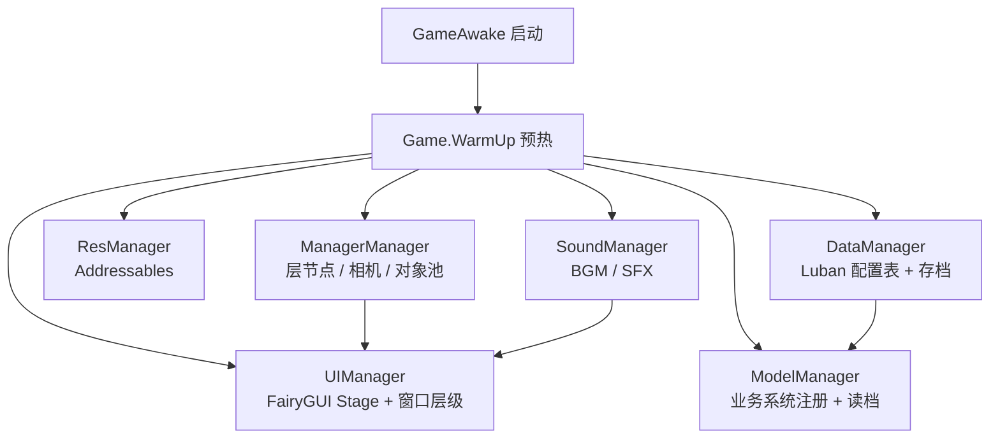

<div align="center">

# 异常调查事务所

**Anomaly Investigation Agency** · 2D 策略经营 + 自动战斗 游戏原型


</div>

---

## 项目简介

《异常调查事务所》是一个从零搭建的 Unity 客户端工程，目标是跑通完整的游戏循环：**主界面 → 角色养成 → 人才招募 → 仓库管理 → 探索 → 战斗结算**。

项目没有使用任何现成的游戏框架，业务框架（管理器、事件总线、Model/Data 分层、UI 层管理）全部自研；美术与 UI 使用 FairyGUI 制作，配置表使用 Luban 从 Excel 生成，资源走 Addressables，代码以 HybridCLR 热更方式运行。

| 项目概况 | |
| --- | --- |
| 引擎版本 | Unity 2022.3.62f3c1（内置渲染管线） |
| 脚本规模 | 244 个 `.cs`，约 2.6 万行（`Assets/HotUpdate`） |
| 设计分辨率 | 1920×1080 |
| 构建场景 | `Menu`（主菜单）→ `Game`（游戏主场景） |

## 技术栈

| 方向 | 方案 | 用途 |
| --- | --- | --- |
| UI | **FairyGUI** | 美术在 FairyGUI 编辑器里做界面，运行时由 UGUI 预制体上的 `UIPanel` 承载 |
| 热更新 | **HybridCLR** | `Assembly-CSharp` 只做启动，业务与框架代码放在 `HotUpdate` 程序集 |
| 资源 | **Addressables 1.22.3** | UI 包（`*_fui.bytes` + 图集）、预制体、Spine 资源按地址加载 |
| 配置表 | **Luban** | `DataTable/*.xlsx` → C# 行类 + JSON，导出到 `StreamingAssets/Data` |
| 异步 | **UniTask** | `Packages/com.cysharp.unitask` 嵌入式包 |
| 动画 | **Spine 4.x** | 角色立绘 / 战斗动画，封装为通用 `SpineAnimCom` |
| 其它 | DOTween、Nino | 补间动画、二进制序列化 |

## 已实现的系统

| 模块 | 说明 | 规模 |
| --- | --- | --- |
| **Role** 角色 | 角色列表、详情页签（属性 / 装备 / 勋章 / 技能）、称号规则、立绘展示 | 3.7k 行 |
| **Battle** 战斗 | 一维战场、实时 ATB 行动条、指令队列与结算（Model 层完成） | 2.8k 行 |
| **Skill** 技能 | CD 触发、目标选择、条件判定、效果解析与效果实例（Model 层完成） | 2.2k 行 |
| **TalentAcquisition** 人才招募 | 合同抽取、候选人展示与选择、入职结算 | 1.2k 行 |
| **Warehouse** 仓库 | 道具权威数据、增删改事件、JSON 存档 | 1.0k 行 |
| **Explore** 探索 | 节点式地图生成（Model 层完成） | 0.9k 行 |
| **CommandRoom** 指挥室 | 主界面，各功能入口与货币展示 | 0.4k 行 |
| **ComponentUI** 公共组件 | 通用背景框、角色卡、职称徽章、技能图标、Spine 动画组件 | 0.4k 行 |
| **Sound** 声音 | BGM 独占淡入淡出、8 路 SFX 通道池与空闲回收 | 框架层 |
| Shop / Lottery / CoinShow | 商店、彩票、金币展示 | 占位，待开发 |

## 架构

### 启动流程



预热顺序固定为 `Manager → Res → Data → Model → Logic → Operate → Sound → UI`，后面的模块可以直接依赖前面的模块。

### 业务系统标准结构

每个系统都按同一套目录和生命周期组织（规范见 [Docs/系统制作规范.md](Docs/系统制作规范.md)）：

```
Game/<System>/
├─ Model/<System>System.cs     业务入口，ModelBase，用 Game.Model.Get<T>() 取
├─ Data/<System>Data.cs        权威数据 + 存档，SystemDataBase → persistentDataPath/GameMain/Data
├─ Event/<System>Event.cs      事件常量
├─ Event/<System>Message.cs    事件消息体
├─ Define/<System>Define.cs    常量与枚举
├─ Debug/<System>Debug.cs      调试指令
├─ View/<System>View.cs        界面，UIWindow
├─ View/<System>ViewData.cs    界面状态 / FairyGUI 包注册，GameData
└─ Component/<System>Com.cs    界面组件，GComponent
```

- 生命周期：`OnInit` → `OnStart`（读档）→ `OnDestroy`
- 注册：`DataManager.LoadGameData()` 注册 `SystemDataBase`，`ModelManager` 注册 `ModelBase`
- 数据变更一律走事件（例如仓库的 `WarehouseEventDefine.OnItemUpdate` 是全系统唯一写库入口），Data 层监听并回填结果后再广播

### UI 分层

界面本体是 UGUI 预制体，挂在常驻的 `DontDestroy` 层节点上，内部 `UIPanel` 渲染 FairyGUI 内容：

| 层 | 用途 | sortingOrder |
| --- | --- | --- |
| `B_Layer` | 常驻背景、沉浸式界面 | 0 |
| `M_Layer` | 常规业务界面 | 100 |
| `T_Layer` | 弹窗、提示 | 200 |

子界面排序固定为父界面 +1，保证嵌套窗口永远画在父级之上。

## 目录结构

```
.
├─ Assets/
│  ├─ GameLaunch/        启动引导（GameAwake）
│  ├─ HotUpdate/         热更程序集，业务与框架代码都在这里
│  │  ├─ Framework/      框架层：Manager / Base / Event / Res / UI / Model / Data / Expand
│  │  └─ GameMain/       业务层：Game/<系统>、DataTable 配置表代码
│  ├─ Res/               Addressables 资源（UI 包、预制体、Spine）
│  ├─ Resources/         字体等常驻资源
│  ├─ Scenes/            Menu / Game
│  ├─ Spine/             spine-unity 运行时
│  ├─ StreamingAssets/   Luban 导出的配置表 JSON
│  └─ ThridParty/        FairyGUI、DOTween、Nino、LubanLib
├─ UIProject/            FairyGUI 工程（发布产物 → Assets/Res/UI）
├─ DataTable/            Luban 配置表源文件（xlsx）
├─ Docs/                 设计与规范文档
└─ Tools/                Luban 命令行工具
```

## 快速开始

```bash
git clone git@github.com:benzuowudi/Anomaly-Investigation-Agency.git
```

1. 用 Unity Hub 安装 **2022.3.62f3c1**（2022.3 同系列一般也可），打开工程等待首次导入。
   `Library/`、`HybridCLRData/`、`Logs/` 等生成目录不入库，会本地重建。
2. 打开 `Assets/Scenes/Menu.unity` 直接运行。
3. **配置表**：修改 `DataTable/*.xlsx` 后，用编辑器菜单 `Framework/配置表导入`（`Assets/Editor/LuBanTool.cs`）重新生成 C# 行类与 JSON。
4. **UI**：在 FairyGUI 编辑器里修改 `UIProject` 并发布，产物覆盖 `Assets/Res/UI/*_fui.bytes` 与图集，再用 `Framework/FairyGUI/注册 UI 包到 Addressables` 更新注册。
5. **打包**：`Framework/全局资源打包工具` / `Assets/Build AssetsBundle`。

## 开发约定

- **UI 脚本**：界面继承 `UIWindow`，在 `Init` 里用 `ui.GetChild("name").asButton` 直接绑定节点；节点字段不做判空，只有业务数据为空、页签组件未实现时才判空。
- **界面切换**：内容区用 `GLoader` 按 URL 加载组件（如角色界面的 `load_com`），换页签只换 `url`，不再往预制体里平铺组件。
- **配置表**：新增系统要在 `DataTable/__tables__.xlsx` 登记，表名 / JSON 名 / 类名三者对应。
- **字体**：`FZYTK.TTF` 是合并过的中英混排字体（ASCII 取 Agency FB 轮廓，汉字取方正姚体），运行时会写中文或格式化数字的文本用 `UIFont.Apply` 切到它，避免中文回退系统字体。
- 更细的色号、中英术语对照与制作流程见 [Docs/开发约定与流程.md](Docs/开发约定与流程.md)。

## 文档

| 文档 | 内容 |
| --- | --- |
| [系统制作规范](Docs/系统制作规范.md) | MVC / ModelBase / ModelManager 分层与注册方式 |
| [业务框架与类图](Docs/业务框架与类图.md) | 框架层各管理器职责与类图 |
| [战斗系统实现计划](Docs/战斗系统实现计划.md) | 一维战场、ATB、指令与结算设计（v2.3） |
| [技能系统实现计划](Docs/技能系统实现计划.md) | CD 触发、条件消耗、效果解析设计（v2.3） |
| [Spine 动画组件](Docs/Spine动画组件.md) | 通用 Spine UI 动画组件用法 |
| [开发约定与流程](Docs/开发约定与流程.md) | 色号、中英术语、导表与 UI 制作流程 |

## Roadmap

- [x] 自研框架：管理器 / 事件总线 / Addressables 资源 / FairyGUI UI 分层
- [x] Luban 配置表管线
- [x] 中英混排字体
- [x] 角色、人才招募、仓库、声音
- [x] 战斗 / 技能 / 探索 模型层
- [ ] 战斗表现层（Spine 动画、战斗 UI）
- [ ] 商店 / 彩票 / 成就 / 宿舍等外围系统
- [ ] 打包与热更流程自动化

## 说明

- 仓库中的第三方库（FairyGUI、DOTween、Nino、spine-unity、Luban 等）版权归各自作者所有，仅用于学习与演示。
- 美术资源为项目自绘或演示占位，不用于商业用途。
